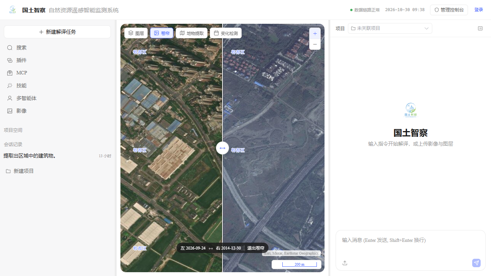
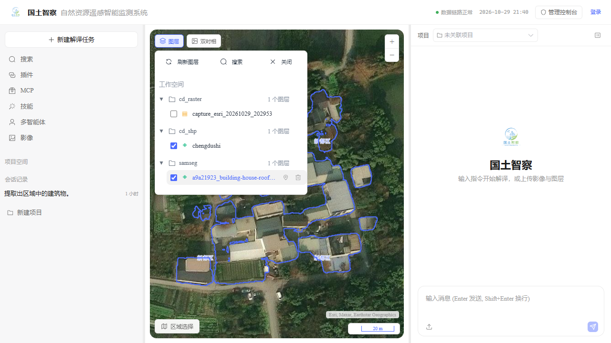
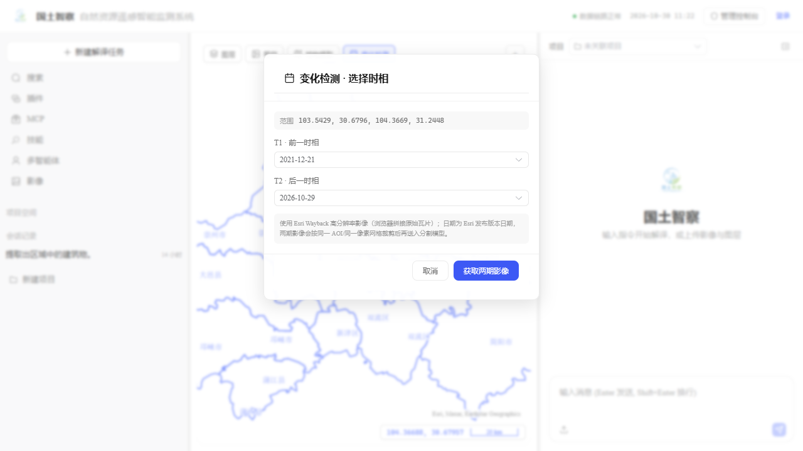
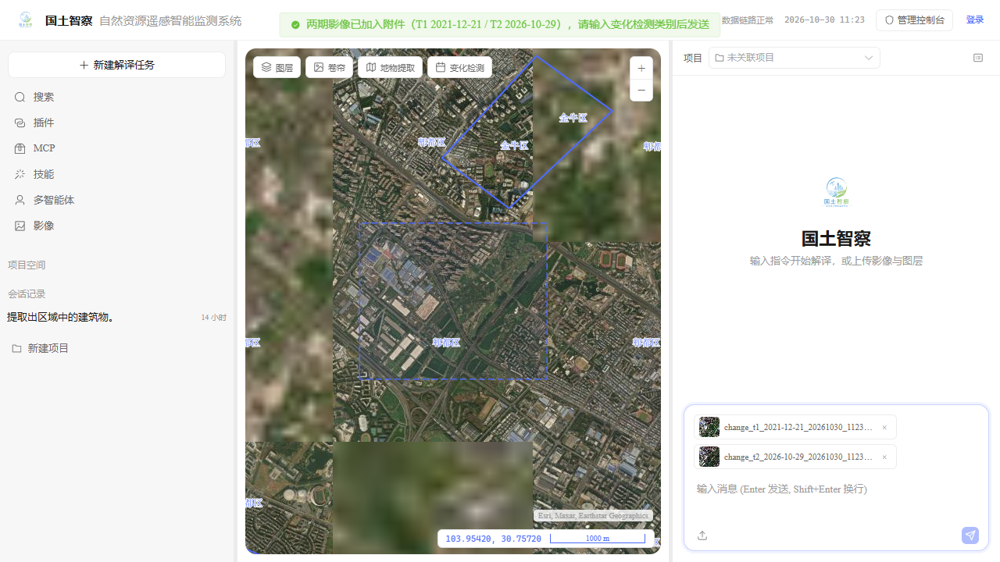
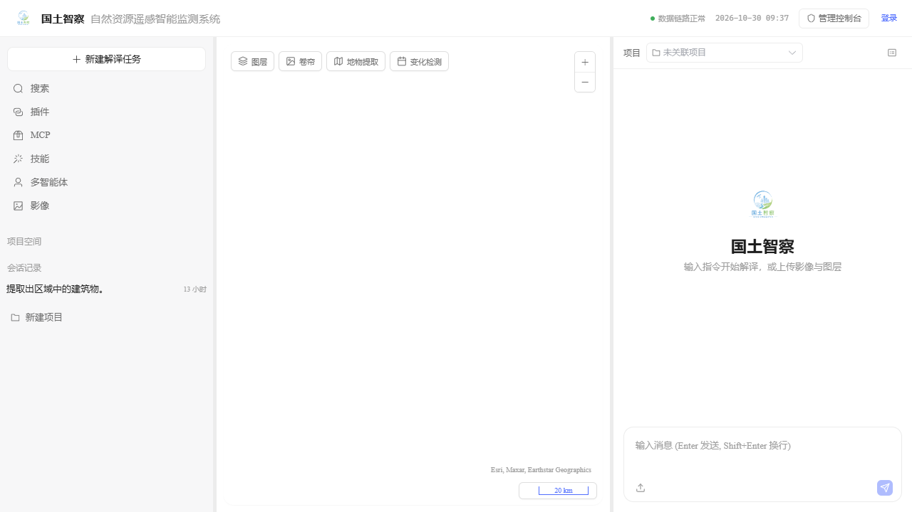
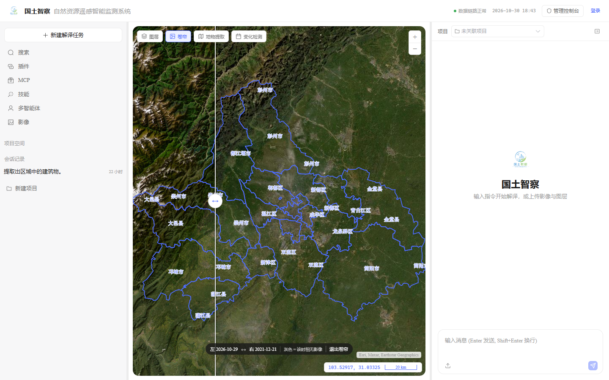

# 项目进度文档

> 最后更新: 2026-10-28 · 架构与核心功能详见 [architecture.md](./architecture.md)
> 启动/演示：[dual-portal-quickstart.md](./platform/dual-portal-quickstart.md) · UI 参考：[ui-reference-notes.md](./platform/ui-reference-notes.md)

---

## 〇、当前状态总览（截至阶段 37）

| 模块 | 状态 | 说明 |
|---|---|---|
| 双服务后端 | ✅ | Java 8081（业务/身份/审计）+ Python 8020（Agent/解译/图层） |
| 双门户 | ✅ | 单前端应用：`/` 工作台、`/admin/**` 管理端（路由隔离 + 守卫） |
| 认证 | ✅ | JWT access 30min + refresh 14d（旋转/重放撤销）；登录/退出/me |
| MFA | ✅ | 管理端强制 TOTP；绑定/校验/恢复码；secret AES-GCM |
| RBAC | ✅ | 4 内置角色 / 30 权限；方法级 `@PreAuthorize`；前端按权限显隐 |
| 管理端 | ✅ 部分 | 总览/用户/角色/审计接真实 API；项目/数据/图层/任务/存储为 P1 占位 |
| 工作台 | ✅ | 三栏（会话/地图/Copilot）、流式对话、分支/重发、上传、@图层 |
| 地图 | ✅ | OpenLayers 4326；天地图影像/矢量/地形（t0–t7 并行）+ Esri 高分底图；默认成都 zoom 9 |
| 影像检索 | ✅ | 4 个开放数据源（PC/ES/CDSE/GEE 兜底）；时间/区域/云量/分辨率筛选；瓦片预览 + AOI 裁剪下载 + 发布图层 |
| 卷帘 | ✅ | Esri Wayback 2014–2026 年度版本；左右两张瓦片 canvas 裁剪 + 拖动分隔线；清单不可达时内置年度快照 |
| 变化检测 | ✅ | 变化检测选区 + T1/T2 两个 Esri Wayback 版本 → 浏览器拼接两期高清影像 → 双期分割 + IoU 实例对比 → 变化图斑/转移矩阵 |
| 地物提取 | ✅ | 左上角工具条第 3 项；Esri 高分底图 + 地图拖框 → GeoTIFF → 当前会话 Agent → SamSeg → 矢量叠加；Esri→天地图自动兜底 |
| Agent | ✅ | ReAct + 42 工具 + 技能/MCP + 三层记忆 + 停止/回滚 |
| 遥感解译 | ✅ | ProC-SAM3 开放词汇（英文类别+同义词，1008/504 可切换）+ 变化检测 + 矢量化；SegEarth legacy 回退 |
| 数据 | ✅ | `rsiis_business` / `cd`(PostGIS) / `Agent_study`；GeoServer 2.28 |
| 视觉 | ✅ | DeepSeek 风格；中文微软雅黑 / 英文 Times New Roman |
| 测试 | ✅ | Java 单测 25 项；UI 冒烟 9 张截图无 console/pageerror/4xx |

> 历史会话已清空：`Agent_study` 与旧 `agent` 库均为 0 会话（旧库同步清空，不再作为迁移源）。

---

## 一、项目定位

基于 WebSocket 的 Agent 系统。LLM（GLM-5.3-Flash，DashScope `qwen3.7-plus` 兜底）驱动 ReAct 推理 + 工具编排，用自然语言操作 **GeoServer 图层服务 + PostgreSQL 数据库 + SamSeg 遥感分析 + 沙盒代码执行**。

三层架构（agent → model → data），前端支持聊天 UI + **OpenLayers 地图容器**影像/矢量预览 + 项目会话管理。品牌名：**国土智察 自然资源遥感智能监测系统**。

---

## 二、演进历史（阶段 1-22 摘要）

| 阶段 | 主题 | 核心产出 |
|---|---|---|
| 1 | 脱离 qh 栅格影像数据库 | 清除湖泊/lake_catalog 绑定，变通用底座 |
| 2 | SamSeg 遥感分析接入 | segment_image + detect_change，SegEarth-OV3 推理 |
| 3 | 连通域统计增强 | 每类区域数、像素面积、占比 |
| 4 | 修复结果不显示 bug | 解耦 frontend_action 推送与等待；新增 `/api/v1/upload` |
| 5 | 原图即时显示 + 颜色图注 | 上传后立即显示；结果图加颜色→类别图注 |
| 6 | 完整流程梳理 | 端到端时序图 + 关键设计决策 |
| 7 | 变化检测误判优化 | iou/min_area 收紧；修复 prob 死代码 + 两期统一阈值 |
| 8 | 沙盒 + 统一文件存储 | Docker 沙盒子系统 + understand_image 视觉理解 |
| 9 | AI 任务持久化 | ai_task/task_log 表 + 重工具白名单埋点 |
| 10 | 渔网分割数据集 | XD2023+XD2025 切 1209 瓦片，7:1:2 划分 |
| 11 | 前端视觉统一 | 品牌名 + Logo + 蓝绿白配色 |
| 12 | 14 条核心功能对接 | 6 Phase 实施，新增 preprocess/report 工具类 |
| 13 | 沙盒启用 + 自纠学习 | self_correction.py 跨会话经验沉淀 |
| 14 | 架构强化 | 移除 Leaflet；连通域工具；GeoTIFF 掩码；卡片坐标 |
| 15-17 | 核心架构升级（v2.4-v2.5） | 目录顺序统一 `{proj}/{conv}`；统一 Tool Result schema；多级上下文压缩；消息分支 DAG；记忆策略调整 |
| 18-19 | 矢量可视化 + 表格富化 | `visualize_vector`（GeoJSON→PNG+shp）；富表格（排序/复制/分页） |
| 20 | 沙盒下载 + 错误治理 | 沙盒文件下载到宿主机；前端错误块一键复制 |
| **21** | **OpenLayers 地图容器（★重大回退决策）** | **撤销阶段 14"移除地图引擎"，重新引入 OpenLayers 9；卡片墙→地图图层容器；砍掉 overlay/edge 自动产物（改图层透明度叠加）；系统提示词加"表格优先"规则** |
| **22** | **矢量渲染增强 + 端到端测试** | **新增 shp-to-geojson 端点 + `showVectorFile`（geojson/shp 原生渲染）；后端脚本 `map_container_backend.py`（28 项验证）；Playwright `map-container.spec.ts`（4 项全过）** |

---

## 三、近期重大改造

| 维度 | 阶段 15 · 目录顺序统一 + 文件名精简（v2.4） | 阶段 16 · Agent 核心架构升级（v2.5） | 阶段 17 · 记忆策略调整 |
|---|---|---|---|
| **时间** | 2026-06 | 2026-06 | 2026-06 |
| **背景 / 问题** | 6 个工具文件目录顺序不一致（samseg/geoserver/report 是 `{conv}/{proj}`，sandbox 是 `{proj}/{conv}`）；文件名套娃过长 | 借鉴 APIX v2.1 升级三项核心能力（详见 architecture-tools.md §3.4 / architecture-agent.md §4/§4.6） | `extract_and_save_long_term_memory` 每轮 LLM 硬挖"用户偏好/事实"，21 条记忆 18 条（86%）低价值空话，污染 system prompt ~700 tokens |
| **核心产出 ①** | 新建 `backend/model/tools/_paths.py` 公共 helper，统一目录为 `{proj}/{conv}`、兜底常量 `_default`/`_anonymous` | **统一 Tool Result Schema（Phase 3）**：新建 `_result.py`（ToolResult + 5 helper：`build_success`/`build_error`/`build_frontend_action`/`build_download_action`/`build_render_image_action`）；保证 `instruction.type == action`；迁移 2 个异类工具（`import_file_to_sandbox` 的 `status`→`type`；`sandbox_tools` 的 stdout/stderr→data）；软约束旧工具不强制，`chat_service` 兼容新旧路径命名 | 新增开关 `enable_preference_extraction`（`config.py`，**默认 False**），关闭后 `extract_and_save_long_term_memory` 返回 0、`chat_service` 两处调用点成 no-op |
| **核心产出 ②** | 文件名精简为 `{会话id前8位}_{语义}_{4位随机}.{ext}`（去 stem 叠加 + 时间戳） | **多级上下文压缩（Phase 1）**：新增 `fold_tool_messages`（Level 0.5 可逆），trim 前折叠旧工具结果为 `[已完成·工具名·摘要]`；`maybe_summarize` 改两级：Level 1 fold（可逆）→ Level 2 LLM 摘要（threshold×1.5 触发，不可逆）；DB 加 `compress_level` 列；配置 `summary_level2_multiplier`/`tool_message_keep_tail` | `build_user_profile_text` 默认只注入 `lesson`/`workflow`/`envfact`，屏蔽 preference/entity/fact；新增 `envfact` 类别（环境事实，即"遇到过的问题+已知答案"） |
| **核心产出 ③** | 迁移脚本 `scripts/migrate_agent_files.py`（25 目录翻转 + 1 条 DB 更新） | **消息分支 Git-like DAG（Phase 2）**：message 表加 `node_id`/`parent_id`/`is_active`；conversation 表加 `active_leaf_node`；`fork_from_node`/`soft_delete_branch_after`（软删除，旧分支保留）；3 个新端点 `POST /fork`、`POST /regenerate`、`GET /branches`；前端 human 消息加 `↻ 重新生成` 按钮（hover 显示），48 条历史消息自动迁移为单链 DAG | 数据清理（`scripts/cleanup_user_memory.py`，带 DRY-RUN + 全量备份）：删 16 条废话、迁移 2 条字体 fact→envfact、保留 3 条 lesson；新增诊断脚本 `scripts/diag_user_memory.py` |
| **效果 / 验证** | sam3 环境 segment 端到端验证 ALL PASS | 8 个 Python 文件语法 + backend.main 加载 + fold/fork/迁移行为全部 ALL PASS | 注入 system prompt 的长期记忆从 ~2813 chars (~1406 tokens) 降至 ~2021 chars (~1010 tokens)，**100% 真信号**（错误案例+解决方案）；长期记忆唯一主动学习路径收敛为自纠捕捉器（规则、零 LLM 成本）；3 文件语法 OK + 开关默认值确认 + `build_user_profile_text` 实际输出核对 + `extract_and_save_long_term_memory` 返回 0 确认跳过 |

---

## 四、当前状态

### 4.1 文件存储（v2.4）

```
agent-files/
├── samseg/send/{conv}/                          ← 上传原图（单层）
├── samseg/generate/{proj}/{conv}/               ← 分割/变化检测结果
├── samseg/vector/{proj}/{conv}/                 ← 矢量 GeoJSON
├── geoserver/generate/{proj}/{conv}/            ← 图层下载
├── report/{proj}/{conv}/                        ← 报表/导出
├── analysis/{proj}/{conv}/                      ← 掩膜分析
├── preprocess/{proj}/{conv}/                    ← 预处理
└── sandbox/workspace/{proj}/{conv}/             ← 沙盒工作区
```

兜底：无项目→`_default`、无会话→`_anonymous`。文件名：`{conv8}_{语义}_{rand4}.{ext}`。

### 4.2 运行环境

- **sam3**（`D:\anaconda3\envs\sam3`）：torch + CUDA + pycocotools + rasterio/geopandas + reportlab，SamSeg/报表/预处理全可用
- **base**：无 torch，SamSeg 优雅降级
- **Docker**（可选）：`agent-sandbox:latest` 镜像，缺失则 4 个 sandbox 工具降级

### 4.3 启动

```powershell
conda activate sam3
python -m backend.main
# http://localhost:8020
```

### 4.4 工具箱

**42 个工具，10 大类**（运行时 `get_all_tools()`）：samseg(2) / vlm(1) / sandbox(5) / geoserver(6) / database(10) / layer_control(5) / preprocess(3) / report(4) / analysis(4) / skill(2)。LLM 白名单 38 个。重工具白名单：`{samseg, rule, report, preprocess, analysis}`。

**工作流（Skills）**：3 个已注册方案（`backend/model/skills/`）—— WF1 一键分割+可视化+报告、WF2 一键变化检测+可视化+报告、WF4 上传影像到 GeoServer+显示。agent 通过 `lookup_skill` 按需检索执行。

### 4.5 验证通过项

后端语法/工具注册/三层反伪装/samseg 降级与正常/端到端分割+变化检测+连通域/卡片坐标/沙盒 6 项/自纠学习 4 项/**v2.4 目录统一+文件名精简+迁移**/**v2.5 schema 统一+多级压缩+消息分支**/**v2.5.1 记忆策略收敛** — 全部 ✅。

---

## 五、待完成事项

**工程稳定性**：SAM3 权重预加载；大图超 120s WS 心跳；沙盒容器空闲回收。

**功能扩展（非阻塞）**：规则匹配模块；用户权限管理；变化检测方案 B（prompt-based CD）。

**UI 体验**：AI 对话面板思考/工具块自折叠（阶段 18，见下）。

---

## 六、阶段 18：AI 对话面板 UI 升级 — 思考/工具块自折叠

### 6.1 改动内容（做什么）

将 AI 对话面板中的 **思考面板（thinking-block）** 和 **调用工具面板（tool-block）**，从"全程展开"改为"**完成当前操作后自折叠**"，最终态为可点击展开/收起的折叠条。

| 块类型 | 流式进行中（当前） | 完成当前操作后（阶段 18 目标） | 用户再次操作 |
|---|---|---|---|
| thinking-block | 全展开 + 闪烁 cursor | 自动折叠为单行摘要（如 `💡 thinking（3 段，142 tokens）`） | 点击展开看完整思考；再点折叠 |
| tool-block | 全展开 `tool_name(args)` | 自动折叠为单行摘要（如 `🔧 segment_image ✓`） | 点击展开看完整 args/结果 |

**折叠/展开关系（统一规则）**：

- 每个 `iteration-group`（一轮 thinking + 配对工具）在**该轮结束时自折叠**为一行胶囊。
- 同一条 AI 消息内多个轮次 → 多个折叠胶囊纵向堆叠。
- 默认态：**最新一轮保持展开**（让用户看见正在发生什么），**历史轮次全部折叠**。
- 折叠态点击 → 展开看详情；展开态点击 → 折叠。最新轮次在下一轮开始时也自动收起。

**保留**：展开/折叠是纯前端状态，不写后端、不动 DB、不改 WS 协议；trace 弹窗（对话执行日志）继续走原聚合逻辑。

### 6.2 涉及文件

| 文件 | 改动点 |
|---|---|
| `frontend/chat/msg-ui.js` | `appendThinking` / `appendToolCall` / `appendThinkingTo` / `appendToolCallTo` / `finishMessageForConv` / `ensureIterationGroup`：增加折叠态 DOM 结构、点击切换、轮次切换时折叠旧组 |
| `frontend/styles.css` | 新增 `.iteration-group.collapsed`、`.iter-summary`、`.iter-summary-chevron` 等样式（复用现有 `--accent`/`--bg-inset`/`--border` 令牌） |
| `frontend/chat/samseg.js` | `_markBubbleStopped`：停止时把当前 thinking/tool 组折叠（与 onDone 行为对齐） |
| `frontend/chat/conv-core.js` | `rebuildConvUI`：历史消息重建时，**除最后一条 AI 消息的最后一轮外**，所有轮次默认折叠 |
| 后端 / DB / WS 协议 | **不改** |

### 6.3 实施方案（怎么做）

**步骤 1 · DOM 结构升级（msg-ui.js）**

每个 `iteration-group` 增加 summary 头部 + 详情容器：

```
.iteration-group                 ← 整组, 切换 .collapsed 类
├─ .iter-summary                 ← 折叠时唯一可见行 (点击切换)
│   ├─ .iter-summary-icon        ← ▼/▶ (旋转动画, 复用 .conv-group-header::before 思路)
│   ├─ .iter-summary-label       ← "thinking 汇总" / 工具名
│   └─ .iter-summary-meta        ← 段数/tokens/工具结果状态
└─ .iter-detail                  ← 原 thinking-block + tool-block 的父容器
    ├─ .thinking-block (原样)
    └─ .tool-block   (原样)
```

改造点：
- `ensureIterationGroup(st)`：建组时同步建 `.iter-summary` + `.iter-detail`，绑定 `onclick` → toggle `.collapsed`。
- `appendThinking` / `appendToolCall`：把块 append 到 `.iter-detail`（而非 group 本身），并**实时更新** `.iter-summary-meta`（thinking 段数/tokens、工具名列表）。
- `appendThinkingTo` / `appendToolCallTo`（重建路径）：同上，重建时一并填充 summary meta。

**步骤 2 · 折叠/展开逻辑（msg-ui.js）**

新增 helper：

```
function _collapseIterationGroup(group)   // group.classList.add('collapsed')
function _expandIterationGroup(group)     // group.classList.remove('collapsed')
function _toggleIterationGroup(group)     // 点击 summary 调用
function _syncIterationSummary(group)     // 根据 detail 内子元素生成 summary 文案
```

`_syncIterationSummary` 文案规则：
- 仅 thinking：`思考中（N 段，M tokens）` → 折叠后 `思考过程（N 段，M tokens）`
- thinking + 工具：`思考（N 段）→ 工具：toolA, toolB`
- 折叠态统一去掉 cursor，加 `✓` 或工具图标前缀

**步骤 3 · "完成当前操作后自折叠"触发时机（msg-ui.js + conv-core.js）**

触发折叠的 3 个时机，统一调用 `_collapseIterationGroup`：

| 时机 | 钩子位置 | 行为 |
|---|---|---|
| **新一轮 thinking 开始**（上一轮已完成） | `appendThinking` 顶部的 `if (st.currentGroupHasTool || !st.currentIterationGroup)` 分支 → 先 `_collapseIterationGroup(旧组)` 再 `ensureIterationGroup` | 上一轮立即折叠，新轮展开 |
| **消息结束**（onDone / onError / onChatStopped） | `finishMessageForConv` / `_markBubbleStopped` 末尾 | 当前最后一轮也折叠（保留点击展开） |
| **历史重建** | `rebuildConvUI` 末尾遍历所有 `.iteration-group`：最后一个保持展开（让用户看清最近结论），其余全折叠 | 与"最新轮展开、历史轮折叠"规则一致 |

**步骤 4 · 停止态对齐（samseg.js）**

`_markBubbleStopped` 在追加 `对话已停止` marker 前，先把 `st.currentIterationGroup` 折叠，避免半截展开的思考块残留。

**步骤 5 · 样式（styles.css）**

新增（复用现有令牌，不引入新色）：

```css
.iteration-group .iter-summary{
  display:flex; align-items:center; gap:8px;
  padding:6px 10px; cursor:pointer; user-select:none;
  background:var(--bg-inset); border:1px solid var(--border); border-radius:var(--r-sm);
  font-size:var(--fs-sm); color:var(--text-secondary); font-family:var(--mono);
}
.iteration-group .iter-summary:hover{ background:var(--bg-hover); color:var(--accent); }
.iteration-group .iter-summary-icon{ transition:transform .12s; color:var(--text-muted); }
.iteration-group.collapsed .iter-summary-icon{ transform:rotate(-90deg); }
.iteration-group .iter-detail{ margin-top:6px; }
.iteration-group.collapsed .iter-detail{ display:none; }
/* 折叠时整组收紧, 减少多轮堆叠的视觉占用 */
.iteration-group.collapsed{ margin-top:6px; }
```

**步骤 6 · 验证**

- 单轮（只 thinking 无工具）：thinking 流式 → onDone 折叠为 `思考过程（N 段，M tokens）`，点击展开/收起正常。
- 多轮（thinking→tool→thinking→tool）：第一轮在新轮开始时自动折叠；消息结束最后一轮折叠；历史多轮全部胶囊堆叠。
- 历史重建（切换会话/刷新）：旧消息全部折叠，仅最新一轮展开；点击可逐个展开。
- 停止态（用户点停止）：当前组折叠 + 红色 `对话已停止` marker。
- 回归：trace 弹窗、render_image 卡片墙、`↻ 重新生成` 按钮不受影响。

### 6.4 风险与边界

| 风险 | 处置 |
|---|---|
| 流式中频繁更新 summary 造成抖动 | summary 文案仅在追加新段/工具时更新（已有 throttle：thinking 走 300ms `flushThinkingLog`） |
| 折叠后用户找不到结果 | summary 始终可见且点击即可展开；最新一轮默认展开 |
| 重建路径与流式路径 DOM 不一致 | `appendXxx` 与 `appendXxxTo` 共用 `_syncIterationSummary`，逻辑单一来源 |
| 影响 v2.5 消息分支（fork/regenerate） | 仅在 `iteration-group` 这一层加折叠，不碰 `node_id`/`parent_id` 数据属性，分支按钮不受影响 |

### 6.5 预期收益

- 单条 AI 消息高度从"全展开多屏"压缩到"几个胶囊 + 最后结论"，长 ReAct 多轮对话可读性显著提升。
- 折叠/展开是纯前端，零后端改动、零协议改动，可独立上线、易回滚（删 `.collapsed` 类即恢复）。
- 与 trace 弹窗（执行日志全量）形成"日常轻量 / 调试全量"双层视图。

---

## 七、阶段 19：GeoJSON 矢量结果自动可视化进工作区（+ Shapefile + 封装工具）

### 7.1 背景与缺口

`segment_image` / `detect_change` 已自动产出彩色掩码 PNG + 叠加图（进工作区），且后端设了 `params.vector_url` 指向矢量 GeoJSON。但**前端 `renderImage` 只解构 `image_url/caption/legend/extra_images`，完全不读 `vector_url`** → 矢量结果从不进工作区。工作区是 `` 卡片墙，渲染不了矢量。本阶段把 GeoJSON 栅格化为 PNG 进工作区，同时保存一份 `.shp`，并把方法封装成独立 Agent 工具。

### 7.2 改动内容（表格）

| 维度 | 说明 |
|---|---|
| **新增工具** | `visualize_vector`（`backend/model/tools/vector_tools.py`，注册类别 `analysis`，重工具白名单已含）：`(geojson_path, background_image_path="", alpha=0.5, export_shp=True)` → `frontend_action(render_image)` |
| **写法** | 严格遵循现有 Agent 工具模式：`@register_tool("analysis")` + `@tool` + `build_render_image_action` + `verify_by_path` 成功契约 |
| **核心纯函数** | `rasterize_vector_to_png()`：工具与 segment/detect 自动追加共用，单一来源；matplotlib Agg + CJK 字体；按 `class_name` 稳定哈希配色 + 右侧图例；有底图时按 rasterio bounds 对齐叠加 |
| **Shapefile** | `export_shp=True` 时导出 `.shp`（Fiona 0KB 拦截，ASCII stem），供 GIS；上游已产出 shp 时复用不重复导出 |
| **自动联动** | `samseg_tools._build_vector_visualization`：`segment_image`/`detect_change` 在 GeoJSON 真实生成时，自动生成矢量 PNG 并**追加为 `extra_images` 第二张卡片**，前端零改动 |
| **成功条件（契约）** | 返回 `type=frontend_action` / `action=render_image`；`verification.ok=True`；`data.artifact_path` 指向真实 PNG；`data.feature_count>0`；`export_shp=True` 时 `data.shp_path` 指向真实 `.shp` |
| **降级** | geopandas/matplotlib 缺失或 GeoJSON 为空 → 工具返回 `build_error`；segment/detect 自动追加失败只记 warning，**不阻断主结果**（分割/变化检测 PNG+统计照常返回） |
| **前端/DB/WS** | **不改** |

### 7.3 工作区最终顺序

```
segment_image  → 掩码叠加图 → 边缘叠加图 → GeoJSON 矢量图斑可视化
detect_change  → 变化结果图 → 叠加图 → GeoJSON 变化图斑可视化
```

### 7.4 涉及文件

| 文件 | 改动 |
|---|---|
| `backend/model/tools/vector_tools.py` | **新增**：`visualize_vector` 工具 + `rasterize_vector_to_png` 纯函数 |
| `backend/model/tools/samseg_tools.py` | `_build_vector_visualization` helper；`segment_image`/`detect_change` 把矢量 PNG 追加到 `extra_images`，shp/vis 路径并入 `data` |
| `backend/model/tools/__init__.py` | 自动导入 `vector_tools`（缺依赖 try/except 跳过） |
| `backend/model/skills/wf1-...md` / `wf2-...md` | 产出清单补矢量可视化 + Shapefile；新增成功条件；新增 `visualize_vector` 单独用法 |
| `docs/architecture.md` | 工具数 46→47；analysis 2→3；§3.2 标签；§3.3 清单新增 `visualize_vector`；新增 §10.8.1 产物链小节 |
| `docs/PROGRESS.md` | 本节（阶段 19） |
| 前端 / DB / WS | **不改** |

### 7.5 验证项

- **工具注册**：`import backend.model.tools` 后 `"visualize_vector" in get_all_tools()` 为真，分类为 `analysis`。
- **工具单独**：任意 segment 产出的 geojson → 生成带类别配色+图例的 PNG 进工作区，`verify_by_path.ok=True`；`export_shp=True` 时 `.shp` 真实落地。
- **segment_image**：执行后工作区出现矢量可视化卡片；`data.vector_vis_url` / `data.vector_vis_path` / `data.vector_shp_path` 齐全。
- **detect_change**：同上（变化图斑可视化）。
- **降级**：无矢量 / matplotlib 缺失 → 不追加 extra_images，不报错，主流程返回不变。
- **回归**：trace 弹窗、边缘叠加、`↻ 重新生成` 不受影响。

---

## 八、阶段 20：教训记忆结构化（2026-06）

**问题**：自纠捕捉器产出的 lesson 记忆是**纯规则拼接的流水账**——把 `error_msg + LLM 原始 thinking + 修复动作` 缝成一段，混着 markdown 符号、原始 JSON、报错原文。注入 system prompt 后是一坨，AI 无法直接照做复用。规则能记录"发生了什么"，提炼不出"正确做法是什么"。

**改动**（3 文件 + 数据清理，详见 [architecture-agent.md](agent/core/architecture-agent.md) §4.1.3）：

| 文件 | 改动 |
|------|------|
| `self_correction.py` | 新增 `_DISTILL_LESSON_SYSTEM` 提示词 + `async _distill_correction_to_structured()`（复用 deepseek-v4-flash + `_parse_json_items`，把 7 字段素材提炼成五段结构化经验）；`save_lesson_to_memory` 改 async，value 改由 LLM 提炼生成；★ **无降级**：提炼失败（超时 20s / 缺字段 / 解析错误）跳过不入库；`scan_and_save_corrections` 改 async，删 `save_workflow_to_memory` 双写（标 deprecated） |
| `chat_service.py` | `_async_self_correction_scan` 调用处加 `await` |
| `memory_context.py` | `build_user_profile_text` 注入端改多行缩进（value 换行保留 + 后续行 4 空格），五段在 system prompt 成块展示 |

**记忆 value 格式**（固定五段，不可缺）：
```
现象：失败时观察到的表象
根因：为什么会失败（本质归纳，非复述报错）
正确方法：① 具体步骤（工具名+参数）② ...
验证信号：如何确认修复成功
严重度：high|medium|low
```

**效果**：注入 system prompt 的教训从"流水账一坨"变成"可照做的五段结构化经验"，AI 下轮能直接复用。库纯净——只存结构化格式，旧流水账已清理。

**验证**：toggle_layer 场景实测 LLM 准确还原五段结构 + 字段校验对残缺/空值/非法严重度全部判失败跳过 + 注入端多行缩进正常 + 3 文件语法 OK + 数据清理备份 `backup_user_memory_structured_*.json`。

---

## 九、阶段 21：OpenLayers 地图容器（2026-06-24，★重大回退决策）

> ★ 本阶段**撤销阶段 14"移除 Leaflet、前端统一为卡片墙"的决定**，重新引入地图引擎。这不是简单的回退，而是基于"卡片墙无法实现地理叠加"这一认知的架构纠偏。

### 9.1 背景与问题

卡片墙（flex 堆叠 + CSS transform 缩放）的根本缺陷：
- **无法地理叠加**：原图与分割掩膜只能上下堆叠，看不到叠加效果；为此后端被迫预生成"overlay 混色图（原图70%+掩膜30%）"和"edge 边缘描线 GeoTIFF"，代价是额外产物 + 信息损失 + 5 类产物冗余
- **无法矢量渲染**：GeoJSON 矢量图斑前端渲染不了，阶段 19 不得不用 `visualize_vector` 把矢量栅格化成 PNG（绕路）
- **缩放非地理语义**：CSS transform 的缩放是"看图软件"式，多张图各自缩放，不按坐标联动

### 9.2 改动总览（前端 5 文件 + 后端 3 文件 + 2 skill）

**前端（卡片墙 → OpenLayers 地图容器）**：

| 文件 | 改动 |
|------|------|
| `frontend/index.html` | 引入 OpenLayers 9.2.4 CDN（ol.css + ol.js）；`wmsViewport` 改为 OL 挂载点；删自制缩放控件 |
| `frontend/styles.css` | `.wms-viewport` → `.ol-map-host`；删卡片墙样式（`.wms-item`/`.wms-zoom-*`）；保留 popup/legend |
| `frontend/map/wms-render.js` | **核心重写**为 OL 引擎：`initWmsMap`/`showImageInPanel`（ImageStatic 图层）/`showWmsInPanel`（ImageWMS）/`_clearMapLayers`/GetFeatureInfo Overlay；对外 API 签名不变，3 个调用方零改动 |
| `frontend/chat/conv-core.js` | `_restoreWmsPanelFromConv` 用 `_clearMapLayers()` 替代 `innerHTML=''` |
| `frontend/core/init.js` | 新增 `initWmsMap()` 启动调用 |

**后端（砍 overlay/edge 自动产物）**：

| 文件 | 改动 |
|------|------|
| `backend/model/SamSeg/runner.py` | 删 `_build_overlay_image`/`_build_edge_overlay_geotiff`/`_save_geotiff_singleband` 三函数 + 2 处调用块；保留 mask_tif/vector/shp/edge_utils |
| `backend/model/tools/samseg_tools.py` | segment/detect_change 清 overlay/edge 字段；`main_url` 改用原图；`artifact_path` 改用 mask_tif；summary 去三行声明；params 透传 `mask_tif_url`/`has_crs` |
| `backend/model/skills/wf1*.md`/`wf2*.md` | 删"步骤2 自动边缘叠加"，改为"图层透明度自动实现" |

**系统提示词**：`backend/agent/prompt/system_prompt.py` 新增"结构化呈现（表格优先）"规则（≥3 项同类结果强制 Markdown 表格）。

### 9.3 核心设计

- **图层叠加替代 overlay 混色**：原图层（底图，透明度 1.0）+ 掩膜 GeoTIFF 半透明叠加层（透明度 0.5）= 等效于旧 overlay，但零额外产物
- **无 CRS 影像虚拟坐标铺画布**：extent=[0,0,W,H]，4326 兜底，统一进地图容器不搞双模式
- **`edge_utils.py` 保留**：只砍自动产物，`overlay_edge_on_image` 手动工具仍可用
- **GetFeatureInfo 复用现有端点**：点击坐标反算像素 i/j 调 `/api/v1/geoserver/feature-info`，不新增后端接口

### 9.4 验证

- 后端 3 文件语法 OK + 工具注册 45 个正常 + 无遗留 overlay/edge 引用
- 前端 6 个 JS 语法 OK + 无旧卡片墙 API 残留
- 字段对齐确认：后端 params（mask_tif_url/input_image_path/legend/vector_url/has_crs）↔ 前端 renderImage 解构

---

## 十、阶段 22：矢量渲染增强 + 端到端测试（2026-06-24）

### 10.1 背景

阶段 21 的地图容器能渲染影像/掩膜/WMS 图层，但缺矢量能力（GeoJSON/Shapefile 直接渲染）。本阶段补齐，并建立完整的端到端测试体系。

### 10.2 改动（后端端点 + 前端矢量 + 2 个测试脚本）

| 文件 | 改动 |
|------|------|
| `backend/main.py` | 新增 `GET /api/v1/vector/shp-to-geojson`：geopandas 读 shp 目录（自动找 .dbf/.shx/.prj）→ 返回 GeoJSON；非 4326 自动转投影；feature >5000 采样保护 |
| `frontend/map/wms-render.js` | 新增 `showVectorFile(urlOrPath)` 统一入口：.geojson → OL Vector 图层；.shp → 调后端端点转换再渲染；`_addVectorLayer` 增强（支持 GeoJSON 对象）；`renderImage` 增 vector_url 处理 |
| `frontend/chat/conv-core.js` | `_restoreWmsPanelFromConv` 增加 `type='vector'` 分支 |
| `tests/map_container_backend.py` ★ | **后端产物验证脚本**（sam3 跑真实推理）：segment/detect_change/visualize_vector/export_change_vector/overlay_edge/shp 回读 6 大测试，28 项验证全过 |
| `tests/e2e/map-container.spec.ts` ★ | **Playwright 测试**：上传影像→地图 canvas、GeoJSON 矢量层、Shapefile（走端点转换）、segment 结果完整渲染链路，4 项全过 |

### 10.3 联调修复的 3 个 OL bug（关键经验）

| Bug | 根因 | 修复 |
|-----|------|------|
| `ol.control.defaults is not a function` | OL 9 里 `defaults` 是对象不是函数 | 改用 `ol.control.defaults.defaults()` |
| 有 CRS 影像加载超时 | `ImageStatic` 的 `imageExtent` 误用源 CRS 坐标当 4326 transform | bbox 值 >180 判投影，直接用源 CRS extent + projection |
| 图层不触发加载（imgReqs:0） | `view.fit(extent)` 的 extent 未转成 view projection，视图跑到无效坐标，图层一直在视图外（OL 懒加载） | fit 前先 `transformExtent(extent, sourceProj, viewProj)` |

### 10.4 验证证据

- 后端：28 项断言通过（segment 119 区域 / detect_change 10 变化区域 / 矢量 20 图斑 / shp 回读成功）
- Playwright：4 项全过，截图 `output/playwright/artifacts/map-0[1-4]-*.png` + 审计 `output/playwright/audit/map-*.json`
- 视觉确认：地图容器正确渲染遥感影像，OL 缩放控件 + 比例尺正常

### 10.5 运行方式

```bash
# 后端产物验证（必须 sam3 环境）
D:/anaconda3/envs/sam3/python.exe -m tests.map_container_backend

# 前端 Playwright（需后端运行，见 playwright-usage.md）
npx playwright test map-container --project=msedge
```

### 10.6 涉及文件清单

| 文件 | 用途 |
|------|------|
| `backend/main.py` | shp-to-geojson 端点 |
| `frontend/map/wms-render.js` | showVectorFile + OL 引擎 |
| `frontend/chat/conv-core.js` | 矢量层恢复 |
| `tests/map_container_backend.py` | 后端产物验证 |
| `tests/e2e/map-container.spec.ts` | 前端渲染验证 |
| `tests/data/r000_c006_t1.tif`/`t2.tif` | 双时相测试影像 |
| `tests/data/成都市_县.geojson` | 矢量测试数据 |

---

## 十一、阶段 23：Vue 聊天轨迹与 WFS 属性点查修复（2026-07-07）

### 11.1 背景

Vue 前端在切换历史会话后，AI 思考过程、工具调用、工具结果和最终回复混在同一个消息气泡中，工具结果还可能作为独立消息重新出现，导致聊天流布局混乱。同时，图层面板加载的 WFS 建筑矢量是客户端 `VectorLayer`，原点击属性面板只支持 WMS `GetFeatureInfo`，点击建筑矢量不会弹出属性信息。

### 11.2 改动

| 文件 | 改动 |
|------|------|
| `frontend-vue/src/components/chat/MessageBubble.vue` | AI 消息拆分为思考过程、工具调用、回复内容三段；思考和工具调用默认折叠；工具结果完整显示摘要，不展示原始 JSON |
| `frontend-vue/src/stores/conversation.js` | 历史消息按 `human` / `ai` / `tool` 规范化；后端 `tool` role 结果合并到上一条 AI 的 `toolCalls[].result` |
| `frontend-vue/src/composables/useMap.js` | 地图点击先命中 WFS 客户端矢量 feature，未命中再回退 WMS `GetFeatureInfo` |
| `docs/archive/frontend-vue-refactor.md` | 记录聊天轨迹展示规则和历史消息归并策略（已归档） |
| `docs/archive/frontend-map-geoserver.md` | 记录 Vue 版 WFS 客户端矢量属性点查差异（已归档） |

### 11.3 设计约束

- 聊天面板不展示工具原始 JSON，原始结果归入任务日志详情。
- 工具调用和思考过程使用独立展开状态，避免展开状态互相影响。
- 工具结果完整显示摘要文本并保留换行，避免 UI 摘要被前端截断。
- WFS `VectorSource` 没有 `getFeatureInfoUrl`，必须通过 OpenLayers 客户端 feature 命中检测读取属性。
- WFS 客户端命中优先，WMS 点查作为回退路径保留。

### 11.4 验证

```powershell
cd H:\西藏遥感Agent\Agent\frontend-vue; npm run build
```

验证结果：

- Vite build 通过。
- 聊天区不再出现 `查看原始结果`。
- 工具结果仍在工具调用内部，不生成独立工具结果气泡。
- 浏览器检查工具结果摘要完整显示，长摘要无省略号截断。
- 地图模块运行无前端 console error，WFS 客户端矢量点击路径已补齐。

---

## 十二、阶段 24：四层能力评估体系 + 裁判驱动 prompt 优化（2026-07-25）

### 12.1 背景

现有评估体系（规则层/护栏/行为/修正/e2e）测的是 harness 约束有效性（"刹车灵不灵"）——单轮修复决策。缺少对 Agent 完整能力（规划/探索/表达）的评估维度。本次新增四层能力评估，并用 LLM-as-judge（`gpt-5.6-terra`）驱动 prompt 优化闭环。

### 12.2 四层评估设计与实现

| 层 | 能力维度 | 脚本 | 判定方式 | 基线 |
|---|---|---|---|---|
| ① 任务规划 | 多步任务首步工具选择 | `tests\task_planning_eval.py` | 期望工具集对比 + 参数完整性 | 3/3 (100%) ✅ |
| ② 抑制幻觉 | 失败时谎报完成 | `tests\agent_behavior_harness_eval.py`（现有） | false_success_rate | 0/10 ✅ |
| ③ 失败探索 | 失败后探索方向合理性 | `tests\exploration_eval.py` | acceptable_paths 归属 + 盲目重试检测 | 方向 83% / 盲目 17% ✅ |
| ④ 思维链质量 | 务实/导向/简洁/第一性原理 | `tests\thinking_quality_eval.py` | LLM-as-judge 四维打分 | 90.5/100 ✅ |

方法论详见 `docs\agent\evaluation\capability-four-layers.md`。

### 12.3 裁判驱动的 prompt 优化（核心成果）

四层评估不仅是测试，更是 prompt 优化的驱动闭环——裁判/评估发现短板 → 定位 prompt 问题 → 优化 → 验证 → 确保不回归。已落地两处优化：

1. **根因优先引导**（第④层裁判发现 first_principles 短板）：Repair Plan 协议开头加"先从证据推导根因再查表执行"，Reflection 强化因果链要求。first_principles 维度从 3.2 提升到 4.0+。
2. **遥感工具直连路径**（第①层 P3 发现变化检测选错工具）：工具使用规则明确"segment_image/detect_change 直接接受 agent-files 路径，无需 import_file_to_sandbox"。P3 工具选择从错误修复为正确。

两处优化均通过全评估回归确认无破坏：规则 11/11+5/5+6/6、护栏 10/10、行为 100/100。

### 12.4 验证命令

```powershell
python tests\task_planning_eval.py
python tests\exploration_eval.py
python tests\thinking_quality_eval.py
```

### 12.5 涉及文件

- 新增：`tests\task_planning_eval.py`、`tests\exploration_eval.py`、`tests\thinking_quality_eval.py`
- 优化：`backend\agent\prompt\static_template.py`（根因优先 + 遥感工具直连两处规则）
- 文档：`docs\agent\evaluation\capability-four-layers.md`（新建方法论）、`metrics.md`、`README.md`（补充四层指标与命令）

---

## 十三、阶段 24（2026-10）：官方 SamSeg 流程 + 数据可追溯

### 13.1 背景

对照官方 [SegEarth-OV-3](https://github.com/earth-insights/SegEarth-OV-3) 后发现两处偏差：

1. 平台用的是自研 multipass（多轮涂黑 + 阈值衰减），不是官方单次前向 + 滑窗 + `prob_thd`；
2. 子项目 `sam3/` 被改成 336 输入/简化 neck，与官方 `sam3.pt`（1008 输入、`convs.*`）不匹配，检测头实际为空、presence 恒为 ~1e-6。

### 13.2 改动

| 项 | 内容 |
|---|---|
| 官方引擎 | 新增 `backend/model/SamSeg/engine.py`：清理本地旧 `sam3` 遮蔽，加载 site-packages 官方 `sam3` + `sam3.pt`，`Sam3Processor(resolution=1008)` |
| 官方推理 | 新增 `backend/model/SamSeg/official.py`：单图/512 滑窗、双头+presence、one-hot 聚合、`prob_thd=0.1` |
| 变化检测 | 实例级（覆盖率 0.3 + 面积 20 + 膨胀 2）∩ 语义级（FPN 余弦 + Δlogit×conf + Otsu），类别取语义结果 |
| 配置 | `SAMSEG_INFERENCE_MODE` / `PROB_THD` / `CONFIDENCE_THRESHOLD` / `SLIDE_CROP` / `SLIDE_STRIDE` / `AUTOCAST` / `POSTPROCESS` / `INSTANCE_*` |
| 数据登记 | 新增 `backend/data/vector_registry.py`；`segment_image`/`detect_change` 产出 GeoJSON 自动写 `vector_layer` |
| 存量迁移 | `scripts/migrate_legacy_agent_db.py`（旧 `agent` → `Agent_study`，22 会话/202 消息）；`scripts/register_vector_outputs.py`（24 个 GeoJSON + 329 个 artifact） |
| 文档 | 架构/数据/模型/工具/面试 QA 同步更新为 GLM-5.3-Flash、42 工具、8 张记忆表、官方推理流程 |

### 13.3 验证

- 官方分割（512×512，建筑+水，10 个 query）：约 19s，建筑 86 区域 / 43.8%，水 6 区域 / 0.75%
- 官方变化检测（T1/T2 同区域）：实例级 2117px、语义级 9908px、交集 0px（近同影像仅配准抖动，严格交集策略符合官方行为）
- 服务：Python 8020 / Java 8081 / Vite 5173 均启动并通过 HTTP 200
- 数据：`Agent_study` 22 会话/202 消息；`vector_layer` 24 条；`artifact` 329 条（会话目录不可解析时为 NULL，血缘仍保留 storage_uri/relative_path）

---

## 十四、阶段 25（2026-10）：P0 身份、RBAC、MFA、双门户基础

### 14.1 背景

按已确认的生产决策落 P0：**单组织、管理端独立子域、强制 MFA、云 OSS、Celery + Redis**。
本期先做 Java 侧身份/权限/审计骨架，不改 Agent 与用户端页面。

### 14.2 改动

| 项 | 内容 |
|---|---|
| 数据库 | `schema.sql` 幂等新增 `organizations/roles/permissions/role_permissions/user_roles/project_members/refresh_tokens/audit_logs`；`users` 扩列 `org_id/email/status/mfa_*/last_login_at`；`project` 扩列 `org_id/status/tags` |
| 种子 | 4 个内置角色（system_admin / project_admin / analyst / viewer）、30 个权限点；admin 自动补 `system_admin` |
| 认证 | Access(30min)+Refresh(14d 旋转)、Refresh 重放检测、logout、禁用立即撤销会话 |
| MFA | TOTP 绑定/校验/恢复码；secret AES/GCM 加密；管理端强制；未绑定返回 `mfa_setup_required` |
| RBAC | `IdentityRepository/RbacService`；JWT 过滤器从 DB 加载 roles/permissions；方法级 `@PreAuthorize` |
| 管理 API | `/api/v1/admin/users`（列表/创建/改状态/改角色/重置密码/撤销会话）、`/roles`、`/audit`、`/overview` |
| 当前用户 | `/api/v1/me` 返回 user/roles/permissions |
| 审计 | 登录、MFA、用户、角色、会话撤销等写 `audit_logs`，只追加 |
| 测试 | `TotpServiceTest` / `MfaCipherTest` / `JwtServiceTest` / `ProjectService` / `WorkspaceService` 共 25 项通过 |

### 14.3 验证

- 登录：admin 首次 → `mfa_setup_required`；绑定 TOTP → tokens；后续 → `mfa_required` + verify。
- `/api/v1/me` 返回 `system_admin` + 30 权限。
- `/api/v1/admin/overview`、`/users`、`/roles`、`/audit` 正常。
- 分析员 token 访问 `/admin/users` → 403。
- Refresh 旋转成功；旧 refresh 再次使用会触发 family 撤销。
- 验证后已清理 P0 测试用户/会话，并把 admin 重置为“未绑定 MFA”，等待首次登录绑定。

---


---

## 十五、阶段 26（2026-10）：双门户 SPA 壳 + 登录 / MFA 页面

> 注：本阶段新建的用户端 SPA 已被阶段 27 取代（用户端沿用现有工作台），
> 管理端 SPA 与共享认证 / 组件层保留。

### 15.1 背景

P0 已交付身份、RBAC、MFA、审计与管理 API，但前端仍是单入口旧工作台。
本期按 [two-portal-ui-design.md](./platform/two-portal-ui-design.md) 拆出**两套 SPA 壳**并接通真实登录 / MFA，
为后续接入项目、数据、图层、任务管理留好信息架构；旧工作台保持可用。

### 15.2 改动

| 项 | 内容 |
|---|---|
| 入口 | `index.html`（用户端 `src/user/main.js`）、`admin.html`（管理端 `src/admin/main.js`）、`legacy.html`（旧工作台 `/src/main.js`）；Vite `rollupOptions.input` 三入口 |
| 共享层 | `shared/api/client.js`（Bearer + 401 静默刷新 + 统一错误）、`shared/auth/authStore.js`（按 namespace 的 Pinia 工厂）、`shared/auth/AuthPage.vue`（登录 / MFA 绑定 / MFA 校验）、`shared/styles/shell.css`、`shared/ui/*`、`shared/utils/format.js` |
| 会话隔离 | localStorage 前缀 `rsiis_user_*` / `rsiis_admin_*`，同源开发也不会互相顶号；生产按子域天然隔离 |
| 用户端 | 64px 图标栏 + 56px 顶栏（品牌 / 项目切换 / 通知 / 账号）+ 项目、总览、数据、地图、任务、结果、报告、设置、403；任务与结果接真实数据（Python tasks、GeoServer layers） |
| 管理端 | 212px 白色侧栏（头顶“生产环境”标识）+ 运营总览、用户与组织、角色与权限、审计日志（真实 API）+ 项目 / 数据 / 图层 / 任务 / 存储 / 设置（信息架构 + 待接入标注） |
| 路由守卫 | 未登录 → `/login?redirect=`；管理端要求 `system_admin` 或管理类权限，逐页 `meta.permission` 校验；403 不循环 |
| 交互 | 危险操作二次确认（`DangerConfirm`）、权限矩阵按模块分组、审计行展开 before/after、任务页 10s 自动刷新、项目上下文跨页保持 |
| 文档 | 新增 [dual-portal-quickstart.md](./platform/dual-portal-quickstart.md)；`docs/platform/screens/` 14 张实机截图 |

### 15.3 验证

- `vite build` 三入口通过（`dist/index.html`、`dist/admin.html`、`dist/legacy.html`）。
- `node scripts/ui-shell-check.mjs`：14 张截图，**无 console/pageerror/4xx**；覆盖管理端首次绑定 MFA、二次动态码校验、用户端分析员登录、项目创建、任务/结果/设置页与旧工作台。
- 管理端登录：`mfa_setup_required` → 绑定 → tokens；再次 `mfa_required` → verify → tokens；审计记录 `auth.mfa.*`。
- 用户端分析员：登录直接拿 tokens，项目创建成功，结果页读到 17 个 GeoServer 图层（14 栅格 + 3 矢量）。

### 15.4 遗留

- 管理端项目 / 数据 / 图层 / 任务 / 存储接口未实现，页面为“信息架构 + P1 接入”占位（不伪造数据）。
- 用户端数据资产、报告、地图工作台、全局搜索、Copilot 抽屉待 P1 / Agent 集成。
- 禁用用户的“操作原因”当前未入库（`DELETE /users/{id}` 无 reason 字段），P1 与审计一并补。

---

## 十六、阶段 27（2026-10）：用户端入口收敛到现有工作台

### 16.1 决策

用户确认：**当前工作台就是最终用户端**（Agent 对话 + 地图 + 图层管理），不再另做用户端 SPA。
因此撤销阶段 26 的用户端页面，只保留“管理端 SPA + 共享认证层”，并把工作台登录升级到新契约。

### 16.2 改动

| 项 | 内容 |
|---|---|
| 入口 | `index.html` 指回工作台 `/src/main.js`；`admin.html` 保留管理端；删除 `legacy.html` 与 `src/user/**`（15 个文件）；Vite 双入口 `app` / `admin` |
| 工作台认证 | `services/api.js` 改新契约：`access_token` + `refresh_token` + `user`；401 自动 refresh 一次（并发去重）；logout 撤销 refresh token |
| 登录弹窗 | 管理端账号（`mfa_required` / `mfa_setup_required`）提示“请使用管理控制台 /admin.html 登录”，不做半截 MFA |
| 管理端 | 403 页“前往用户端工作台”指向 `/`；图层/数据占位文案对齐现有工作台能力 |
| 历史数据 | `Agent_study` 的 conversation/message 在 09:48 前后被清空（Postgres `n_tup_del` 佐证，artifact 与 `cd` 库未动）；用 `scripts/migrate_legacy_agent_db.py` 从旧 `agent` 库幂等恢复 22 会话 / 202 消息 |
| 文档 | quickstart 改写为“用户端=工作台 / 管理端=admin.html”；two-portal 设计文档同步 §1/§4/§7.2/§10/§11 |

### 16.3 验证

- `vite build`：`dist/index.html`（工作台 1.48MB）+ `dist/admin.html`（管理端 104KB）。
- `node scripts/ui-shell-check.mjs`：8 张截图，无 console/pageerror/4xx。
- 工作台密码登录 → 顶部显示 `analyst1`，登录弹窗正常关闭；会话列表 22 条可见。
- 管理端首次绑 MFA / 二次动态码、用户/角色/审计页均正常。
- 同源隔离：工作台 `rsiis_token`、管理端 `rsiis_admin_*`，互不覆盖。

---

## 十七、阶段 28（2026-10）：单入口 + 路由分流（工作台 / 管理端）

### 17.1 决策

管理界面与工作界面是两套不同内容，但不再拆 HTML 入口：**一个应用、一套 Vue Router**。
默认进入工作台 `/`；工作台右上角提供「管理控制台」入口，进入 `/admin/**`（独立布局、独立守卫、强制 MFA）。

### 17.2 改动

| 项 | 内容 |
|---|---|
| 路由 | 新增 `src/router/index.js`：`/` → 工作台；`/admin` → 管理端（`/admin/login` 公开、其余按 `meta.permission` 守卫）；`/admin/403`；未知路径回 `/` |
| 入口 | 删除 `admin.html`、`src/admin/main.js`、`AdminApp.vue`、`admin/router.js`；`index.html` → `main.js` 装配 Router；`App.vue` 改为 `<RouterView />` |
| 工作台 | 新增 `src/views/WorkbenchView.vue` 承载 `MainLayout` 与 WS 生命周期；顶栏新增「管理控制台」入口（盾牌图标） |
| 管理端 | 所有导航/跳转统一前缀 `/admin/*`；管理端页面改为异步 chunk（UsersPage 14KB、RolesPage 9KB…），工作台首屏不背治理页面 |
| 守卫 | 仅 `/admin/**` 做登录与权限校验；未登录 → `/admin/login?redirect=...`；非管理员 → `/admin/403`；403 不打转 |
| 认证 | 管理端与会话命名空间 `rsiis_admin_*` 保持不变；工作台 `rsiis_token`；MFA 校验增加 `loading` 防重复提交（避免空 `mfa_token` 的 400） |
| 部署 | `deploy/nginx.conf` 补 `/api/v1/admin`、`/api/v1/me` → Java；静态兜底 `index.html` 即可支持 `/admin` 直达 |

### 17.3 验证

- `vite build`：单入口通过，管理端页面按路由拆分。
- `node scripts/ui-shell-check.mjs`：8 张截图，无 console/pageerror/4xx；路径为 `工作台 → 点「管理控制台」→ /admin/login → MFA → /admin/overview → /admin/users|roles|audit`。
- 工作台登录仍走新 token 契约；历史 22 会话可见。
- 刷新 `/#/admin/users` 保持页面；无管理会话时跳登录并带 `redirect`。

### 17.4 修复：登录时 Infinite redirect

- 现象：非管理员账号登录管理端，控制台报 `Error: Infinite redirect in navigation guard`，页面停在登录页。
- 原因：守卫先判 `isAdminLike` 再判 `skipPermission`；`/admin/403` 自身也要求管理员，
  于是 403 → 403 自我重定向。
- 修复：`/admin/403` 只要求已登录，跳过角色/权限判定；登录页检测到“已登录但非管理员”直接送 403。
- 回归：`ui-shell-check.mjs` 增加非管理员登录用例，断言落到 `/#/admin/403` 且无 pageerror。

---

## 十八、阶段 29（2026-10）：工作台视觉去“AI 味” + 清理历史会话

### 18.1 背景

用户反馈“UI 的 AI 味太重”，并确认：**保留原有配色**、**字体统一微软雅黑**；
同时要求把历史对话记录从数据库删除。

参考了自然资源一张图/综合监管驾驶舱类系统的做法（见 [ui-reference-notes.md](./platform/ui-reference-notes.md)）：
机构式顶栏、任务面板而非助手欢迎语、高密度小字号、方形控件、地图为主。

### 18.2 改动

| 项 | 内容 |
|---|---|
| 数据清理 | `DELETE FROM conversation`（级联 message / conversation_summary / ai_task / task_log），清理 23 个会话 / 203 条消息；`artifact`（329，conversation_id 为空）保留 |
| 字体 | `--sans` 与 Element Plus `--el-font-family` 统一为微软雅黑（回退 PingFang/Noto） |
| 配色 | **回退到原有浅色蓝白**（`--accent:#2c6fbd`、`--bg-base:#f5f6f8`、`--border:#e4e7ec`）；仅保留更方的圆角与更紧的密度 |
| 顶栏 | 机构式：`国` 标识 + 国土智察 + 自然资源遥感智能监测系统 + 英文副题；右侧链路状态 / 会话 ID / 时间 / 管理控制台 / 登录 |
| 左栏 | 「新建解译任务」主按钮 + 搜索/图层/技能/MCP 四宫格工具条；分区改为「项目空间 / 会话记录」；会话行改左 2px 强调条 |
| 右栏 | 头部「解译工作台 · Copilot」+ Agent 标签；欢迎语改为任务面板（01 变化检测 / 02 地物提取 / 03 数据与图层核查 / 04 任务与产物），示例指令置底 |
| 消息 | 方形字母标识替代圆头像；用户气泡深蓝方角、AI 气泡白底 + 左 2px 蓝色条；去阴影 |
| 管理端 | 顶栏/侧栏/表格/按钮随令牌收紧（圆角 1–3px、行高更密）；KPI 仍为卡片，待后续改指标带 |

### 18.3 验证

- `vite build` 通过；`node scripts/ui-shell-check.mjs` 9 张截图，无 console/pageerror/4xx。
- 会话删除后工作台显示空态；新建对话/发消息仍正常（未改 WS 与工具链路）。
- 字体在 Windows 下实际渲染为微软雅黑；Element Plus 弹窗/按钮同步。

---

## 十九、阶段 30（2026-10）：工作台文案收敛 + 居中欢迎提示

### 19.1 反馈

不要灰色小标题（`TASK PANEL`、英文副题、灰色系统名），顶栏直接一行「国土智察 自然资源遥感智能监测系统」；
解译工作台不要堆文字，移除初始化面板里的任务选项，面板居中放欢迎提示即可。

### 19.2 改动

| 项 | 内容 |
|---|---|
| 顶栏 | 删除英文副题 `NATURAL RESOURCES...`；`国土智察`（蓝色 16px/600）+ `自然资源遥感智能监测系统`（15px/400，正文色）同一行，无分隔线、无灰色小字 |
| 左栏 | 「项目空间 / 会话记录」由 10px 灰字距标签改为 12px 次级色、无字距 |
| 右栏头部 | 只留「智 解译工作台」+ 执行日志按钮；删除 `Copilot` 角标与 `Agent · 工具编排` 标签 |
| 欢迎区 | 删除 `TASK PANEL`、说明段、01–04 任务选项与示例脚注；改为垂直水平居中的：标识块 + 国土智察 + “输入指令开始解译，或上传影像与图层” |
| 代码 | 移除 `quickQuestions` / `onQuick` 及对应样式 |

### 19.3 验证

- `vite build` 通过；`node scripts/ui-shell-check.mjs` 9 张截图，无 console/pageerror/4xx。
- 空会话时右栏为居中欢迎提示；有消息时正常渲染气泡。

---

## 二十、阶段 31（2026-10）：整体视觉转向 DeepSeek 客户端风格

### 20.1 反馈

以 DeepSeek 桌面客户端为参照重做整套 UI 观感：近白底、浅灰侧栏、少量品牌蓝、大圆角、极简文案。

### 20.2 改动

| 项 | 内容 |
|---|---|
| 设计令牌 | 背景 `#f7f7f8`、面板纯白、边框 `#ececec`、文字 `#1a1a1a/#6b6b6b/#9b9b9b`、品牌蓝 `#4d6bfe`；圆角 4/6/8/12/14；阴影降到近乎没有 |
| 顶栏 | 52px 纯白 + `#f0f0f0` 细线；左侧圆形/方形品牌块 + “国土智察 自然资源遥感智能监测系统”；右侧链路、时间、管理控制台、登录全部弱化为灰色 |
| 工作台左栏 | 背景改为浅灰 `#f7f7f8`；“新建解译任务”改为白色描边胶囊按钮；搜索/图层/技能/MCP 改为 DeepSeek 式竖向菜单行；会话/项目行改为圆角灰底选中，去掉左侧色条 |
| 工作台右栏 | 删除“解译工作台”标题栏，改为项目选择条 + 日志按钮；消息区纯白；欢迎页居中大标识 + 标题 + 一行提示 |
| 输入区 | 14px 大圆角输入框、聚焦淡蓝光圈；发送按钮改圆形品牌蓝 |
| 消息 | AI 回复不再套气泡（白底直排），用户气泡为浅灰圆角；AI 标识为浅蓝圆角方块 |
| 管理端 | 侧栏浅灰 + 灰色圆角选中；卡片 12px 圆角、表格表头/分隔线降到 `#f0f0f0`；按钮圆角 8 与品牌蓝统一 |
| 登录页 | 左栏渐变改为品牌蓝淡色网格，按钮/提示同步 `#4d6bfe` |
| 地图 | 矢量默认描边由旧蓝改为 `#4d6bfe`，与新品牌色一致 |

### 20.3 说明

- 本阶段覆盖了阶段 29/30 的“保留原配色”决定：以本条为准。
- 字体仍为微软雅黑。
- `vite build` 通过；`ui-shell-check.mjs` 9 张截图，无 console/pageerror/4xx。

---

## 二十一、阶段 32（2026-10）：去掉副标题 + 对齐 DeepSeek 细节

### 21.1 反馈

1. 再次清空历史对话（数据库）；
2. 不要副标题；
3. 继续按 DeepSeek 的设置面板风格做。

### 21.2 改动

| 项 | 内容 |
|---|---|
| 数据 | 再次执行 `DELETE FROM conversation`（级联 message/summary/task），确认 `conversation=0 / message=0` |
| 副标题 | `PageHeader` 不再渲染 `subtitle`（保留入参吸收，页面标题只留标题+操作）；登录页去掉“管理控制台 · 仅授权管理员可登录”；管理端品牌改为单行「国土智察 · 管理控制台」 |
| 主按钮 | 管理端 `.btn-primary` 改为近黑色 `#1a1a1a`（参考 DeepSeek 设置面板的“充值”按钮）；工作台发送/登录仍为品牌蓝 |
| 弹窗 | 16px 圆角、无标题分隔线、阴影收敛为 `0 16px 48px rgba(0,0,0,.14)` |
| 说明 | 历史会话为 0 时工作台显示空态；若界面仍有旧列表，刷新页面即可 |

### 21.3 验证

- `vite build` 通过；`ui-shell-check.mjs` 9 张截图，无 console/pageerror/4xx。
- 管理端各页只剩标题行；用户/角色/审计表格密度与 DeepSeek 设置面板一致。

---

## 二十二、阶段 33（2026-10）：中英文分字体（雅黑 + Times New Roman）

### 22.1 要求

中文用微软雅黑，英文用 Times New Roman。

### 22.2 改动

| 项 | 内容 |
|---|---|
| 字体令牌 | `--sans: "Times New Roman", "Microsoft YaHei", "PingFang SC", ...`：Times 负责拉丁字形，中文缺字自动回落到微软雅黑 |
| Element Plus | `--el-font-family` 同步为同一字体栈（输入框、按钮、下拉、弹窗一致） |
| 保留 | `--mono`（任务号、图层 ID、日志）仍为等宽字体，避免技术标识串行难读 |
| 副标题 | 继续清理：登录页品牌区“遥感影像智能解译平台”副标题移除，只留“国土智察” |

### 22.3 验证

- `vite build` 通过；`ui-shell-check.mjs` 9 张截图无 console/pageerror/4xx。
- 实测中文为雅黑、英文（admin / MFA / TOTP / P1 / GeoServer）为 Times New Roman。

---

## 二十三、阶段 34（2026-10）：天地图默认只加载四川省 + 瓦片并行

### 23.1 要求

天地图底图默认只加载四川省（不是成都市、也不是全国），并优化加载/渲染。

### 23.2 改动

| 项 | 内容 |
|---|---|
| 默认视图 | `MapPanel.vue` 新增 `SICHUAN_EXTENT = [97.3, 26.0, 108.6, 34.4]`；首帧 `postrender` 后 `view.fit` 到省范围（maxZoom 9），初始 zoom 6.8、中心 `[102.95, 30.2]` |
| 范围约束 | View 设 `extent: SICHUAN_EXTENT`、`constrainOnlyCenter: false`、`smoothExtentConstraint: true`，平移/缩放不越出省界，避免请求省外瓦片；`minZoom 5.5 / maxZoom 17` 与天地图 0–17 级对齐 |
| 瓦片并行 | 天地图地址由固定 `t0` 改为 `t0–t7` 八个子域轮询（`WMTS.urls`），降低单域排队、加快首屏出图 |
| 说明 | 地图容器为竖版，省界宽高比与视口不完全一致，边缘可能露出邻省少量瓦片；视野中心与可平移范围已限定在四川 |

### 23.3 验证

- `vite build` 通过；`ui-shell-check.mjs` 9 张截图无 console/pageerror/4xx。
- 首屏为四川全省（阿坝/甘孜/凉山/成都/绵阳/南充/宜宾等可见），比例尺约 100km。

---

## 二十四、阶段 35（2026-10）：恢复地图缩放 + 核心功能文档梳理

### 24.1 调整

| 项 | 内容 |
|---|---|
| 地图缩放 | 按反馈恢复原样：中心 `[103.943905, 30.764575]`、`zoom 9`；移除阶段 34 的 `extent` / `minZoom` / `maxZoom` / `fit`，缩放与平移行为回到改造前 |
| 保留优化 | 天地图 `t0–t7` 多子域并行拉瓦片保持不变；影像 + 注记两层结构不变 |
| 文档 | `architecture.md` 更名并新增「当前核心功能快照（2026-10，阶段 35）」：运行形态/工作台/Agent/数据/管理端/安全/边界；`PROGRESS.md` 顶部新增「当前状态总览」表 |
| 清理 | 历史会话保持清空状态（两个库均 0 会话） |

### 24.2 说明

- 阶段 34 的“默认四川视图 + 省界约束”已撤销，仅保留多子域加载优化。
- 当前地图默认仍是成都视图（zoom 9），可自由缩放/平移到任意区域。

### 24.3 验证

- `vite build` 通过；`ui-shell-check.mjs` 9 张截图无 console/pageerror/4xx。
- 地图比例尺恢复到 zoom 9（成都范围），天地图瓦片正常加载。

---

## 二十五、阶段 36（2026-10）：开源遥感影像检索与下载

### 25.1 要求

搜索可调用、可下载的开源遥感影像 API 并集成，支持按「某个时段 + 某个地区」筛选高分辨率影像；GEE 可作兜底但需翻墙，不作为主路径。

### 25.2 数据源结论

| 源 | 是否接入 | 能力 | 账号 |
|---|---|---|---|
| Microsoft Planetary Computer | ✅ 主源 | 检索 + 地图瓦片 + AOI 裁剪 GeoTIFF | 免密钥 |
| AWS Earth Search | ✅ | 检索 + 快视图 | 免密钥 |
| Copernicus Data Space | ✅ | 检索 + 快视图（整景去 Browser） | 检索免登录 |
| Google Earth Engine | ✅ 兜底（默认未配置） | 检索 + 瓦片 + 下载 | 服务账号 + 科学上网 |

- 免费全球开放影像以 **Sentinel-2 L2A 10m** 为主，Landsat 30m、Sentinel-1 10m 补充；0.6m 仅美国 NAIP；国内亚米级需商业/政务账号，已在 UI 明确提示。
- 最终选择「PC 主源 + ES/CDSE 目录 + GEE 兜底」组合，全部不依赖翻墙。

### 25.3 后端

| 项 | 内容 |
|---|---|
| 适配层 | 新增 `backend/data/imagery/{providers,service}.py`：统一 provider 接口、归一化 item、快视图缓存、AOI 裁剪、元数据登记 |
| 路由 | 新增 `backend/api/imagery.py`：`GET /providers`、`POST /search`、`GET /thumbnail`、`POST /download`，并挂载到 `backend/main.py` |
| 关键修复 | PC 不允许跨 collection 混检（400）→ 按集合拆分并发；Landsat 多资产需重复 `assets`；Earth Search 只接受严格 RFC3339；CDSE 快视图为 octet-stream 按文件头识别 |
| 下载 | PC `bbox/{bbox}.tif` 裁剪；面积 ≤0.5°²、≤300MB；写 `agent-files/imagery/downloads/` + 同名 `.json` 溯源；登记 `image_metadata`（`cd_raster`） |
| 配置 | `IMAGERY_*` / `GEE_*` 集中于 `backend/config.py` |

### 25.4 前端

| 项 | 内容 |
|---|---|
| 入口 | 左栏工具行新增「影像」；地图左下角新增「影像检索」 |
| 弹窗 | `ImagerySearchDialog.vue`：左侧区域/时间/数据源/产品/云量/分辨率/排序，右侧结果网格（快视图/日期/云量/分辨率/来源） |
| 地图联动 | `useMap.addXyzLayer` 叠加 PC 瓦片（限制图层 extent，避免景外 404）；`addFootprintLayer` 画景范围虚线；`DragBox` 拖拽框选回填 bbox |
| 下载闭环 | 结果栏「加载到地图 / 发布为图层（GeoServer cd_raster）/ 下载文件」；超面积自动引导框选 |
| 风格 | 沿用 DeepSeek 近白底 + `#4d6bfe`，无副标题，中文微软雅黑 / 英文 Times New Roman |

### 25.5 验证

- `python tests\imagery_test.py` → `imagery: PASS`（区间格式、归一化、能力矩阵、排序、面积上限）。
- `node scripts\imagery-check.mjs`：24 条结果、框选后自动重检、下载 44.5MB GeoTIFF、加载到地图成功；仅 2 个景边界瓦片 404（已用 extent 限制）。
- `vite build` 通过；后端真实检索 PC/ES/CDSE 均返回结果。

### 25.6 文档

- 新增 [open-imagery-sources.md](./platform/open-imagery-sources.md)：数据源矩阵、REST 契约、配置、实现要点、许可。
- `architecture.md` 快照升至阶段 36，新增「5.5 开源影像检索」；`PROGRESS.md` 状态表新增「影像检索」行。

---

## 二十六、阶段 37（2026-10）：高分底图 + 框选解译

### 26.1 要求

高分影像底图能显示即可；解译时在地图上框选，通过技术手段取到影像内容，并送入当前会话 Agent 解译。

### 26.2 方案

| 项 | 内容 |
|---|---|
| 底图 | 新增 **Esri World Imagery**（0.3–0.6m，免翻墙）与天地图并列；右下角署名 |
| 取图 | `POST /api/v1/imagery/capture`：Esri `export`（png32→自写 GeoTIFF EPSG:4326）或天地图 WMTS 拼接（EPSG:3857） |
| 兜底 | Esri 连接失败自动切天地图，返回 `fallback`，前端提示 |
| 交互 | 地图左下「框选解译」→ DragBox → 确认弹窗（源/分辨率/类别）→ 取图 → 附件送入当前会话 |
| 解译 | Agent 调 `segment_image`，结果矢量叠加；框选输入不叠加原图 WMS，避免白色块 |
| 限制 | 面积 ≤0.02°²、输出 ≤1024px；6GB 显存下单次约 1–2 分钟 |

### 26.3 关键修复

- 本机 `PROJ_LIB` 指向 PostGIS 旧 `proj.db`（LAYOUT.MINOR=2），写 GeoTIFF 报 `OGR Error code 6` → `config.py` 在 rasterio 导入前切到其自带 `proj_data`。
- Esri `format=tiff` 内嵌 WKT 与旧 PROJ 冲突 → 改用 `png32` + 自写 GeoTIFF。
- 天地图浏览器端 Key 服务端请求 403 → 带 `Referer/Origin`；仍建议申请服务端 Key。
- 服务端取图后 CRS 被读成 `LOCAL_CS` 的假象 → 实际文件为 EPSG:3857，读取侧需同样设置 `PROJ_DATA`。

### 26.4 验证

- `node scripts/capture-check.mjs`：Esri 取图 200 → 附件自动发送 → `segment_image` 完成（verification ok，2 个矢量要素）→ 地图叠加；0 console/pageerror/4xx。
- 框选 1m / 约 0.02km²，单次分割约 60–90s（RTX 4050 6GB）。
- `vite build`、`python tests\imagery_test.py` 通过。

### 26.5 文档

- `open-imagery-sources.md` 新增「3.1 高分底图与框选解译」、配置项与实现要点。
- 截图：`14-bbox-capture.png`、`15-bbox-result.png`。

---

## 二十七、阶段 38（2026-10）：ProC-SAM3 替换 SegEarth-OV3

### 27.1 要求

- 解译类别名词必须用**英文**，并加入**英文同义词**；
- 用 `E:\1代码\模型\变化检测\ProC-SAM3-main` 的算法替换当前 SegEarth-OV3。

### 27.2 接入方式

| 项 | 内容 |
|---|---|
| 适配层 | 新增 `backend/model/ProC_SAM3/engine.py`：加载 ProC `CachedSAM3OpenSegmentor`（`configs/cfg_vaihingen.py`），动态写英文类别文件 |
| 类别格式 | `building, house, roof; water, river, lake`：**分号分隔类别、逗号分隔同义词**；首类自动补 `background, other` 并固定索引 0 |
| 引擎切换 | `SAMSEG_ENGINE=proc_sam3`（默认）；旧 SegEarth 可 `legacy` 回退 |
| 分割 | `runner.run_segment` 走 ProC `predict`，保留现有上色/统计/GeoTIFF/GeoJSON/SHP 后处理 |
| 变化检测 | 两期分别 ProC 预测 → 实例级变化对比，保留转移矩阵/矢量统计 |
| 分辨率 | `PROC_SAM3_RESOLUTION=504`（默认，交互快）；1008 精度优先、较慢 |

### 27.3 前端与提示词

- 框选解译类别改为英文：`Building / Road / Water / Vegetation / Farmland / Bareland`，值携带英文同义词；
- 提示词：用户消息只发送**英文类别**（class-only）；附件上下文与任务指令使用英文（`[Task] Segment ...`），SAM 端类别文件只含类别/同义词；
- `segment_image` 文档与 `_classes_tag` 适配分号；文件名/图层名清洗为 `building-water`。

### 27.4 关键修复

- ProC 自带 `sam3` 与 site-packages `sam3` 冲突（`vitdet` 形状断言失败）→ 先导入 ProC 引擎，再加载旧 `infer` 做调色板；
- ProC 类别文件必须英文；适配层兼容旧中文类别并映射；
- 图层名中的 `;`/空格清洗，避免 GeoServer/SHP 异常。

### 27.5 验证

- `runner.run_segment`（504）：37.4s 总耗时（模型 35.5s + 产物 1.9s），4 类，6 区域，5 图斑；
- `runner.run_change_detection`：T1=T2 时新增/消失/类别变化均为 0；
- 框选解译 E2E：Esri 取图 → 英文类别 → ProC 分割 → GeoServer 矢量 → 地图叠加；
- `vite build` 通过。

---

## 二十八、阶段 39（2026-10）：自定义类别 + 影像预览修复

### 28.1 自定义类别

- 框选解译弹窗新增 `Custom classes` 输入：英文类别（`greenhouse, plastic roof; solar panel, photovoltaic`），回车/Add 加入；
- 自定义类别以 chip 展示，可点击移除；与预设类别一起按“分号分隔类别、逗号分隔同义词”发送；
- 非英文输入直接提示，不写入 SAM 类别文件。

### 28.2 影像预览修复

| 问题 | 修复 |
|---|---|
| 预览只剩虚线框、影像不显示 | 预览先叠加快视图 `addImageUrlLayer` 兜底，再叠加 XYZ 瓦片；瓦片不可达时至少能看到影像 |
| 预览无法关闭 | 地图左下新增 `清除影像 N` 按钮；`useMap` 维护影像图层版本号，所有 imagery/outline 图层可一键清除 |
| 下载影像叠加载入失败后留下空白层 | `addStaticImageLayer` 失败/超时自动移除图层并回滚计数 |

### 28.3 验证

- Playwright：预览后 `清除影像` 出现（count=1），点击后 count=0；
- 自定义类别输入 `greenhouse, plastic roof; solar panel, photovoltaic` 成功显示 chip；
- 0 console/pageerror；
- `vite build` 通过。

---

## 二十九、阶段 40（2026-10）：默认 Esri 底图 + 解译配准修复

### 29.1 默认底图

- `loadDefaultLayers()` 从天地图影像改为 **Esri World Imagery**；`_basemapType` 初始值同步为 `esri`，按钮默认高亮 Esri。

### 29.2 配准误差根因

框选抓图时 `_target_size()` 用**米制**宽高（x 乘 `cos(lat)`、y 不乘），而 Esri `export` 的 bbox 是**经纬度**范围。两者宽高比不一致时，Esri 会按 `size` 调整 bbox，服务端返回影像的实际范围不等于请求 bbox；我们仍按请求 bbox 写 GeoTIFF，导致整幅影像与解译矢量整体偏移。

验证：请求 `0.002° × 0.002°` 的方形范围，旧逻辑输出 `384×443`，新逻辑输出 `384×384`。

### 29.3 修复

| 修复 | 内容 |
|---|---|
| 宽高比 | `_target_size()` 改为按经纬度跨度同比例计算像素宽高，保持 bbox 宽高比 |
| 服务端 | Esri export 增加 `adjustAspectRatio=false`，禁止服务端再改 bbox |
| 显示同源 | 框选解译无 GeoServer 底图时，用 `input_image_path` 把本地捕获 GeoTIFF 以 `ImageStatic` 叠在地图上，矢量与原始影像同一 transform |
| 兜底 | 影像加载失败/超时自动移除图层；地图左下可一键清除影像预览 |

### 29.4 验证

- 方形 bbox：抓图尺寸 `384×384`，返回 bbox 与输入 bbox 完全一致；
- 默认打开工作台，底图按钮高亮 `Esri`；
- `vite build` 通过。

### 29.5 Esri 底图市界注记

- `setBasemap('esri')` 原调用 `refreshDefaultBoundary(false)`，导致成都市矢量边界只有线、没有 name 注记；
- 改为 `true`，Esri/无底图时注入带 `TextSymbolizer` 的 SLD，天地图影像因自带注记仍保持隐藏，避免重复；
- 验证：默认 Esri 可见彭州市、都江堰市、简阳市、蒲江县等区县标注。

---

## 三十、阶段 41（2026-10）：ProC-SAM3 解译速度优化

### 30.1 耗时构成

| 阶段 | 504 | 1008 |
|---|---|---|
| SAM3 权重加载（仅冷启动） | ~50–60s | ~60s |
| 单图推理 | ~5–8s | ~25–35s |
| 结果上色/GeoTIFF/GeoJSON/SHP | ~1–2s | ~1–2s |
| Agent 决策/工具调用 | ~10s 左右 | 同左 |

原实现每次换类别都会重建 `CachedSAM3OpenSegmentor`（3GB 权重），所以自定义类别越多越慢。

### 30.2 优化

| 优化 | 做法 |
|---|---|
| 提示词与权重解耦 | 模型缓存 key 改为 `resolution|device`；换类别只重建 `PromptBank` 并替换执行引擎的提示引用，不重载 SAM3 权重 |
| 默认分辨率 | `PROC_SAM3_RESOLUTION` 默认从 1008 改为 **504** |
| 启动预热 | `PROC_SAM3_WARMUP=true`（默认）在 lifespan 后台线程预热模型 + UI 默认 3 类提示，首解译不再等权重加载 |
| 类别缓存 | 文本嵌入继续用 PromptBank 内存/磁盘缓存 |

### 30.3 实测

- 504 冷启动首次：63.9s（含权重加载）；
- 504 同进程换类别：**7.5s**，不再重载权重；
- 启动预热日志：`[ProC-SAM3] 后台预热完成`；
- 1008 仍可通过 `PROC_SAM3_RESOLUTION=1008` 启用，质量优先、速度较慢。

> 剩余固定耗时是 Agent 的 LLM 决策 + 工具编排（约 10s）和结果矢量落盘；若还要更快，可跳过 `report_agent` 或把默认类别固定为 3 类（当前已默认 3 类）。

---

## 三十一、阶段 42（2026-10）：图层管理迁移 + Agent 能力占位

### 31.1 图层管理

- 从 Agent 左栏移除「图层」入口与 `LayerPanel`，左栏 Agent 能力调整为：**插件 / MCP / 技能 / 多智能体**；
- `LayerPanel` 改为地图左上角浮层：`map-layer-toggle` 打开，320px 宽、最大高度自适应，`floating` 模式下按钮为「关闭」；
- 图层树、搜索、显隐、定位、删除、刷新逻辑不变。

### 31.2 插件 / 多智能体占位

- 新增 `AgentPlaceholderPanel.vue`，插件入口与原「图层」位置对齐；
- 插件占位：影像下载器、报告导出、GeoServer 连接器；
- 多智能体占位：**规划智能体、执行智能体、报告智能体、审查智能体**；设计说明见 [multi-agent-design.md](agent/multi-agent-design.md)；
- 均明确标注「占位 / 尚未接入执行链路」，不影响现有功能。

### 31.3 影像输入进入地图与图层管理

- 上传影像：`ChatPanel.onUpload` 上传 → 发布 `cd_raster` → `addWmsLayer` 叠加 → `bumpLayerVersion` 刷新图层树；
- 框选影像：`onCaptureInterpret` 新增 `publishCaptureLayer`，抓图后立即发布 `cd_raster`、叠加地图并刷新图层管理；
- 解译结果仍用本地捕获 GeoTIFF + 矢量同源叠加。

### 31.4 验证

- Playwright：左栏工具为 `搜索 / 插件 / MCP / 技能 / 多智能体 / 影像`；
- 地图左上角「图层」可打开/关闭面板，图层树正常显示 `cd_shp`、`cd_raster`、`samseg`；
- 插件、多智能体占位面板可切换，0 console/pageerror；
- `vite build` 通过。

### 31.5 地图控件与四类智能体

- 关闭 OpenLayers 默认 zoom 控件，新增右上角 `+ / −`（底图已固定 Esri，不再显示切换框）；
- 图层入口由原左上角下方上移到地图左上角 `top:10px`，浮层 `top:44px`；
- 框选解译按钮取消蓝色高亮，与「影像检索」保持同一中性样式；
- 多智能体设计为四个角色：
  1. **规划智能体**：目标理解、任务拆解、技能/工具选择、生成执行计划；
  2. **执行智能体**：调用检索/框选/解译/变化检测/数据工具，产出证据与图层；
  3. **报告智能体**：汇总证据、统计、图注，生成报告与专题图；
  4. **审查智能体**：校验证据完整性、结果质量、权限合规，失败回退重试。

### 31.6 验证（补充）

- Playwright：`+ / −` 位于底图按钮下方，点击可改变 zoom；
- 图层浮层上移后不再与缩放按钮冲突；
- 多智能体面板显示四个角色名称与职责；
- 0 console/pageerror，`vite build` 通过。

---

## 三十二、阶段 43（2026-10）：简化框选解译流程

### 32.1 底图固定

- 移除右上角「无 / Esri / 影像 / 矢量 / 地形」切换框；
- 默认且仅使用 **Esri World Imagery**；Esri 抓图失败仍由后端自动回退天地图；
- 右上角仅保留 `+ / −` 缩放，图层入口保持在左上角。

### 32.2 缩略图 + 自然语言类别

- 框选范围后，弹窗打开即按 bbox 以 2m 粗分辨率抓取缩略图，并把 `preview_url` 显示在**对话框最上方**；
- 缩略图只用于确认范围；提交时按用户选定分辨率正式抓图并发布图层；
- 移除弹窗内的取图源、固定类别 chips、Custom classes；
- 新增「告诉 Agent 要提取什么」文本框，用户直接输入：
  - `提取建筑物和水体`
  - `找出温室大棚和光伏板`
- 点击「发送并解译」后，Agent 做意图识别和类别转换：
  - `提取建筑和水体` → `building, house, roof, structure; water, river, lake, pond`
  - `找出温室大棚` → `greenhouse, plastic roof, glasshouse`

### 32.3 Agent 转换链路

| 层 | 改动 |
|---|---|
| 附件上下文 | `[Task]` 明确要求推断类别并转英文 primary + synonyms |
| 工具文档 | `segment_image` 增加中文自然语言转换示例 |
| 系统提示词 | `classes` 修复规则改为英文类别示例 |
| 适配层兜底 | 若 `classes` 仍是“提取建筑和水体”，自动抽取已知中文类别词 |

### 32.4 验证

- 弹窗缩略图自动显示（测试范围 `335×401` 快速缩略图），提交按选定分辨率重新抓图；
- 中文自然语言解析：`提取建筑和水体` → `building...; water...`；
- 移除底图切换框后，右上角只保留缩放；
- `vite build` 通过。

---

## 三十三、阶段 44（2026-10）：影像检索筛选 + Agent 影像加载

### 33.1 检索筛选

按官方 STAC 字段扩展检索条件：

| 选项 | 字段/实现 |
|---|---|
| 云量范围 | `cloud_min` / `cloud_max` → STAC `eo:cloud_cover` 的 `gte`/`lt`；双端滑杆默认 0–30% |
| 平台 | `platform` → Sentinel-2A/2B/2C、Landsat 8/9、Sentinel-1A/1B；服务端统一归一化后过滤 |
| 处理级别 | `processing_level` → L1C/L2A |
| 轨道方向 | `orbit_direction` → 升轨/降轨 |
| 太阳高度角 | `sun_elevation_min` → ≥15°/30°/45°，有元数据时过滤 |
| 分辨率/排序 | 已有 `max_gsd` / `date_desc` / `cloud_asc` / `gsd_asc` |

- 前端筛选放在「高级筛选」折叠区，避免侧栏过长；
- 后端 `SearchBody`/`SearchQuery`/`ImageryService.search` 全链路透传；
- 云量进入 STAC 查询；平台/级别/轨道/太阳按 `_common_item` 归一化字段做兜底过滤，缺失字段不强制剔除。

### 33.2 Agent 影像加载

新增工具 `load_image_to_map(file_path, layer_name="")`：

- 校验 GeoTIFF/COG 与 CRS；
- 发布到 `cd_raster`（复用已有则跳过）；
- 取 WMS bbox；
- 返回 `render_image` frontend_action，前端 `addWmsLayer` 叠加并定位；
- 用户说“把这张影像加载到地图/显示这张影像”即可触发；
- 输入区上传按钮提示改为「加载影像到地图（GeoTIFF）」。

### 33.3 验证

- PC 云量 0–10% 检索：4 条，全部 ≤10%；
- PC 平台 `sentinel-2c` + 云量 0–10%：2 条，平台过滤生效；
- 工具直调：`render_image` + `cd_raster:...` + bbox 返回正常；
- `vite build`、Python compile 通过。

---

## 三十四、阶段 45（2026-10）：框选解译无弹窗直连对话

### 34.1 新流程

1. 点「框选解译」直接进入 DragBox；
2. 拖框结束立即以 **Esri 0.3m 最高分辨率**抓图；
3. 影像直接加入右侧聊天附件（不弹窗），自动发布 `cd_raster` 并刷新图层管理；
4. 输入框自动聚焦，用户输入类别描述；
5. Agent 做意图识别 → 英文类别/同义词 → `segment_image`。

### 34.2 移除

- `MainLayout` 不再挂载 `CaptureInterpretDialog`；
- 不再选择取图源/类别/目标分辨率；
- 不再有缩略图确认弹窗。

### 34.3 实现

- `MapPanel.captureDirect(bbox)`：`captureImagery({source:'esri', target_gsd:0.3})`；
- 事件 `rsiis:capture-interpret` 增加 `autoSend:false`；
- `ChatPanel.onCaptureInterpret`：发布图层 → 加入附件 → 聚焦输入框，不自动发送；
- 抓图期间地图提示「正在抓取 Esri 最高分辨率影像…」。

### 34.4 验证

- Playwright：框选后 `.capture-dialog` 数量 0，`.pending-thumb` 数量 1，焦点为 `.ai-textarea`；
- 影像自动发布为 `cd_raster:capture_esri_...`；
- 输入「提取建筑物和水体」→ Agent 调用 `segment_image` 且 classes 为英文；
- 0 console/pageerror，`vite build` 通过。

### 34.5 保留框选虚线框

- 框选结束立即调用 `showCaptureBBox(bbox)`，写入 `outline:capture-bbox` 矢量层（虚线蓝，zIndex 16）；
- 新框选会先移除旧 `outline:capture-bbox` 再绘制；
- 抓图/解译/图层发布后框线不消失；`清除影像` 时一并清除；
- 解决“框选完成后框框消失”的反馈。

---

## 三十五、阶段 46（2026-10）：移除解译红色掩膜文件

### 35.1 原因

`run_segment` 默认同时输出：

1. 彩色类别掩膜 PNG（建筑物等类别按调色板上色，常见为红色）；
2. 带 CRS 的掩膜 GeoTIFF；
3. 矢量 GeoJSON / Shapefile。

前端/Agent 会把掩膜当作“解译结果文件”展示，于是看起来有两个解译文件；用户只需要矢量图斑。

### 35.2 修复

- `run_segment` 新增 `save_mask: bool = True`；
- `segment_image` 调用改为 `save_mask=False`：
  - 不写彩色 PNG；
  - 不写掩膜 GeoTIFF；
  - 保留统计、图注、矢量 GeoJSON/Shapefile；
- `artifact_path` 改为指向矢量 GeoJSON（或 Shapefile）；
- 摘要/geo_summary 删除“红色掩膜/GeoTIFF 掩膜”表述；
- 其他调用（如 mask_tools）仍可按需 `save_mask=True` 生成掩膜。

### 35.3 验证

- `runner.run_segment(..., save_mask=False)`：`png=False, tif=False, vec=True`；
- `segment_image` 返回不再包含 `mask_tif_path/mask_tif_url`；
- 新建解译只产出矢量结果，地图叠加矢量图层。

> 历史解译目录中已生成的 PNG/TIF 掩膜不会自动删除，可手动清理。

---

## 三十六、阶段 47（2026-10）：影像入口收敛 + 预览影像元信息

### 36.1 入口收敛

- 移除地图左下角「影像检索」按钮：检索入口统一为左栏工具行「影像」；
- 地图左下角只保留「区域选择」与「清除影像 N」，避免与左栏重复。

### 36.2 点击预览影像查看元信息

- `ImagerySearchDialog.preview()` 给景轮廓登记场景元信息，没有 footprint 时用检索 bbox 生成矩形兜底；
- `addFootprintLayer()` 支持 `properties/title`：`properties` 非空即标记 `sceneMeta=true`，轮廓 zIndex 降到 13，避免遮挡解译矢量（15）；
- `useMap.findVectorFeatureAtPixel()` 放行 `sceneMeta=true` 的影像轮廓，点击后复用 GetFeatureInfo 弹窗；
- 弹窗标题为「影像元信息」，表格字段为 **景号 / 日期 / 云量 / 数据源**；
- 属性值统一 HTML 转义，景号等长字符串可换行。

### 36.3 验证

- Playwright：左栏「影像」→ 检索 → 预览 → 点击地图中心影像，`.wms-popup` 出现且包含四个字段；
- 示例：`S2B_MSIL2A_20261025T...` / `2026-10-25` / `8.9%` / `Planetary Computer`；
- 左下角 `.map-actions` 不再包含「影像检索」；
- `vite build` 通过。

---

## 三十七、阶段 48（2026-10）：框选解译更名为区域选择

- 地图左下角按钮文案由「框选解译」改为「区域选择」，按钮 tooltip 同步改为「在地图上选择区域…」；
- 框选过程提示改为「拖动选择区域 · Esc 取消」；
- 聊天兜底提示词改为「对所选区域进行地物解译。」；
- 内部仍沿用 `capture` 命名（`capture.requestDraw`、`/imagery/capture`），避免无意义的接口/状态重命名；
- 历史文档中的「框选解译」保留为当时名称，新文档统一使用「区域选择」。

---

## 三十八、阶段 49（2026-10）：区域选择增加待确认

### 38.1 新交互

1. 拖框过程中：提示「拖动选择区域 · Esc 取消」；
2. 松开鼠标：**不立即抓图**，保留虚线框并进入待确认，提示「已选择区域 · Enter 确定 · Esc 取消」；
3. **Enter**：确认抓图，虚线框保留到抓图完成；
4. **Esc**：取消本次选择，清除虚线框并回到空闲；需要重新点击「区域选择」再绘制；
5. 待确认期间再次点击「区域选择」：丢弃旧框，直接重新绘制。

### 38.2 实现

- `MapPanel` 新增 `pendingBBox` 状态；
- `DragBox.boxend` 只写 `pendingBBox` + `showCaptureBBox`，不再调用 `captureDirect`；
- `onKeydown` 增加 Enter 确认、Esc 取消；Enter 在输入框/文本域中不拦截，避免影响聊天发送；
- `confirmPendingBBox()` 清理待确认状态后调用 `captureDirect`；
- `cancelPendingBBox()` 移除 `outline:capture-bbox` 并退出。

### 38.3 验证

- Playwright：第一次拖框松开后 400ms 内无 `/imagery/capture` 请求；Esc 后提示消失、仍无请求；
- 第二次拖框后按 Enter，抓图请求发出且只发一次；
- `vite build` 通过。

---

## 三十九、阶段 50（2026-10）：Esri 双时相与卷帘对比

### 39.1 影像时间说明

- 当前 Esri `World_Imagery` 是**最新影像镶嵌**，没有单一成像日期，同一屏可能混合多年份/多来源；
- 需要时相时使用 Esri **Wayback** 历史版本，其日期是**版本发布日期**，不是单景成像日期；
- 本机 Python 直连 `wayback.maptiles.arcgis.com` 不稳定，因此版本清单与瓦片均由浏览器直连。

### 39.2 双时相卷帘

- 地图左上角新增「双时相」按钮（「图层」右侧）；
- 面板按年份选择左右时相（2014–2026，每年取该年最后一个发布版本）；
- `services/imagery.js:getEsriWaybackReleases()` 拉取 `World_Imagery/MapServer?f=json`，解析 `Selection` 的 `Name/M/ID`，生成 WMTS 瓦片模板；
- `useSwipeCompare` 叠加两张 3857 XYZ，图层 `prerender` 按 `ratio` 裁剪、`postrender` 恢复；
- 分隔线可拖动，底部状态条显示左右日期并可退出；
- 开启卷帘时清除会遮挡对比的检索预览层；Wayback 层 zIndex 6/7，位于市界与解译矢量之下。

### 39.3 兜底

- 版本清单失败重试 2 次（每次 8s）；仍失败时使用内置 13 个年度版本快照，并提示“版本清单接口暂不可达”；
- 清单 localStorage 缓存 6 小时；
- 已知限制：Wayback 覆盖/分辨率随地区变化；国内部分地区仍可能是低分辨率或旧影像；需要真实成像日期时使用 Sentinel-2/Landsat 检索。

### 39.4 验证

- 2026-09-24 vs 2014-12-30：成都城区左右影像差异明显，分隔线拖动到 30%/50% 正常；
- 2026-09-24 vs 2021-12-21 默认组合正常；
- 清单接口不可达时使用内置快照也能开启卷帘；
- `vite build` 通过。



---

## 四十、阶段 51（2026-10）：地图功能入口统一左上角

### 40.1 规则

- 地图相关功能入口统一放在**左上角工具条**，从左到右依次追加；
- 当前顺序：`图层` → `双时相`；后续新增地图功能按钮继续追加在右侧；
- 右上角只保留放大/缩小，不再放业务功能入口；
- 图层面板与双时相面板互斥，打开一个自动收起另一个，避免左上角浮层重叠。

### 40.2 实现

- `MapPanel` 新增 `.map-tools-bar` 容器，包裹「图层」「双时相」两个按钮；
- `.map-compare-toggle` 从 `top:76px; right:10px` 改为工具条内 flex 项；
- `.compare-panel` 改为 `top:44px; left:10px`，与图层面板同一锚点；
- 新增 `toggleLayerPanel()`，与 `toggleComparePanel()` 互相关闭对方。

### 40.3 验证

- Playwright：两按钮同一行，`双时相` 位于 `图层` 右侧；
- 双时相面板距地图左缘 <20px、距顶 30–60px；
- 打开图层面板时双时相面板收起，反之亦然；
- `vite build` 通过。

---

## 四十一、阶段 52（2026-10）：解译只保留一个矢量面结果

### 41.1 反馈

解译完成后图层管理里仍会出现两个图版：`*_poly`（面）+ `*_edge`（边线）。用户只需要一个面结果，边线描边由面图层样式完成即可。

### 41.2 修复

- `geoio.vectorize_mask_to_geojson()` 不再生成 `*_edge_shp` 边线 Shapefile；
- `runner.run_segment/run_change_detection` 不再返回 `edge_shp_path`；
- `segment_image`/`detect_change` 不再发布 `edge_layer`，只返回 `polygon_layer`；
- 前端 `renderImage.js` 删除 `edge_layer` 渲染分支；`useWebSocket` 图层刷新只识别 `base_layer/polygon_layer`；
- 清理历史冗余：删除已有 `*_edge_shp` 目录与当前 GeoServer `*_edge` 图层（不再生成新边线数据）。

### 41.3 验证

- `vectorize_mask_to_geojson` 输出键仅为 `vector_path/vector_stats/shp_path/shp_zip_path/shp_components`，无 `edge_shp_path`；
- 输出目录只有一套 `check.shp/.dbf/.shx/.prj/.cpg + check.geojson`，无 `_edge`；
- GeoServer 边线图层数量为 0；
- `python -m py_compile`、`vite build` 通过。

---

## 四十二、阶段 53（2026-10）：图层定位自适应缩放

### 42.1 问题

图层面板点击图层名称/定位按钮时，`fitExtent` 固定 `maxZoom: 16`。对 100m 级图斑，16 级下只有几十像素，看起来只是一个小蓝点，无法判断图斑与周边建筑的关系。

### 42.2 修复

- `fitExtent` 的 `maxZoom` 从 16 提升到 **20**，由 `view.fit` 根据图层外接矩形自动选择层级；
- padding 从 40 调整为 56，给图斑留出上下文；
- 增加零面积范围兜底：居中并定位到 18 级；
- `addStaticImageLayer` 同步使用同一套 fit 参数；
- `addWfsLayer` 增加同名去重：已加载的图层再次点击只定位，不再叠加重复 WFS 层。

### 42.3 验证

- 点击 `a9a21923_building-house-roof-structure_seg_0a5v`：比例尺约 20m，图斑占地图可视区域大部分，周边建筑清晰可辨；
- 重复点击同一图层不再新增图层，只重新定位；
- Esri 底图在高缩放级下正常显示（等待瓦片加载后）；
- `vite build` 通过。



---

## 四十三、阶段 54（2026-10）：变化检测完整流程

### 43.1 流程

1. 地图左上工具条新增「变化检测」；
2. DragBox 选 AOI；
3. 弹窗选择 T1/T2 目标日期；
4. 后端按同一 AOI 自动检索两期 Sentinel-2 L2A（±60 天、云量 ≤30%、完整覆盖），分别裁剪 GeoTIFF；
5. 两期影像一起进入聊天附件，输入框聚焦；
6. 用户输入类别后发送；Agent 读取 `[Task] Change detection` 上下文，调 `detect_change(t1_path, t2_path, classes)`；
7. 结果按变化图斑叠加地图，并生成报告。

### 43.2 后端

- `ImageryService.capture_change()`：逐时相取景 → 过滤完整覆盖 AOI 的景 → 按“日期接近度 + 云量”打分 → 调 `download()` 裁剪；
- 新路由 `POST /api/v1/imagery/change-captures`，入参 `bbox / t1_date / t2_date / window_days / cloud_max`；
- 返回 `t1/t2` 两期 `file_path / preview_url / acquired_at / cloud_cover / bbox`；
- 面积沿用地物提取上限 `0.02°²`。

### 43.3 Agent 上下文

- 附件标记 `intent=change`、`phase=t1/t2`、`datetime`；
- `memory_context` 输出 `[Task] Change detection ...`，并直接给出 `t1_path/t2_path`，要求调用 `detect_change`、禁止 `segment_image`；
- 系统提示词原本已规定“两张影像按顺序作为 T1/T2”，无需新增工具。

### 43.4 算法

沿用现有变化检测链路（与 SegEarth-OV3 同族思路）：

```text
T1/T2 → 分割模型两期掩膜（默认 ProC-SAM3，legacy 回退 SegEarth-OV3）
     → 连通域实例 → T1×T2 像素 IoU 贪心匹配
     → 消失 / 新增 / 类别变化 → 变化掩膜
     → 统计 + 类别转移矩阵 + 变化图斑矢量
```

`detect_change` 调用 `run_change_detection(..., save_mask=False)`，不再生成/暴露变化掩膜 PNG/GeoTIFF，只保留变化图斑矢量（与解译“一个结果”规则一致）。

### 43.5 验证

- 后端真实调用：`bbox=104.09,30.83,104.10,30.84`，T1=2026-09-05，T2=2026-10-20 → 6.1s 返回两期 102×102、10.91m GeoTIFF，日期/云量/预览 URL 正确；
- 城市边缘 AOI `103.9336,30.7560,103.9542,30.7732`：默认 T1/T2 在 ±60 天窗口内分别命中 2025-11-29 / 2026-08-31，210×175 GeoTIFF；
- 前端 Playwright：按钮位于左上角第三项；拖框弹出时相选择；取消不产生附件；确认后 2 个附件、输入框聚焦；
- `memory_context` 单测：输出 `detect_change`、`t1_path`、`t2_path`，禁止 `segment_image`；
- `py_compile`、`vite build` 通过。





---

## 四十四、阶段 55（2026-10）：区域选择更名地物提取并迁入左上角

### 44.1 改动

- 地图左下角「区域选择」移除，迁入左上角工具条；
- 名称改为 **「地物提取」**，位于第 3 项：
  `图层` → `卷帘` → `地物提取` → `变化检测`；
- 左下角仅在存在影像预览时显示 `清除影像 N`；
- 点击「地物提取」会关闭图层/卷帘/变化检测浮层，直接进入 DragBox；
- 拖框流程保持不变：松开 → Enter 确认 / Esc 取消 → 抓图进附件；
- 工具栏支持换行（`flex-wrap`），后续新增功能继续往右追加；
- 拖框提示下移到 `top:48px`，避免与变长的左上角工具条重叠。

### 44.2 验证

- Playwright：工具条按钮顺序严格为 `图层 / 卷帘 / 地物提取 / 变化检测`；
- 左下角不再出现「区域选择」；
- 点击地物提取后提示「拖动选择地物提取范围 · Esc 取消」；
- `vite build` 通过。



---

## 四十五、阶段 56（2026-10）：「双时相」更名为「卷帘」

- 左上角工具条第 2 个按钮文案由「双时相」改为「卷帘」；
- 面板标题改为「卷帘对比」，成功提示改为「卷帘对比：…」；
- 功能不变：选择两个 Esri Wayback 年度版本，左右拖动分隔线对比；
- 工具条顺序保持 `图层 → 卷帘 → 地物提取 → 变化检测`；
- 相关文档同步更名，历史阶段记录保留旧名。

---

## 四十六、阶段 57（2026-10）：变化检测改用 Esri Wayback 高清影像

### 46.1 反馈

变化检测的时相也要能选，但影像源必须是 **Esri 高分辨率影像**（与卷帘一致的 Wayback 版本），不是 Sentinel-2 10m。

### 46.2 实现

- 时相弹窗改为两个 **Esri Wayback 版本下拉**（与卷帘共用 `getEsriWaybackReleases` 清单，年度收敛）；默认 T1≈5 年前、T2=最新；
- 新增 `composables/useWaybackCapture.js`：
  - 按 AOI 计算 WebMercator 瓦片计划（z19 向下，≤1200px、≤100 瓦片）；
  - 浏览器 `` 拉取 Wayback 瓦片 → canvas 拼接 → 裁剪到精确 bbox → PNG；
  - 失败重试 2 次，提示「Esri 瓦片加载失败」；
- 新增 `POST /api/v1/imagery/georeference`：PNG + bbox → EPSG:3857 GeoTIFF，登记 `cd_raster` 元数据；两期使用同一 bbox/像素网格；
- 移除 UI 对 Sentinel-2 `change-captures` 的调用（接口保留为 legacy）；
- 两期高清 GeoTIFF 仍进入聊天附件，`[Task] Change detection` 不变；`detect_change` 只保留矢量结果。

### 46.3 验证

- Playwright 真实链路：拖框 → T1 2021-12-21 / T2 2026-10-29 → 两期 480×400 GeoTIFF（约 0.3–0.6m）→ 两个附件；
- 完整 Agent：调用 `detect_change`，输出 `polygon_layer`，无 `edge_layer`、无 mask；
- `assert_image_has_crs` 两期均通过；
- `py_compile`、`vite build` 通过。

---

## 四十七、阶段 58（2026-10-30）：修复 Esri 底图空白与历史时相加载失败

### 47.1 现象

- 工作台打开后 Esri 底图整片空白；
- 在「图层 → 底图 → Esri 影像」选择历史日期后一直提示失败，地图没有影像。

### 47.2 根因

- Wayback 官方主域 `wayback.maptiles.arcgis.com` 在本机被 DNS 污染（解析到无关 IP）并重置 TLS，版本清单和瓦片都取不到；
- 旧 `setWaybackBasemap` 先移除当前 Esri 图层、再添加 Wayback 图层，且不验证瓦片是否可用；一次失败就把可用底图顶掉，失败日期还会写入 `localStorage`，刷新后继续空白；
- 旧版本清单缓存（v1）里保存的 `tileUrl` 指向不可达主域，命中缓存后不会重新探测；
- 旧版底图缓存 Service Worker 可能在当前页继续用坏瓦片响应 `server.arcgisonline.com`。

### 47.3 实现

- `services/imagery.js`：版本清单按 `wayback-a → wayback-b → 主域` 顺序探测，首个可达域写入每个 release 的 `tileUrl`；缓存键升级 `rsiis:wayback:releases:v2`，丢弃旧地址；
- `useMap.js`：
  - Wayback 瓦片统一走 `.../WMTS/1.0.0/default028mm/MapServer/tile/{release}/{z}/{y}/{x}`；
  - `setWaybackBasemap` 改为 async：先用低层级瓦片探活（失败重试 1 次），通过后才移除当前底图；首批瓦片全失败时自动切回最新 Esri；
  - Esri/历史底图都挂瓦片健康统计，全失败时冒泡 `rsiis:basemap-error`，由 `MapPanel` 提示一次；
- `useBasemap.js`：恢复上次时相失败时显式 `setBasemap('esri')` 并清空持久化日期，保证刷新后绝不空白；
- `useWaybackCapture.js`：截图模板直接复用 `release.tileUrl`，主域失败自动换 `wayback-b`，变化检测两期截图同链路受益；
- `main.js`：清理旧底图缓存 SW 后，若它仍控制当前页则强制刷新一次完成交接。

### 47.4 验证

- 默认打开工作台：Esri 瓦片 200，地图正常出图；
- 选择 `2021-12-21`：`wayback-a` 瓦片 200（服务端 301 到实际 release），底图切为 2021 影像，`localStorage` 记录日期；
- 刷新页面：自动恢复 2021 影像；
- Playwright 拦截全部 Wayback 请求：页面回到最新 Esri 影像、日期被清空，面板提示「当前网络无法访问 Esri 历史影像，已保持当前底图」；
- `node --check` 全部修改文件通过。

---

## 四十八、阶段 59（2026-10-30）：卷帘拖动时手柄与裁剪线对齐

### 48.1 反馈

拖动卷帘分隔线时，白色分隔线、圆形手柄与左右两期影像的切换接缝不重合；Windows 显示缩放不是 100% 时尤其明显，100% 缩放下几乎看不出来。

### 48.2 原因

有两个独立问题叠加：

1. **坐标基准不同**：分隔线是 DOM，位置用 CSS 像素；`clipLayer` 的 `prerender` 拿到的是**画布设备像素**坐标（`canvas.width = CSS 宽度 × devicePixelRatio`）。直接把 CSS 的 `x` 传给 `ctx.rect()`，在 DPR>1 时接缝会落在 `x × dpr` 的位置，整条偏左。
2. **提交时机不同**：分隔线用 CSS 百分比、裁剪用 canvas 像素，各算一份 x，拖动时还会一帧领先/落后。

之前的自动化验证只比较了 `ctx.rect` 的入参和分隔线中心，二者当然相等，所以误判为“已对齐”；真正要看的是**画布上影像切换的像素列**。

### 48.3 实现

- `useSwipeCompare.setRatio` 用 `requestAnimationFrame` 合并同一帧内的多次 pointermove；
- rAF 内先直接写 `divider.style.left`，再调用 `map.renderSync()`；
- `clipLayer` 在 `prerender` 里读取分隔线的 `getBoundingClientRect()` 中心（CSS 像素），再用 `getRenderPixel(event, [x, y])` 换算成画布设备像素，最后用四个角构造 `clip()` 路径；
- 移除分隔线的 Vue `:style` 绑定，避免微任务再覆盖一次；`stopSwipe` 取消待执行的 rAF。

这样 DOM 线、手柄、canvas 裁剪共用同一个 CSS 像素，DPR 换算交给 OpenLayers 官方 API，不再手写 `× dpr`。

### 48.4 验证

- 用纯色瓦片替换两期影像（左蓝右红）做像素级验证，读取 canvas 实际颜色切换列：

| DPR | 分隔线中心 | 影像接缝 | 误差 |
|---|---|---|---|
| 1.0 | 225px | 225px | 0 |
| 1.25 | 225px | 224.8px | −0.2px |
| 1.5 | 225px | 224.67px | −0.33px |

- 误差来自设备像素取整，均小于 1 个 CSS 像素；
- Playwright 连续拖动采样、125% 缩放下同样通过。



### 48.5 经验（高 DPI 与双通道定位）

1. **OpenLayers 图层渲染上下文是设备像素坐标**，不是 CSS 像素。`prerender`/`postrender` 里任何 `ctx.rect`、`clip`、`drawImage` 都要先用 `getRenderPixel(event, cssPixel)` 换算；手写 `x * devicePixelRatio` 在带地图偏移、旋转或非整数 DPR 时仍可能错。
2. **“自动测试通过、真机错位”优先怀疑 DPI/缩放**。E2E 至少覆盖 `deviceScaleFactor = 1 / 1.25 / 1.5`；只比较代码里的 x 没有意义，必须用纯色瓦片或可识别图案测**画布实际接缝像素**。
3. **DOM overlay 与 canvas 混用时，只保留一个坐标基准**。这里以分隔线的 CSS 像素为准：先写 DOM，再在同一帧 `renderSync()`，裁剪读取这条线的实际位置。
4. **不要用 CSS 百分比和 canvas 取整各算一份 x**。两套取整、两套提交时机，迟早会在某一帧分开。
5. **用户说“手柄和线错位”时，先做截图像素分析**：找白线列、手柄白色区域质心、影像接缝列。三者可能两两不同；本例最终是“线/手柄对齐，影像接缝偏左”，如果只盯着手柄会修错方向。


---

## 四十九、阶段 60（2026-10-31）：PlanGraph / DAG 执行器与 Data/Model 契约骨架

### 49.1 背景

当前 ReAct 主循环只有“执行中追加的线性 plan”，缺少执行前 Planner/DAG。
目标不是替换 ReAct，而是增加可选的 Plan-first 模式；先落结构与执行器，再逐步灰度。

### 49.2 新增

- `backend/agent/planner/`
  - `schema.py`：`PlanGraph` / `PlanNode`（依赖、并行组、验收标准、备选工具、执行状态）；
  - `validator.py`：节点唯一、依赖存在、DAG 无环、工具注册/白名单、验收标准、预算/深度校验；
  - `templates.py`：变化检测 / 单期分割 / GeoServer 发布三套 DAG 模板，支持 `{{node.field}}` 占位符；
  - `plan_adapter.py`：PlanGraph → 现有 plan state（step_id=node_id，internal 节点不进入执行步骤）；
  - `runtime.py`：Shadow 模式 + Plan-first 灰度（`AGENT_PLAN_FIRST=false`），失败/无类别回退 ReAct；
- `backend/agent/executor/dag_executor.py`：
  - 拓扑执行、ready 节点并发（`max_parallel`）、输入占位符解析；
  - required 失败标记 blocked 并阻断下游；optional 失败降级 skipped；
  - 预算 `max_tool_calls` 护栏；
- Data 契约：
  - `backend/data/base.py`：`AssetRef`（kind/uri/crs/bbox/time/metadata）、`DataStore` 协议、`LocalFileRepository`、校验；
  - `backend/data/catalog.py`：统一资产目录（kind/bbox/time/text 查询）；
  - 新建 `data/image`、`data/text`、`data/other`、`data/connectors` 域骨架；
  - 新增 `ImageRepository` / `VectorRepository` / `TextRepository` / `OtherRepository`，共享本地文件存储与 catalog 登记；
- Model 契约：
  - `backend/model/base.py`：`ModelRequest` / `ModelResult` / `InterpretationModel` 协议；
  - `backend/model/registry.py`：capability → 模型工厂，懒加载、单例/多例；
  - 新建 `model/segmentation`、`model/change_detection`、`model/understanding` 域骨架；
- 真实模型适配器：
  - `model/segmentation/proc_sam3/adapter.py`：包装 `SamSeg.runner.run_segment`；
  - `model/change_detection/proc_sam3/adapter.py`：包装 `run_change_detection`；
  - `model/builtins.py`：幂等注册 `proc_sam3` / `proc_sam3_change`，不预加载权重；
- 变化检测 Plan-first 执行器：
  - `agent/executor/change_detection_runner.py`：internal 校验 + `invoke_tool` 调用 + NodeResult 转换；
  - 工具 `data` 字段暴露为节点 outputs，支持 `{{n2_detect_change.vector_path}}`；
- 目录迁移：
  - `backend/agent/tools/registry.py`：工具注册表已实际迁入 agent 层，17 处后端导入已切换；
  - `backend/agent/tools/`：`layer_tools`、`skill_tools`、`memory_tools`、`team_tools`、`data_tools`、`analysis_tools`、`mask_tools`、`preprocess_tools`、`report_tools`、`vector_tools`、`samseg_tools`、`sandbox_*`、`image_preview` 全部迁入；
  - 共享 helper：`_result`、`_paths`、`_verification`、`_shapefile`、`sandbox_manager` 全部迁入；
  - `backend/model/tools/`：已删除，所有工具实现与注册表只在 `agent/tools/`；
  - `backend/agent/skills/loader.py`、`selector.py`：技能加载/选择器已迁入 agent 层；
  - 技能 Markdown 文档仍留在 `model/skills`，loader 自动回退扫描；旧 skills shim 已删除。

### 49.3 验证

- `python tests/planner_test.py`：模板结构、DAG 无环、工具白名单、占位符、可选失败降级、required 失败阻断、真实工具契约 runner、PlanGraph→plan state、依赖步骤激活全部通过；
- `python tests/backend_contracts_test.py`：资产校验/目录查询、模型注册/懒加载/单例、ProC 适配器、内置模型注册全部通过；
- `python -m compileall backend` 通过；
- `import backend.agent.chat_service`、`import backend.agent.tools, backend.agent.skills` 通过；
- `python tests/skill_selector_test.py` 通过（已切到新 skills 路径）；
- `python tests/data_repositories_test.py` 通过：vector/image/text/other 存取、catalog 查询、kind 校验；
- 迁移后工具注册表仍为 **50 个工具**，`toggle_layer_visibility` / `lookup_skill` / `detect_change` 均可用；
- Shadow 模式默认开启（`AGENT_PLAN_SHADOW=true`），只写日志，不影响现有聊天与 ReAct；
- Plan-first 灰度默认关闭（`AGENT_PLAN_FIRST=false`）；真实工具注册表下可生成 3 个可执行步骤（n2/n3/n4）；
- 真实变化检测 DAG 回归：使用已有两期 GeoTIFF 调用 `detect_change`，计划 `status=completed`，n2 输出 `vector_path/vector_stats/polygon_layer`；
- 聊天级 Plan-first E2E（临时 8021，`AGENT_PLAN_FIRST=true`）：WebSocket 发送双时相附件 + “对比建筑变化”，计划步骤 `n2_detect_change=completed`，`n3/n4` 保持 pending（optional），工具链只调用 `detect_change`，最终 `done`。

### 49.4 下一步

1. 全量回归（工具调用、分割/变化检测、沙盒、报告、GeoServer）；
2. 扩大 Plan-first 覆盖（发布流程的真实输入接入），评估后再考虑默认开启；
3. 按需补充 data 域到具体仓储（远程对象存储/PostGIS）；
4. 文档收尾与旧备份脚本清理。

---

## 五十、阶段 61（2026-11-01）：外部 Tools / MCP / Skills / Harness / Prompt 分离

### 50.1 外部 Tools 接入

- `backend/integrations/vendor/`：从 `E:\1代码\系统\Tools` 复制**最小代码子集**（无权重、无数据，约 260KB）：
  - `raster_io.py`、`spectral/`、`spatial/`、`mask_postprocess/` 必要模块；
  - `knowledge/` 下的知识条目、解决方案案例、工具说明 md。
- `backend/integrations/external_tools.py`：改为直接导入 vendored 代码，不再把外部路径加入 `sys.path`；
- 新增 5 个标准工具：
  - `external_raster_info`：投影/尺寸/波段；
  - `external_spectral_index`：NDVI/NDWI 统计；
  - `external_raster_to_vector`：掩膜转 Shapefile；
  - `external_spatial_operation`：buffer / intersection / erase；
  - `external_knowledge_query`：检索 vendored 知识条目/案例。
- 配置：`EXTERNAL_TOOLS_ENABLED`；
- 工具注册表从 50 → **55**，工具目录新增 `external` 分类。

### 50.2 MCP 客户端

- `backend/agent/mcp/client.py`：SSE / stdio 连接，`list_tools` / `call_tool`；
- `backend/agent/mcp/registry.py`：把启用服务器的远程工具动态注册为 `mcp__<server>__<tool>`；
- 刷新时先移除旧 MCP 工具；聊天前按 300s TTL 懒加载，失败不阻断；
- API：
  - `POST /api/v1/mcp/refresh`
  - `GET /api/v1/mcp/tools`
- 已用本地 FastMCP stdio demo 验证：`add(2,3)=5`，动态工具 `mcp__demo__add` 可调用。

### 50.3 标准 Skills

- `backend/agent/skills/spec.py`：`SkillSpec` + 校验；
- `backend/agent/skills/catalog.py`：6 个标准业务技能：
  - 地物提取、变化检测、GeoServer 发布、外部空间分析、栅格质量/光谱检查、知识库问答；
- 每个技能声明触发词、必填输入、工具序列、验收标准、失败回退。

### 50.4 标准 Harness

- `backend/agent/harness/base.py`：`HarnessContext` / `HarnessEvent` / `AgentHarness`；
- `backend/agent/harness/chat_harness.py`：`ChatHarness` 适配现有 ChatService；
- `backend/agent/harness/registry.py`：Harness 注册表；
- `backend/api/ws.py` 已改为通过 `ChatHarness.run(HarnessContext)` 启动对话，WS 路由不再直接拼 ToolChatRequest。

### 50.5 Prompt / Context / Memory 分离

- Prompt：唯一静态模板 `backend/agent/prompt_store/templates/static_template2.md`；`system_prompt.py` 缺失模板直接报错，不再回退代码模板；
- Context：`backend/agent/context/builder.py` 统一构建入口；ChatService 已改为通过 ContextBuilder 构建/持久化消息；
- Memory：`backend/agent/memory/stores.py` 拆出 Working/Summary/LongTerm 三个 store，memory_context 保留编排职责。

### 50.6 验证

- `python tests/skills_catalog_test.py`：5 技能字段/工具依赖全部通过；
- `python tests/harness_test.py`：run/stop 生命周期通过；
- `python tests/agent_storage_test.py`：PromptStore、ContextBuilder、MemoryStores 通过；
- MCP stdio demo：`add` 调用返回 `5`；动态注册/调用通过；
- 外部工具实测：`external_raster_info`、`external_spatial_operation`、`external_knowledge_query`、`external_raster_to_vector` 返回 success；
- `python tests/external_tools_vendor_test.py` 通过：不依赖外部 Tools 路径、spatial/knowledge 命中、GDAL 环境栅格读取；
- 全量工具注册：**55**；`python -m compileall backend` 通过；
- 8020 服务重启后 `/docs` 200，聊天 smoke 经 ChatHarness 路由返回 `done`；
- `GET /api/v1/mcp/tools` 返回空列表；`POST /api/v1/mcp/refresh` 返回 `refreshed`。

---

## 五十一、阶段 62（2026-11-01）：ProC-SAM3 代码入库

### 51.1 入库范围

- 复制到 `backend/model/ProC_SAM3/vendor/`：
  - `sam3_segmentor_cached.py`、`sam3_segmentor.py`、`config_qwen3_sam3.py`、`mask_postprocess.py`、`palettes.py`；
  - `configs/`、`core/`、`sam3/`、`mmseg/`、`mmengine/`、`_vendor/mmcv/`；
  - 运行所需 yaml/txt/gz（tokenizer 词表等）。
- **不包含**：`sam3.pt` 权重、`QwSAM3TestData/`、`demo_out/`、`assets/`、GUI/demo/eval/训练脚本、`__pycache__`；
- 约 **690 个文件 / 8.7MB**。

### 51.2 路径切换

- `PROC_SAM3_ROOT` 默认改为 `backend/model/ProC_SAM3/vendor`；
- 权重默认改为 `backend/model/ProC_SAM3/weights`，文件 `sam3/sam3.pt`；可用 `PROC_SAM3_WEIGHTS_ROOT` 覆盖；
- 权重 3.45GB，本地副本；`.gitignore` 排除整个 weights 目录，不进入 Git 历史、不推送 GitHub（单文件超过 GitHub 100MB/LFS 2GB 限制）；
- `engine._ensure_paths()` 把 vendor 根目录与 `_vendor` 加入 `sys.path`，导入本地 `mmseg` / `mmengine` / `mmcv` / `sam3` / `configs` / `core`。

### 51.3 验证

- `proc_sam3_available()` 为 True；
- vendor 下 `CachedSAM3OpenSegmentor` 可导入；
- `mmseg` / `sam3` / `mmengine` / `mmcv` 均解析到 `backend/model/ProC_SAM3/vendor`；
- `Config.fromfile(vendor/configs/cfg_vaihingen.py)` 读取成功；
- `python tests/proc_sam3_vendor_test.py` 通过；
- 真实推理回归：`engine.segment(agent-files/test_official_seg.tif, "building")` 成功输出 `(512, 512) int64` 掩膜，类别行 `background, other` / `building, house, roof, structure`。

---

## 五十二、阶段 63（2026-11-01）：SAM3 权重本地副本（不入库）

- 复制 `E:\1代码\模型\权重\sam3\` 到 `backend/model/ProC_SAM3/weights/sam3/`；
- 包含 `sam3.pt`（3,450,062,241 bytes / 3.45GB）及 tokenizer/config/LICENSE；
- `sam3.pt` SHA256：`9999E2341CEEF5E136DAA386EECB55CB414446A00AC2B55EB2DFD2F7C3CF8C9E`；
- `PROC_SAM3_WEIGHTS_ROOT` 默认改为 `backend/model/ProC_SAM3/weights`；
- `.gitignore` 排除整个 `backend/model/ProC_SAM3/weights/*`，仅 `README.md` 入库；权重不进入 Git 历史；
- **本地副本，不推送 GitHub**：GitHub 普通 Git 单文件 100MB、LFS/Releases 单文件 2GB，均无法承载 3.45GB；
- 验证：`proc_sam3_available()` 为 True，权重路径指向仓库内。

---

## 五十三、阶段 64（2026-11-02）：提示词收敛为唯一静态模板

- 新增唯一静态模板 `backend/agent/prompt_store/templates/static_template2.md`；
- `system_prompt.py` 固定读取 `static_template2`，缺失直接抛 `RuntimeError`；
- 删除 `backend/agent/prompt/static_template.py` 与 `templates/role.md`，移除代码兜底；
- `PromptStore` 不再对 `system` 做内置模板回退；
- 动态上下文（任务状态 / 计划 / 摘要 / 用户画像）保持不变；
- 验证：`build_system_prompt()` 可生成完整 prompt；模板缺失时明确报错；`agent_storage_test.py` 通过。

---

## 五十四、阶段 65（2026-11-02）：静态提示词精简重构

- 重写 `static_template2.md`，收敛为 7 个稳定区块：
  - 成功标准 / 行为红线 / 执行协议 / 工具与数据约定 / 记忆使用 / 输出契约 / 能力边界；
- 静态模板从约 **4,957 tokens 降到约 2,094 tokens**；
- 完整 system prompt 从约 **7,391 tokens 降到约 4,530 tokens**；
- 合并重复的 `agent_validation`、repair、记忆、输出规则，建立唯一证据优先级链；
- 工具参数、具体路径、前端实现细节改为引用工具契约与 `path_map`，减少静态耦合；
- 动态上下文结构、顺序、来源不变；
- 验证：`build_system_prompt()` / `build_system_prompt_blocks()` 正常，关键区块齐全。

---

## 五十五、阶段 66（2026-11-02）：工具 schema 与按需注入

- 注册工具 **57 个**，LLM 暴露 **43 个**；
- 新增 `agent/tools/schema.py`：
  - 绑定时只使用短 description；
  - `load_tool` 返回完整 description + parameters schema；
- `segment_image` / `detect_change` / `understand_image` 增加显式 `args_schema`；
- `search_tools` / `load_tool` 增加显式参数 Field 描述；
- 新增 `agent/tools/discovery.py` + `discovery_tools.py`：
  - 首轮按用户目标关键词选择少量工具；
  - 默认保留核心解译工具和 `search_tools` / `load_tool`；
  - `AGENT_DYNAMIC_TOOLS=true` 默认开启，`AGENT_DYNAMIC_TOOLS_LIMIT=12`；
- ChatService 在 `load_tool` 后把目标工具加入绑定集合，下一轮重新 `bind_tools`；
- Prompt 工具目录只拼接当前工具名 + 短描述，不重复参数 schema；
- 效果（“提取建筑”示例）：
  - 绑定工具从 43 个降到 6 个；
  - tool schema 约 28,594 → **2,239 tokens**；
  - 完整 system prompt 约 **2,932 tokens**；
- 验证：`tests/tool_discovery_test.py` 通过；`build_system_prompt(tool_names=...)` 正常。

---

## 五十六、阶段 67（2026-11-02）：记忆边界修复与运行时断点续存

### 56.1 记忆 store 边界

- `WorkingMemoryStore` 增加 `load_since` / `delete_upto`；
- `SummaryMemoryStore` 增加 `compute_summarized_upto`；
- `memory_context` 的摘要、历史、长期记忆读写全部改为走 `get_memory_stores()`；
- `chat_service` 的全局 lesson 读取与偏好即时写入也改为走 stores；
- `agent_db` 保留为 store 层的数据访问实现。

### 56.2 checkpoint 回滚修复

- 新增 `agent_db.rollback_to_checkpoint()`：软删除 checkpoint 之后消息，同时把 `conversation.active_leaf_node` 回退到 checkpoint 节点；
- `chat_service` 停止回滚改用该函数；
- 修复回滚后 active leaf 仍指向隐藏节点、新消息挂错父节点的问题。

### 56.3 模型运行时快照

- 新增 `agent/runtime/run_state.py` 与 `agent_run` 表：
  - `run_id` / `conversation_id` / `session_id`
  - `status` / `iteration` / `checkpoint_id` / `persist_start_idx`
  - `active_tool_names` / `plan` / `messages` / `last_tool` / `error`
- 每个工具批次结束后保存快照；
- `resume_chat` WebSocket 命令：加载最近 `running/paused` 快照，恢复消息、计划、工具绑定和迭代轮次；
- 正常完成标记 `completed`，停止标记 `stopped`，异常标记 `failed`；
- 快照包含模型消息链、工具结果、计划状态，不再只依赖聊天消息。

### 56.4 验证

- `python tests/run_state_test.py`：快照 UPSERT/恢复/状态切换、checkpoint 回滚 active leaf；
- `resume_chat` 快照恢复 smoke：`session_started → thinking → content → done`；
- 普通聊天快照落库：`agent_run.status=completed`；
- `memory_context` 不再直接调用 `agent_db` 的摘要/历史/长期记忆方法。
