# 国土智察 · 系统架构与核心功能文档

> 本文档按 **10 大功能模块** 组织，完整梳理项目的架构、接口与流程；文末「当前核心功能快照」为 2026-10 的实际实现状态。
> 通信机制（WebSocket 事件 + 前端执行层）详见 [communication.md](platform/communication.md)。
> 启动与演示见 [dual-portal-quickstart.md](platform/dual-portal-quickstart.md)。
> 所有图表使用 Mermaid 语法，可在 GitHub / VSCode Mermaid 插件 / Typora 直接渲染。

---

## 系统总述（数据-模型-智能体-服务平台 四板块）

> ★ 双服务架构 (2026-10): 后端拆为 **Java 业务服务 (backend-java/, Spring Boot 3, 8081)** 与
> **Python AI 服务 (backend/, FastAPI, 8020)** 两个进程。分工与规则:
> - Java 直管: 项目 CRUD (自有库 `rsiis_business`)、登录认证 (JWT)、工作区文件夹浏览。
> - 数据归属: 会话/消息/记忆/任务表全部留在 Python (`agent_db`), Java 的会话与任务端点
>   是纯代理, 经 `/internal/*` 内部接口 (`X-Internal-Token` 静态令牌) 转发, 响应体原样透传。
> - 依赖单向 Java → Python; 删项目时 Java 调 `/internal/conversations/detach-project`
>   完成会话解绑 (替代原库内外键的 ON DELETE SET NULL)。
> - 入口分流: 开发期 `frontend-vue/vite.config.js` proxy, 生产 `deploy/nginx.conf` —
>   `auth/projects/workspace/conversations/tasks` → Java, 其余 `/api` 与推理 WS → Python。
> - 认证三档: `SECURITY_MODE = off (迁移期默认) / observe / enforce`, 详见 `backend-java/README.md`。

Agent-Flow-Study 以 **「数据—模型—智能体—服务平台」** 为主线，通过数据层、模型层、智能体层、服务平台四大板块的分层解耦与协同联动，形成从底层数据资源组织、核心智能能力构建到上层自然语言交互的完整闭环。

- **数据层**是基础资源层，为系统提供高质量的空间与业务语料：通过 GeoServer 统一发布 WMS/WFS/WCS 栅格与矢量图层服务，PostgreSQL 业务库以「表名作参数」的通用 CRUD 承载业务数据，并预留知识库骨架（pgvector/向量服务可选），为上层的认知与推理提供可检索、可操作的数据底座。
- **模型层**作为智能中枢，实现了「通用地学大模型 + 专业技能模型」的融合：一方面通过 **GLM-5.3-Flash（智谱 OpenAI 兼容接口，DashScope `qwen3.7-plus` 兜底）** 提供统一的认知、推理与生成能力；另一方面以 `model/base.py` + `model/registry.py` 统一解译模型协议，把 **ProC-SAM3 分割/变化检测**（代码已 vendored，权重外置）、影像理解、后续检测/分类模型做成可插拔适配器。GeoServer 操作、数据库 CRUD、图层控制、沙盒、预处理、报表等能力则作为 **55 个注册工具（14 类）** 放在 `agent/tools/`，由 `@register_tool` 统一调度；Markdown 技能方案承载长任务编排。
- **智能体层**作为应用承载，采用 **ReAct 推理 + 工具编排 + 可选 Plan-first**机制：流式输出思维链、无硬性工具轮次上限（用户停止兜底）、按 `conversation_id` 精确停止与消息回滚；执行前可由 PlanGraph 生成 DAG（变化检测已灰度），执行中由确定性 verification/repair/completion gate 约束。配合**三层记忆系统**（工作记忆、短期摘要、长期经验/教训）与显式上下文缓存，将大模型的「单次问答」升级为「持续推理、自主决策、长程协作」的智能体行为。
- **服务平台**面向终端用户，通过 **WebSocket 全双工通道**实现前后端协同：以 `request_id` 配对完成「智能体发指令→前端执行渲染→回传结果」的闭环，支持同一连接多对话并行；前端集成聊天交互、**OpenLayers 地图容器**（影像/掩膜/矢量图层叠加 + WMS 图层 + GetFeatureInfo 属性弹窗 + 颜色图注）、数据表格面板，以及任务日志监控。

整体架构强调**数据驱动与模型、智能并重**：通过引入大模型与智能体技术，实现地理空间信息处理从**传统菜单/脚本驱动**向**认知驱动与决策驱动**的转型——用户用一句自然语言即可完成图层发布、数据库增删改查、遥感分析等跨系统的多步操作，智能体自主推理、调用工具、在地图/表格/影像上渲染结果。

| 板块 | 对应代码 | 关键组件 | 体现的「转型」 |
|------|---------|---------|---------------|
| 数据层 | `backend/data/` | AssetRef/catalog、GeoServer、业务库、五类数据域 | 数据资源组织 |
| 模型层 | `backend/model/` | LLM 客户端、解译模型协议/registry、ProC-SAM3 适配器 | 认知/推理/生成 + 专业技能融合 |
| 智能体层 | `backend/agent/` | ReAct/PlanGraph/DAG、工具注册表、三层记忆、System Prompt、WS 任务管理 | 规则驱动 → 认知/决策驱动 |
| 服务平台 | `frontend-vue/` | 工作台（聊天 + OpenLayers 地图 + 图层）+ 管理控制台（`/admin` 路由）；WS 多对话路由 | 上层应用服务闭环 + 治理闭环 |

---

## 当前核心功能快照（2026-10，阶段 36）

> 反映当前代码的真实实现；未完成项在文末「边界与待办」列出。

### 5.1 运行形态与入口

| 项 | 当前实现 |
|---|---|
| 前端 | 单应用 Vue 3 + Vite + Vue Router（Hash）：`/` 工作台（默认入口），`/admin/**` 管理控制台；页面按路由异步加载 |
| 后端 | Java 业务服务 8081（Spring Boot 3 + MyBatis-Plus + Spring Security/JWT）+ Python AI 服务 8020（FastAPI） |
| 数据 | PostgreSQL 17：`rsiis_business`（业务/身份/审计）、`cd`（PostGIS 影像元数据/矢量图层）、`Agent_study`（会话/消息/任务/记忆/产物） |
| 地图服务 | GeoServer 2.28（8080，工作空间 `cd_raster` / `cd_shp`） |
| 开发代理 | Vite 5173：`/api/v1/{auth,me,admin,projects,workspace,conversations,tasks}` → Java，其余 `/api` + 推理 WS → Python，`/geoserver` → GeoServer |
| 字体/主题 | 中文微软雅黑、英文 Times New Roman；DeepSeek 风格近白底 + `#4d6bfe` 品牌蓝 |

### 5.2 工作台（用户端）

- 三栏：左栏「新建解译任务 + 搜索/插件/MCP/技能/多智能体 + 项目空间/会话记录」，中间 OpenLayers 地图，右栏 Copilot。
- 会话：新建（可选项目）、消息流式输出、停止、分支/重发、历史列表、搜索、重命名、删除。
- 地图：EPSG:4326；**默认 Esri World Imagery**，可切换天地图影像/矢量/地形（t0–t7 多子域并行）；默认成都视图（zoom 9）；Esri 下叠加成都市边界与区县 name 注记；**缩放 `+ / −` 位于底图选择下方，图层管理浮层位于左上角**；GeoServer WMS 图层叠加、显隐/透明度/定位、GetFeatureInfo 属性弹窗、图例、比例尺与经纬度。
- 影像检索：按「区域 + 时段 + 云量 + 分辨率」筛选开放卫星影像（Planetary Computer / Earth Search / Copernicus，GEE 兜底）；瓦片预览叠加、景范围虚线、AOI 裁剪 GeoTIFF 下载，可加载到地图或发布为 GeoServer 图层（详见 [open-imagery-sources.md](./platform/open-imagery-sources.md)）。
- 地物提取（原「区域选择」/「框选解译」）：地图拖框 → 松开后进入待确认（**Enter 确定 / Esc 取消**，取消需重新绘制）→ 确认后**不弹窗**，以 0.3m Esri 抓图并加入聊天附件 + 发布 `cd_raster` → 用户输入自然语言类别 → Agent 意图识别并转换为英文类别/同义词 → `segment_image` → 本地捕获影像 + 矢量结果叠加（同一 transform，避免配准偏移/白色块）。
- 输入：上传影像（CRS 校验）→ 发布 `cd_raster` → 地图 WMS 叠加 + 图层管理可见；`@图层` 选择、待发送附件预览。
- 登录：Java JWT（access 30min + refresh 14d）；管理端账号会被引导到 `/admin/login` 完成 MFA。

### 5.3 智能体与模型

- ReAct 推理 + 工具编排，最多 15 轮；流式思维链；`request_id` 前后端闭环；按 `conversation_id` 停止/回滚。
- 工具：50 个注册工具（14 类），`@register_tool` 注册表统一调度；技能库（Markdown）+ MCP 服务器管理。
- 记忆：工作记忆（完整工具链）/ 短期会话摘要 / 长期经验（仅 verification=passed 的 lesson）；偏好/事实提取默认关闭。
- LLM：GLM-5.3-Flash（DashScope `qwen3.7-plus` 兜底），System Prompt 显式缓存。
- 遥感：**ProC-SAM3**（Prompt-Calibrated SAM3，开放词汇；英文类别 + 英文同义词；默认 504 交互快，`PROC_SAM3_RESOLUTION=1008` 精度优先）；变化检测 = 两期 ProC 掩膜实例对比；结果矢量化写 `vector_layer`。旧 SegEarth-OV3 保留 `SAMSEG_ENGINE=legacy` 回退。

### 5.4 数据、图层与产物

- 业务库通用 CRUD（表名作参数）；`image_metadata` / `vector_layer` 登记；PostGIS GIST 空间索引。
- GeoServer：发布（raster→`cd_raster`，shp→`cd_shp`）、删除图层/工作空间、bbox 查询、WMS/GetFeatureInfo。
- 文件：`agent-files/`（send / generate / geoserver / sandbox / report / **imagery**）；产物 `artifact` 表登记。
- 影像检索产物：`agent-files/imagery/downloads/*.tif` + 同名 `.json` 溯源；快视图缓存 `imagery/thumbs/`；下载即登记 `image_metadata`（`cd_raster`）。
- 会话库 `Agent_study`：conversation / message / conversation_summary / ai_task / task_log / user_memory / artifact / mcp_server。

### 5.5 开源影像检索、地物提取与卷帘

- 适配层：`backend/data/imagery/providers.py` 统一 provider 接口（检索 / 归一化 / 元数据回查 / 裁剪）；
- 四个源：`pc`（检索 + 瓦片 + AOI 裁剪）、`es`（检索 + 快视图）、`cdse`（检索 + 快视图，整景去浏览器）、`gee`（兜底，需服务账号 + 科学上网，默认未配置）；
- 路由：`/api/v1/imagery/{providers,search,thumbnail,download,georeference}`（`change-captures` 为 legacy Sentinel-2 路径，当前 UI 不使用）；
- 框选取图：`POST /api/v1/imagery/capture`（Esri export / 天地图瓦片拼接 → 带 CRS GeoTIFF，落 `imagery/captures/`）；前端 `CaptureInterpretDialog.vue` + 地图左上角「地物提取」入口；Esri 失败自动回退天地图；
- 前端：`ImagerySearchDialog.vue`（左侧筛选 + 右侧结果网格）+ 左栏「影像」入口 + DragBox 框选；左上角工具条依次为 `图层 → 卷帘 → 地物提取 → 变化检测`，点击预览影像弹出景号/日期/云量/数据源；
- 图层面板两级：第一级 `底图`（Esri 最新影像 / 天地图影像 / 天地图矢量 / 天地图地形 / 无底图，Esri 下可再选 Wayback 年度时相作历史底图），第二级 `工作空间`（GeoServer 图层树）；底图选择由 `composables/useBasemap.js` 持久化到 localStorage，地图挂载时恢复；默认仍是 Esri 最新影像，不再在挂载时静默替换成 Wayback（历史影像不可达会让整张底图空白）；
- 底图渲染性能：地图视图统一为 `EPSG:3857`（与 Esri/Wayback/天地图瓦片同投影，消除逐瓦片重投影），WMS 按 `SRS=EPSG:3857` 请求；瓦片源 `transition: 0` + `cacheSize: 1024` + `useInterimTilesOnError`；`public/basemap-cache-sw.js` 用 Cache Storage 持久缓存 Esri/Wayback 瓦片（2500 张、30 天、LRU），图层面板可查看/清理；经纬度展示与业务 bbox 在边界处统一转 `EPSG:4326`；
- 卷帘对比：地图左上角工具条「卷帘」（「图层」右侧）→ 选择 Esri Wayback 两个年度版本 → 左右两张 3857 XYZ 按 canvas 裁剪，拖动分隔线对比；清单或瓦片直连浏览器，清单不可达时用内置年度快照；日期为 Wayback 发布版本日期，不是单景成像日期；
- 变化检测取图：地图左上角「变化检测」→ DragBox 选范围 → 弹窗选 T1/T2 **Esri Wayback 版本**（与卷帘共用清单）→ 浏览器直接拉取 Wayback 高清瓦片、按同一 AOI/像素网格拼接两张 PNG → `POST /api/v1/imagery/georeference` 写带 CRS GeoTIFF → 两期影像进入聊天附件 → Agent 调 `detect_change`（双期分割 + IoU 实例匹配 + 转移矩阵，SegEarth-OV3 同族思路；ProC-SAM3 为默认分割引擎）；
- 地图功能入口规范：新增地图功能统一放**左上角工具条**，从左到右追加（当前 `图层` → `卷帘` → `地物提取` → `变化检测`），右上角只保留缩放；
- 限制：单次裁剪面积默认 0.5°²、大小 300MB；框选面积 0.02°²、输出 ≤1024px；瓦片只允许数据源资产，快视图服务端缓存。

### 5.6 管理控制台（`/admin`）

| 模块 | 状态 |
|---|---|
| 管理员登录 + 强制 TOTP | 已实现：首次绑定（密钥/otpauth/8 个恢复码）、后续动态码或恢复码；secret AES-GCM；access+refresh |
| 运营总览 | 已实现：用户/启用/项目/运行任务/存储 KPI + 最近审计 + 用户概览 + 模块进度 |
| 用户与组织 | 已实现：列表/搜索/新建/改角色/改邮箱/重置口令/禁用（撤销会话）/启用/撤销会话 |
| 角色与权限 | 已实现：4 内置角色只读、30 权限点按模块矩阵展示、复制为自定义角色、保存权限 |
| 审计日志 | 已实现：按操作者/动作筛选、展开 before/after JSON、request_id |
| 项目管理 / 数据治理 / 图层服务 / 任务与模型 / 存储与配额 / 系统设置 | 信息架构 + P1 占位（接口未接入，页面不伪造数据） |

### 5.7 安全与权限

- RBAC：`users` / `roles` / `permissions` / `role_permissions` / `user_roles`；JWT 过滤器从 DB 加载角色与权限。
- 方法级 `@PreAuthorize`（`user:manage`、`role:manage`、`audit:read`、`system:config` 等）为最终边界，前端只做可见性。
- 会话：refresh token 只存 SHA-256 哈希、旋转与重放撤销；禁用用户立即撤销全部会话。
- 审计：登录、MFA、用户、角色、会话撤销等写 `audit_logs`（只追加）。
- 三档模式：`SECURITY_MODE=off/observe/enforce`（迁移期默认 off）。

### 5.8 边界与待办（P1）

1. 管理端 `admin/projects|datasets|layers|jobs|storage` 接口与页面；
2. dataset/job/layer 领域表与服务（当前只有 image_metadata/vector_layer/ai_task）；
3. 云 OSS `StorageService` 与配额、Celery + Redis Worker；
4. 用户端数据资产、报告、任务中心页面（当前工作台保留现有能力）；
5. 管理端“只读进入用户项目”、危险操作原因入库；
6. 影像检索：GEE 兜底未在本机验证（需账号 + 科学上网）；CDSE 整景下载仍走 Copernicus Browser；国内亚米级需商业/政务账号；
7. 影像检索结果尚未接入 Agent 工具目录（当前为独立 REST + UI，后续可加 `search_satellite_imagery` 工具）；
8. 地物提取：Esri 为商业底图，正式生产前需确认授权/署名/导出条款；天地图建议申请服务端 Key；6GB 显存下单次分割约 1–2 分钟，建议 0.5–1m + 小范围。

---

## 目录（按架构层拆分）

> 本文档为**总纲**，只讲系统总述 + 总架构图。各层细节见子文档：

| 子文档 | 覆盖内容 | 章节 |
|--------|---------|------|
| [architecture-agent.md](agent/core/architecture-agent.md) | Agent 内核：会话管理 / ReAct 推理 / 三层记忆 / System Prompt / WebSocket | §1 §2 §4 §5 §6 |
| [architecture-tools.md](model/architecture-tools.md) | 工具系统：注册机制 / 10 大分类 42 工具 / 统一 Tool Result Schema | §3 |
| [architecture-samseg.md](model/architecture-samseg.md) | SamSeg 遥感分析：ProC-SAM3 开放词汇分割/变化检测/矢量化；SegEarth legacy 回退 | §10 |
| [architecture-platform.md](platform/architecture-platform.md) | 平台层：前端指令执行(OpenLayers 地图容器) / GeoServer 数据集成 / 技能编排 / 视觉设计 | §7 §8 §9 §11 附 |
| [core-architecture-design.md](platform/core-architecture-design.md) | **非 Agent 核心架构（V1）**：项目/数据目录/图层/任务/产物五域，Java BFF + Python Core，Agent 接缝 | 新增 |
| [production-architecture.md](platform/production-architecture.md) | **生产级双门户架构**：多租户/RBAC/双入口/队列/对象存储/审计/部署 | 新增 |
| [ui-design-spec.md](platform/ui-design-spec.md) | **用户端 UI 设计（V1）**：信息架构、页面、组件、Copilot 形态；原型见 `core-ui-mockup.html` | 新增 |
| [two-portal-ui-design.md](platform/two-portal-ui-design.md) | **双门户 UI 设计**：用户端 vs 管理端、管理端信息架构与权限化交互；原型见 `admin-ui-mockup.html` | 新增 |
| [open-imagery-sources.md](platform/open-imagery-sources.md) | **开源影像检索**：PC/ES/CDSE/GEE 数据源、REST 契约、AOI 裁剪下载、限制与许可 | 5.5 |

---

## 总架构图（三层 + 平台）

整张图按 **智能体 / 模型 / 数据** 三层（主体自下而上）+ **平台层**（右侧承载用户交互）组织。

> **★ 三层重构 (2026-10, Backend V2)**：
> - **agent 层**：Planner/Executor（ReAct + DAG）+ **全部工具实现与注册表** + 技能 loader/selector + 记忆 + Prompt + 连接/任务管理 + 上下文隔离
> - **model 层**：解译模型统一协议/注册表（ProC-SAM3 分割/变化检测适配器）+ LLM 客户端 + 权重/推理实现
> - **ProC-SAM3**：运行时代码在 `backend/model/ProC_SAM3/vendor/`；权重在 `backend/model/ProC_SAM3/weights/sam3/sam3.pt`（仅本地提交，不推 GitHub），可用 `PROC_SAM3_WEIGHTS_ROOT` 覆盖
> - **data 层**：AssetRef/catalog + 影像/矢量/图片/文本/other 五类域 + GeoServer/业务库连接器
> - 依赖方向：`agent → model`、`agent → data`、`model → data`；data 不反向依赖 agent/model。

```mermaid
graph LR
    %% ========== 主体: 自下而上 数据 → 模型 → 智能体 ==========
    subgraph MAIN["主体架构 (自下而上)"]
        direction TB

        subgraph AGENT["🧠 智能体层 (Agent) — 最顶层"]
            direction LR
            SERVICE["AgentChatService<br/>ReAct · 工具调度"]
            PLANNER["planner/<br/>PlanGraph · DAG 模板"]
            EXECUTOR["executor/<br/>ReAct + DAG"]
            TOOLS["tools/<br/>注册表 + 工具实现"]
            SKILLS["skills/<br/>loader · selector"]
            WS["ws_manager<br/>连接·任务管理"]
            MEMORY["memory/memory_context<br/>上下文构建·记忆编排"]
            AGENTDB["memory/agent_db<br/>记忆数据库"]
            PROMPT["prompt/system_prompt<br/>System Prompt"]
            RUNTIME["runtime/context_vars<br/>运行时上下文"]
        end

        subgraph MODEL["🤖 模型层 (Model)"]
            direction LR
            LLM_CLIENT["llm_client<br/>LLM 实例构造"]
            MODELREG["model/registry<br/>capability 模型注册"]
            ADAPTERS["segmentation / change_detection<br/>ProC-SAM3 适配器"]
            SAMSEG["ProC_SAM3 / SamSeg<br/>🛰️ 权重与推理实现"]
        end

        subgraph DATA["💾 数据层 (Data) — 最底层"]
            direction LR
            CATALOG["catalog<br/>AssetRef · 统一资产"]
            IMAGE["imagery / image<br/>影像与图片"]
            VECTOR["vector<br/>矢量"]
            TEXT["text / other<br/>文本与其他"]
            BIZ["business_db<br/>业务库"]
            GEOSERVER["geoserver_client<br/>图层发布·WMS/REST"]
        end
    end

    %% ========== 平台层 (右侧) ==========
    subgraph PLATFORM["🖥️ 平台层 (Platform)"]
        direction TB
        UI["聊天界面<br/>思考流·工具调用·回复"]
        MAP["OpenLayers 地图容器<br/>影像/掩膜/矢量图层·GetFeatureInfo"]
        DATAPANEL["数据面板<br/>表格·图表·下载"]
        WSCHAT["core/ws-chat.js<br/>WS 客户端·多对话路由"]
    end

    %% ========== 智能体层内部 ==========
    SERVICE -->|"可选 Plan-first"| PLANNER
    PLANNER -->|"PlanGraph"| EXECUTOR
    SERVICE -->|"ReAct / DAG"| EXECUTOR
    EXECUTOR -->|"invoke"| TOOLS
    SERVICE -->|"build_context"| MEMORY
    SERVICE -->|"set_runtime_context"| RUNTIME

    %% ========== 智能体 → 模型 ==========
    SERVICE -->|"create_llm"| LLM_CLIENT
    TOOLS -->|"resolve(capability)"| MODELREG
    MODELREG --> ADAPTERS
    ADAPTERS --> SAMSEG
    MEMORY -->|"build_system_prompt"| PROMPT
    PROMPT -.->|"工具目录"| TOOLS

    %% ========== 智能体 → 记忆数据库 ==========
    MEMORY -->|"load/persist"| AGENTDB

    %% ========== 工具 → 数据 ==========
    TOOLS -->|"查询/增删改"| BIZ
    TOOLS -->|"发布/下载/查属性"| GEOSERVER
    TOOLS -->|"资产登记/检索"| CATALOG
    CATALOG --> IMAGE
    CATALOG --> VECTOR
    CATALOG --> TEXT

    %% ========== 平台层 ↔ 智能体层 ==========
    WSCHAT <-->|"WebSocket"| WS
    UI <-->|"chat_request / done"| SERVICE
    MAP <-->|"frontend_action / tool_result"| SERVICE
    DATAPANEL <-->|"渲染 / 下载"| SERVICE

    %% ========== 样式 ==========
    classDef agentLayer fill:#e8f5e9,stroke:#388e3c,stroke-width:2px,color:#1b5e20
    classDef modelLayer fill:#fff3e0,stroke:#f57c00,stroke-width:2px,color:#e65100
    classDef dataLayer fill:#fce4ec,stroke:#c62828,stroke-width:2px,color:#b71c1c
    classDef platformLayer fill:#e3f2fd,stroke:#1976d2,stroke-width:2px,color:#0d47a1

    class SERVICE,WS,MEMORY,AGENTDB,PROMPT,RUNTIME,PLANNER,EXECUTOR,TOOLS,SKILLS agentLayer
    class LLM_CLIENT,MODELREG,ADAPTERS,SAMSEG modelLayer
    class CATALOG,IMAGE,VECTOR,TEXT,BIZ,GEOSERVER dataLayer
    class UI,MAP,DATAPANEL,WSCHAT platformLayer
```

**依赖方向**（自上而下承载，**不反向**）：

| 方向 | 说明 |
|------|------|
| agent → model | 推理调 LLM、按 capability 取解译模型 ✅ |
| agent → data | 工具通过 data catalog/仓储读写影像/矢量/图片/文本 ✅ |
| agent 内部自洽 | memory ↔ agent_db ↔ stores、prompt/prompt_store、context 均在 agent 层 ✅ |
| model → data | 模型适配器读取 AssetRef/栅格数据 ✅ |
| data → 无上层 | 仅读 config ✅ |
| platform ↔ agent | 通过 WebSocket 双向交互（见 [communication.md](platform/communication.md)） |

---

---

> ★ 架构演进：本文档随项目迭代持续更新。最新两轮重大改造见 [PROGRESS.md](./PROGRESS.md)：
>   - 阶段 21：OpenLayers 地图容器（撤销阶段 14 移除地图引擎的决策）
>   - 阶段 22：矢量渲染增强 + 端到端测试体系

---

## 外部工具、MCP、Skills 与 Harness（2026-11）

| 能力 | 位置 | 说明 |
|---|---|---|
| 外部 Tools 适配 | `backend/integrations/external_tools.py` + `vendor/` | 栅格元信息、NDVI/NDWI、掩膜转矢量、buffer/intersection/erase、知识检索；代码已 vendored，无权重/数据依赖 |
| MCP 客户端 | `backend/agent/mcp/` | SSE/stdio 连接、`list_tools`/`call_tool`、动态注册 `mcp__server__tool` |
| MCP API | `POST /api/v1/mcp/refresh`、`GET /api/v1/mcp/tools` | 刷新已启用服务器工具，聊天前按 TTL 懒加载 |
| 标准业务技能 | `backend/agent/skills/catalog.py` | 地物提取/变化检测/发布/空间分析/栅格 QA 的结构化 SkillSpec |
| 标准 Harness | `backend/agent/harness/` | `HarnessContext` / `HarnessEvent` / `AgentHarness`，ChatHarness 适配现有 ChatService |
| Prompt 独立存储 | `backend/agent/prompt_store/` | 唯一静态模板 `static_template2.md`；缺失直接报错，无代码兜底 |
| Context 独立构建 | `backend/agent/context/builder.py` | 调用方只依赖 ContextBuilder，不直接依赖 memory_context |
| Memory 独立存储 | `backend/agent/memory/stores.py` | Working/Summary/LongTerm 三层 store，memory_context 只做编排 |
