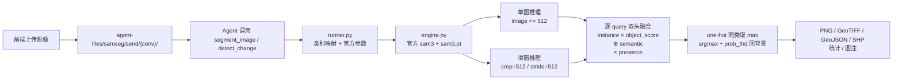

# SamSeg 遥感分析（ProC-SAM3 / SegEarth-OV3）

> 本文是 [architecture.md](../architecture.md) 的子文档。系统总览见总纲。
> **阶段 38 起**，语义分割默认切换为 **ProC-SAM3**（Prompt-Calibrated SAM3，英文类别 + 英文同义词，`backend/model/ProC_SAM3/`）；旧 SegEarth-OV3 保留 `SAMSEG_ENGINE=legacy` 回退。
> 阶段 24 的对齐说明仅适用于 legacy 引擎：官方 SegEarth-OV-3（`demo.py` / `segearthov3_segmentor.py` / `segearthov3_change_detector.py`）。

---

## 10. SamSeg 遥感分析

> **一句话**：ProC-SAM3 以**离线提示池/英文同义词 + SAM3 多提示前向 + PGRF 融合 + 峰值保持聚合**做开放词汇分割；变化检测用两期 ProC 掩膜的实例级对比；结果输出彩色 PNG + 带 CRS 的 GeoTIFF + GeoJSON/Shapefile 图斑 + 类别图注 + 连通域/转移矩阵统计。

**关键文件**：
- [`backend/model/SamSeg/engine.py`](../../backend/model/SamSeg/engine.py) — **官方引擎**：加载 site-packages `sam3` 的官方模型 + `Sam3Processor(resolution=1008)`，避免被子项目旧版 `sam3/` 遮蔽
- [`backend/model/SamSeg/official.py`](../../backend/model/SamSeg/official.py) — **官方推理流程**：单图/滑窗、双头融合、presence、类别聚合、`prob_thd`、实例级/语义级变化与交集
- [`backend/model/SamSeg/runner.py`](../../backend/model/SamSeg/runner.py) — **编排层**：模型缓存、类别映射、上色/统计/图注、GeoTIFF/矢量落盘、业务类型规则判读
- [`backend/model/SamSeg/visualize.py`](../../backend/model/SamSeg/visualize.py) — PNG 上色 + 图注（轻量依赖）
- [`backend/model/SamSeg/geoio.py`](../../backend/model/SamSeg/geoio.py) — GeoTIFF 掩膜 + GeoJSON/Shapefile 矢量
- [`backend/model/SamSeg/referring.py`](../../backend/model/SamSeg/referring.py) — 指代表达解析与单实例选择
- [`backend/model/tools/samseg_tools.py`](../../backend/model/tools/samseg_tools.py) — `segment_image` / `detect_change` / `understand_image`
- [`backend/data/vector_registry.py`](../../backend/data/vector_registry.py) — 矢量产物自动登记 `vector_layer`

> ★ **旧版 `SamSeg/SamSeg/sam3/` 不再参与运行时**：它被改成 336 输入/简化 neck，与官方 `sam3.pt`（1008 输入、`convs.*` 权重）键名和形状不匹配，会导致检测头全空。`engine.py` 会清理本地路径并强制使用 `sam3` conda 环境里已安装的官方包。

### 10.1 官方推理流程

> ⚠️ 10.1–10.4 描述的是 **legacy SegEarth-OV3** 引擎（`SAMSEG_ENGINE=legacy`）。默认 `proc_sam3` 见 10.5。

**官方默认参数**（[`config.py`](../../backend/config.py)）：

| 参数 | 默认值 | 含义 |
|---|---|---|
| `SAMSEG_CONFIDENCE_THRESHOLD` | `0.1` | `Sam3Processor` 实例置信度（官方 demo 值） |
| `SAMSEG_PROB_THD` | `0.1` | argmax 后低于该置信度的像素压回背景 |
| `SAMSEG_SLIDE_CROP` | `512` | 大图滑窗裁剪尺寸；0 关闭滑窗 |
| `SAMSEG_SLIDE_STRIDE` | `512` | 滑窗步长；重叠区域简单平均 |
| `SAMSEG_AUTOCAST` | `true` | CUDA bfloat16 autocast；CPU/旧卡自动退回 float32 |
| `SAMSEG_POSTPROCESS` | `false` | 官方不做形态学后处理；需要降噪时再开 |
| `SAMSEG_INSTANCE_IOU_THRESHOLD` | `0.3` | 变化检测实例覆盖率阈值 |
| `SAMSEG_MIN_INSTANCE_AREA` | `20` | 实例级变化最小面积 |
| `SAMSEG_INSTANCE_DILATION` | `2` | 配准容差膨胀半径（像素） |

> 输入分辨率固定 **1008**（`1008/14=72`，RoPE 表 5184）；`Sam3Processor` 的 `resolution` 必须显式传 1008，否则会与权重形状不匹配。

### 10.2 与旧 multipass 流程的区别

| 维度 | 旧 multipass（已弃用） | 官方流程（当前） |
|---|---|---|
| 前向次数 | 最多 10 轮，每轮涂黑已分割区域 | **单次前向**（大图按 512 滑窗） |
| 阈值 | `prob` 逐轮 ×0.7 衰减 | 固定 `confidence_threshold=0.1` + 后置 `prob_thd=0.1` |
| 大图 | 整图推理，易 OOM/漏检 | 512×512 滑窗 + 重叠平均 |
| 后处理 | 形态学平滑/去碎片/填洞 | 默认不做，保留 `SAMSEG_POSTPROCESS` 开关 |
| 结果来源 | 仅自研 logits 融合 | 官方 instance/semantic 双头 + presence |

### 10.3 类别系统

- 默认 7 类：`background / building / road / water / bareland / vegetation / farmland`
- 中文类别名（建筑/道路/水/植被/农田/裸地）→ 英文标准名 + 同义词增强
- 支持**任意开放词汇**（如“大棚/光伏板”），未知类直接作为 query 透传
- 类别行格式与官方一致：每行一类，逗号分隔同义词；第 0 行固定 `background`，不发文本提示

### 10.4 变化检测：官方实例 ∩ 语义

[`run_change_detection`](../../backend/model/SamSeg/runner.py) 对 T1/T2 各跑一次官方分割，然后：

1. **实例级**：两期前景 mask 各连通域在另一期的覆盖率 < `0.3` 且面积 ≥ 20 → 判变化；先对目标 mask 做半径 2 膨胀吸收配准漂移；双向取并集。
2. **语义级**：取 SAM3 backbone FPN 最后一层，上采样后算余弦相似度，`1-sim` 为结构变化强度；对每类计算
   `energy = max(conf_t1, conf_t2) × |logit_t1 - logit_t2| × feature_change`，逐类 Otsu（下限 0.01）得到该类变化区域。
3. **融合**：官方交集策略 —— 实例级与语义级都判变化的像素才保留；类别取语义级结果（官方原实现取二值实例图会丢类别，此处修正）。

**输出**：变化彩色 PNG、变化掩膜 GeoTIFF、变化图斑 GeoJSON/Shapefile、`stats.per_class`、**类别转移矩阵**（`transition`，供“耕地→建筑”等业务事件判读）。

### 10.4.1 ProC-SAM3（当前默认）

- 适配层：[`backend/model/ProC_SAM3/engine.py`](../../backend/model/ProC_SAM3/engine.py)，运行时代码已 vendored 到 `backend/model/ProC_SAM3/vendor/`；权重已复制到 `backend/model/ProC_SAM3/weights/sam3/sam3.pt`（仅本地提交，不推 GitHub），可用 `PROC_SAM3_WEIGHTS_ROOT` 覆盖；
- 模型：`CachedSAM3OpenSegmentor` + `configs/cfg_vaihingen.py`，默认 `processor_resolution=504`（交互快）；`PROC_SAM3_RESOLUTION=1008` 精度优先；
- 类别：**英文 + 英文同义词**，格式 `building, house, roof; water, river, lake`（分号分隔类别、逗号分隔同义词）；首行自动补 `background, other` 并固定索引 0；
- 分割：ProC `predict` → 类别索引掩膜，沿用 runner 的上色/统计/GeoTIFF/GeoJSON/SHP 后处理；
- 变化检测：两期 ProC 掩膜 → `compute_instance_change_map` 实例级对比（连通域 + IoU 匹配：消失/新增/类别变化），并输出类别转移矩阵；与 SegEarth-OV3 的双期分割 + 实例对比思路一致；
- 取图：前端「变化检测」区域选择 + T1/T2 两个 **Esri Wayback** 时相 → 浏览器拼接两期高清 PNG → `/api/v1/imagery/georeference` 写 GeoTIFF → 聊天附件 → Agent 调 `detect_change`；
- 旧 SegEarth：`SAMSEG_ENGINE=legacy` 回退；指代表达（`referring_expression`）在 ProC 下暂不支持。

### 10.5 业务变化类型判读

`detect_change` 当前使用**确定性规则 + 转移矩阵**（[`samseg_tools.py`](../../backend/model/tools/samseg_tools.py)）：

- 优先看转移矩阵主导项（`farmland→building` = 耕地占用、`water→bareland` = 水体萎缩等）
- 无矩阵时按变化主导类别映射（建筑主导=新增建筑、裸地主导=推土、水体=水体变化…）

> `runner.classify_change_type_by_vlm` 仍保留，但 `detect_change` **不调用**它：一方面 VLM 网络请求会阻塞检测任务终态，另一方面入口要求 `RESPONSES_API_KEY`，当前 GLM 主线未配置该凭据。业务类型统一由规则给出，`change_type.source='rule'`。

### 10.6 视觉理解（`understand_image`）

- 分类 `vlm`，模型取 `settings.vision_model`（默认 **GLM-5.3-Flash**）
- 把图片 base64 作为 `image_url` 喂多模态模型，回答“图里有什么/空间分布/形态纹理”等理解类问题
- 与分割/变化检测的分工：理解类问题走 `understand_image`，明确要求“提取/分割/标注”走 `segment_image`

### 10.7 优雅降级

| 环境 | 行为 |
|---|---|
| sam3 conda（torch + CUDA + 官方 sam3 包 + 权重） | 正常推理 |
| 无 torch / 无官方 sam3 / 权重缺失 | `samseg_available()=False`；工具返回 `type=error`，不影响其他工具 |
| 无 CUDA | 自动 CPU（极慢，仅应急） |
| `geopandas/rasterio` 缺失 | 跳过 GeoTIFF/矢量，PNG/统计仍可用 |

### 10.8 产物与元数据

- **文件**：`agent-files/samseg/generate/{proj}/{conv}/`（PNG/GeoTIFF）、`agent-files/samseg/vector/{proj}/{conv}/`（GeoJSON + Shapefile）
- **`vector_layer`**：`segment_image` / `detect_change` 产出 GeoJSON 后自动登记 bbox/要素数/真实面积/CRS/类别统计（`backend/data/vector_registry.py`）
- **`artifact`**：会话链路中的工具产物由 `chat_service` 自动登记；存量文件用 `scripts/register_vector_outputs.py` 回填
- **GeoTIFF**：带源影像 CRS，前端地图用半透明叠加层展示

### 10.9 存量迁移脚本

| 脚本 | 用途 |
|---|---|
| `scripts/register_vector_outputs.py` | 回填 `vector_layer` + `artifact`（幂等） |
| `scripts/migrate_legacy_agent_db.py` | 旧 `agent` 库 → `Agent_study` 会话/消息迁移（幂等） |

---
