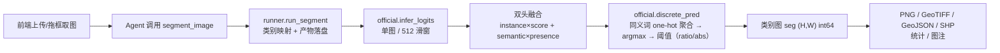

# SamSeg 遥感分析

> 本文是 [architecture.md](../architecture.md) 的子文档。系统总览见总纲。
> **2026-11（阶段 74/75）起**，地物提取（`segment_image`）只走 **SamSeg 本体**（`backend/model/SamSeg/`，SegEarth-OV3 官方流程：单图/512 滑窗 + 双头融合 + `prob_thd`）。阶段 72 引入的原生 SAM3（`backend/model/sam3native/`）已**移交样本制作功能**（`docs/agent/method/sample-data-pipeline.md`），不再参与地物提取，`SAMSEG_INFERENCE_MODE` 开关随之废弃。

---

## 10. SamSeg 遥感分析

> **一句话**：SamSeg（SegEarth-OV3 官方流程）以**文本 query 双头融合（instance 掩码 × score、semantic 语义头 × presence）**做开放词汇分割，滑窗拼接后按类别 one-hot 聚合、`prob_thd` 压背景；结果输出彩色 PNG + 带 CRS 的 GeoTIFF（默认关）+ GeoJSON/Shapefile 图斑 + 类别图注 + 连通域统计。

**关键文件**：
- [`backend/model/SamSeg/runner.py`](../../backend/model/SamSeg/runner.py) — **编排层 + 推理入口**：`run_segment`（SamSeg 唯一口径）/ `run_change_detection`、类别映射、上色/统计/图注、GeoTIFF/矢量落盘、业务类型规则判读
- [`backend/model/SamSeg/official.py`](../../backend/model/SamSeg/official.py) — SamSeg 官方推理核心：`infer_logits`（单图/滑窗）→ `discrete_pred`（聚合 + `prob_thd`），另有实例级/语义级变化融合
- [`backend/model/SamSeg/engine.py`](../../backend/model/SamSeg/engine.py) — 解析 site-packages 官方 `sam3` 包并 `build_sam3_image_model` + `Sam3Processor(resolution=1008)`
- [`backend/model/SamSeg/visualize.py`](../../backend/model/SamSeg/visualize.py) — PNG 上色 + 图注（轻量依赖）
- [`backend/model/SamSeg/geoio.py`](../../backend/model/SamSeg/geoio.py) — GeoTIFF 掩膜 + GeoJSON/Shapefile 矢量
- [`backend/model/SamSeg/referring.py`](../../backend/model/SamSeg/referring.py) — 指代表达解析与单实例选择（`Sam3Processor` 路径）
- [`backend/model/sam3native/`](../../backend/model/sam3native/) — 原生 SAM3 引擎，**已移交样本制作功能**（接地头批量候选 + 交互头点/框精修），地物提取不再引用
- [`backend/model/sample/`](../../backend/model/sample/) — 样本制作编排（候选生成 / 标注落盘 / 导出），见 [sample-data-pipeline.md](../agent/method/sample-data-pipeline.md)
- [`backend/agent/tools/samseg_tools.py`](../../backend/agent/tools/samseg_tools.py) — `segment_image` / `detect_change` / `understand_image`
- [`backend/data/vector_registry.py`](../../backend/data/vector_registry.py) — 矢量产物自动登记 `vector_layer`

> ★ **旧版 `SamSeg/SamSeg/sam3/` 不参与运行时**：它被改成 336 输入/简化 neck，与官方 `sam3.pt`（1008 输入、`convs.*` 权重）键名和形状不匹配，会导致检测头全空。`engine.py` 会清理本地路径并强制使用 `sam3` conda 环境里已安装的官方包。
> ★ `SamSeg/SamSeg/infer.py` 只提供调色板（`build_palette`）、形态学后处理（`postprocess`）、实例变化图（`compute_instance_change_map`）等工具函数；推理主链路在 `official.py`。

### 10.1 分割推理流程（默认 official）

- 模型：官方 `build_sam3_image_model` + `Sam3Processor(resolution=1008)`，权重 `backend/model/SamSeg/SamSeg/sam3/sam3.pt`；
- 滑窗：图像任一边大于 `SAMSEG_SLIDE_CROP`（512）时按 `SAMSEG_SLIDE_STRIDE`（512）切片，重叠区按**高斯窗加权**平均（中心权重大、边缘低，消除拼缝；口径参考 `H:/图文描述数据集/SAM推理/proc_engine.py`）；
- 融合：每个 query 取 `sigmoid(pred_masks) × (sigmoid(pred_logits) × presence)` 与 `sigmoid(semantic_seg) × presence` 的逐像素 max；
- 聚合：同义词 query 按类别 one-hot 取 max → argmax → 阈值以下压回 `background`；阈值默认 `ratio` 自适应（取峰值图的 `1-FG_RATIO` 分位，默认前景占比 0.90，裁剪到 [0.05, 0.95]），可选 `abs` 固定 `SAMSEG_PROB_THD`；
- 后处理：默认开启（`SAMSEG_POSTPROCESS=true`），链路 平滑 → 去小连通域 → 填小背景孔，参数 `SAMSEG_SMOOTH_KERNEL=3` / `SAMSEG_POSTPROCESS_MIN_AREA=64` / `SAMSEG_POSTPROCESS_MAX_HOLE=128`。

**配置项**（[`config.py`](../../backend/config.py)）：

| 参数 | 默认值 | 含义 |
|---|---|---|
| `SAMSEG_MODEL_PATH` / `SAMSEG_BPE_PATH` | SamSeg 内置 `sam3/sam3.pt` + bpe | 权重与词表 |
| `SAMSEG_CONFIDENCE_THRESHOLD` | `0.1` | 实例置信度阈值（双头融合过滤） |
| `SAMSEG_PROB_MODE` | `ratio` | 阈值口径：`ratio` 自适应 / `abs` 固定 |
| `SAMSEG_FG_RATIO` | `0.90` | `ratio` 口径目标前景占比 |
| `SAMSEG_PROB_THD` | `0.1` | `abs` 口径下的固定阈值 |
| `SAMSEG_SLIDE_CROP` / `SAMSEG_SLIDE_STRIDE` | `512` / `512` | 滑窗裁剪与步长（高斯加权拼接） |
| `SAMSEG_AUTOCAST` | `true` | CUDA 上 bf16 autocast |
| `SAMSEG_POSTPROCESS` | `true` | 形态学后处理开关 |
| `SAMSEG_SMOOTH_KERNEL` / `SAMSEG_POSTPROCESS_MIN_AREA` / `SAMSEG_POSTPROCESS_MAX_HOLE` | `3` / `64` / `128` | 后处理参数 |
| `SAMSEG_CHANGE_HARMONIZE` | `lab` | 双时相色调一致性口径（`none/lab/lum/hist/linear`） |
| `SAM3_NATIVE_*` | — | 原生 SAM3 权重/设备/分辨率，仅供样本制作使用（见阶段 72 与样本制作设计稿） |

> `SAMSEG_INFERENCE_MODE` 已于阶段 75 删除：地物提取不再有 `native` 口径。

### 10.2 类别系统

- 默认 7 类：`background / building / road / water / bareland / vegetation / farmland`
- 中文类别名（建筑/道路/水/植被/农田/裸地）→ 英文标准名 + 同义词增强
- 支持**任意开放词汇**（如“大棚/光伏板”），未知类直接作为文本提示透传
- 类别行格式：每行一类，逗号分隔同义词；第 0 行固定 `background`，不发文本提示
- 提示词总数 = 各类同义词展开后的 query 数，每个 query 都要走一次 `forward_grounding`

### 10.3 变化检测：change_qwen 专用 ONNX（唯一口径）

[`change_detection/change_qwen_runtime/runtime.py`](../../backend/model/change_detection/change_qwen_runtime/runtime.py) 用 ONNX Runtime 跑专用二值变化权重：

1. 两期影像按 CRS 读入（`rasterio` + `WarpedVRT`），336×336 分块、步长 168、重叠区加权融合；
2. 两类场景各一套权重：`jzg`（九寨沟滑坡）/ `cdcd`（成都 2016–2023 建筑变化），文本提示用预计算 `*_text.npz` tokens；
3. 概率图按阈值二值化，`min_area_px` / `min_area_m2` 过滤小图斑。

**输出**：二值变化 mask、彩色图、概率 GeoTIFF、变化图斑 GeoJSON（带源 CRS）、`stats`（区域数 / 变化像素 / 占比 / 面积）。

> registry 中 `change_detection` 只注册 `change_qwen` 一项；原 `sam3_native_change`（双时相实例对比）适配器已删除。
> `runner.run_change_detection`（T1/T2 各分割一次 → 实例 IoU 匹配 → 转移矩阵）函数与 `SAMSEG_CHANGE_HARMONIZE` 仍保留，但不再注册、工具链不调用。

> 取图：前端「变化检测」区域选择 + T1/T2 两个 **Esri Wayback** 时相 → 浏览器拼接两期高清 PNG → `/api/v1/imagery/georeference` 写 GeoTIFF → 聊天附件 → Agent 调 `detect_change`（`model` 参数选 `jiuzhaigou_landslide` / `chengdu_building`）。

### 10.4 指代表达（保留路径）

`referring_expression` 走保留的旧推理路径：`Sam3Processor`（官方 sam3）+ [`referring.py`](../../backend/model/SamSeg/referring.py) 解析表达 → 目标/锚点文本提示 → 按大小/方位/参照关系选单个实例。普通分割不走此路径。

### 10.5 业务变化类型判读

- `detect_change`（change_qwen 口径）输出二值变化：区域数 / 变化像素 / 占比 / 面积，不做类别转移判读。
- `runner.classify_change_type_by_rule` / `classify_change_type_by_vlm` 与转移矩阵函数保留在 SamSeg 内，但无注册入口、工具链不调用（VLM 路径需 `RESPONSES_API_KEY`，GLM 主线未配置）。

### 10.6 视觉理解（`understand_image`）

- 分类 `vlm`，模型取 `settings.vision_model`（默认 **GLM-5.3-Flash**）
- 把图片 base64 作为 `image_url` 喂多模态模型，回答“图里有什么/空间分布/形态纹理”等理解类问题
- 与分割/变化检测的分工：理解类问题走 `understand_image`，明确要求“提取/分割/标注”走 `segment_image`

### 10.7 优雅降级

| 环境 | 行为 |
|---|---|
| sam3 conda（torch + CUDA + 官方 sam3 包 + 权重） | 正常推理 |
| 无 torch / 无官方 sam3 / 权重缺失 | `samseg_available()=False`；工具返回 `type=error`，不影响其他工具 |
| 无 CUDA | 自动 CPU（极慢，仅应急） |
| `geopandas/rasterio` 缺失 | 跳过 GeoTIFF/矢量，PNG/统计仍可用 |

### 10.8 产物与元数据

- **文件**：`agent-files/samseg/generate/{proj}/{conv}/`（PNG/GeoTIFF）、`agent-files/samseg/vector/{proj}/{conv}/`（GeoJSON + Shapefile）
- **`vector_layer`**：`segment_image` / `detect_change` 产出 GeoJSON 后自动登记 bbox/要素数/真实面积/CRS/类别统计（`backend/data/vector_registry.py`）
- **`artifact`**：会话链路中的工具产物由 `chat_service` 自动登记；存量文件用 `scripts/register_vector_outputs.py` 回填
- **GeoTIFF**：带源影像 CRS，前端地图用半透明叠加层展示

### 10.9 存量迁移脚本

| 脚本 | 用途 |
|---|---|
| `scripts/register_vector_outputs.py` | 回填 `vector_layer` + `artifact`（幂等） |
| `scripts/migrate_legacy_agent_db.py` | 旧 `agent` 库 → `Agent_study` 会话/消息迁移（幂等） |

---
