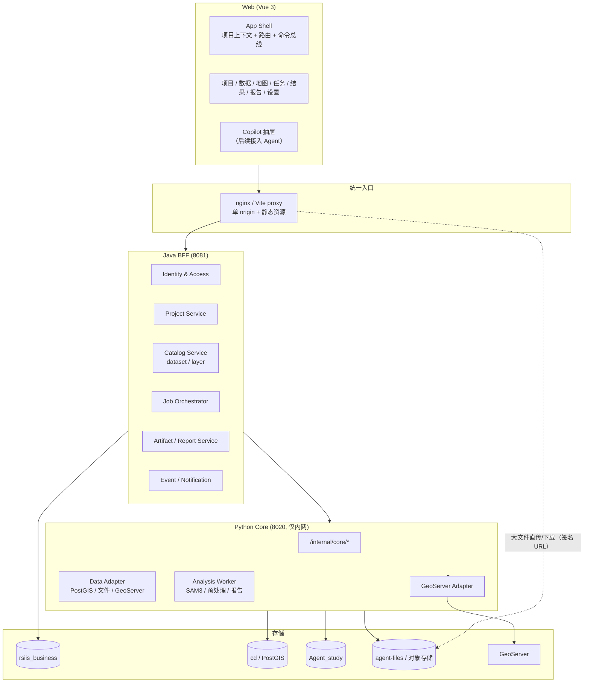
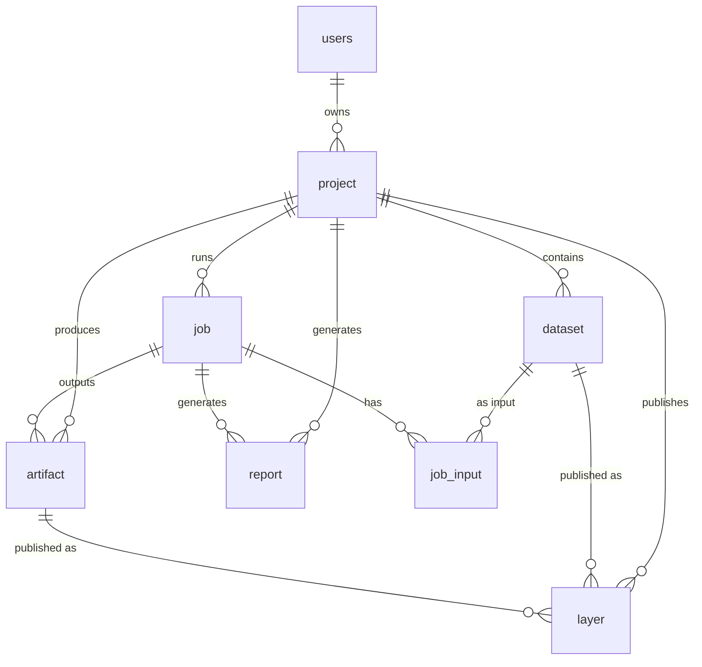
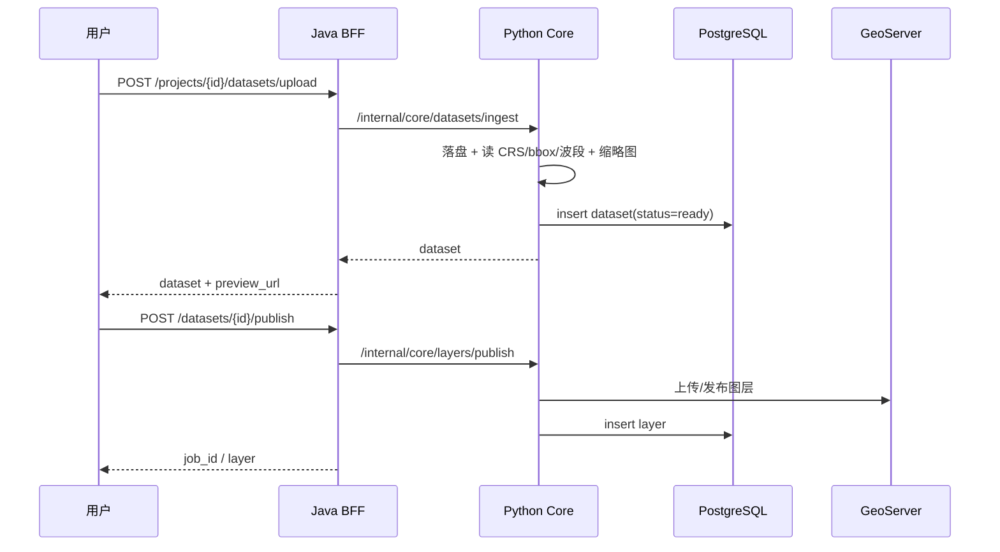
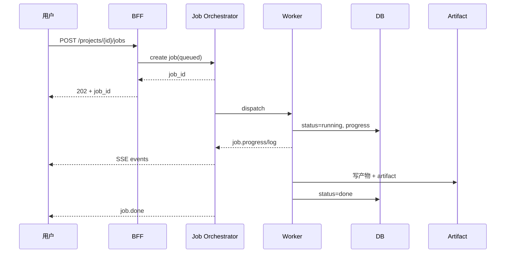

# 非 Agent 核心系统架构设计（V1 草案）

> 范围：先把 **Agent 之外** 的系统设计成可独立使用的遥感数据与解译平台；Agent 后续作为“Copilot”接入，而不是系统入口。
>
> 生产级扩展（多用户权限 + 用户端/管理端双门户）见 [production-architecture.md](./production-architecture.md) 与 [two-portal-ui-design.md](./two-portal-ui-design.md)。
>
> 结论先行：当前代码更像“Agent 聊天 Demo + 地理数据后端”。项目、数据集、图层、任务、产物没有成为一等公民，分析执行也绑在 Agent 的聊天循环里。建议先补 **项目 / 数据目录 / 任务编排 / 产物中心 / 图层目录** 五个核心域，再让 Agent 调用它们。

---

## 一、现状盘点（只列与本次设计相关的事实）

### 1.1 前端：单页、聊天主导

| 维度 | 现状 | 影响 |
|---|---|---|
| 路由 | 没有 `vue-router`，`App.vue` 只做 WS 连接 + `MainLayout` | 无法承载项目/数据/任务/结果等多页面 |
| 布局 | 三栏：左栏（对话/图层/技能/MCP） + 中栏地图 + 右栏聊天 | 聊天是主角，地图和数据是附件 |
| 项目 | 左栏对话列表按项目分组，项目只有名称/描述 | 没有项目总览、资产统计、项目工作区 |
| 数据 | 图层面板直接查 GeoServer 服务树（白名单 `cd*`/`samseg*`） | 看不到“本地上传但未发布”的影像/矢量，也没有项目维度 |
| 上传 | 在聊天输入框上传，落 `agent-files/samseg/send/{conv}/` | 上传是“聊天附件”，不是“数据入库” |
| 任务 | `TaskMonitorDialog` 只读任务日志 | 没有任务中心、没有人工发起分析任务的入口 |
| 结果 | 产物通过聊天 `frontend_action` 展示 | 关掉会话就找不到结果，没有结果资产库 |
| 身份 | `DEFAULT_USER='study_user'`，JWT 只存不强制 | 项目/数据没有真正的用户隔离 |

关键文件：`frontend-vue/src/App.vue`、`layouts/MainLayout.vue`、`components/sidebar/LeftSidebar.vue`、`components/map/LayerPanel.vue`、`services/api.js`。

### 1.2 Java 业务服务：只是“半个 BFF”

| 能力 | 现状 |
|---|---|
| 认证 | JWT 登录，`SECURITY_MODE` 默认 `off` |
| 项目 | `project` 表仅 `id/user_id/name/description/folder_path`，无状态/资产/统计 |
| 工作区 | 只读列本地目录树 |
| 会话/任务 | 纯代理到 Python `/internal/*` |
| 数据/图层/任务执行 | 没有对应 API |

关键文件：`backend-java/src/main/java/com/rsiis/business/**`、`resources/schema.sql`。

### 1.3 Python 非 Agent 部分：数据能力有，业务编排没有

已有 REST：

- 文件：上传/下载/影像元数据/Shapefile→GeoJSON
- GeoServer：服务树、bbox、发布、删除、WMS/FeatureInfo 代理
- 任务：只读 `ai_task/task_log`
- 技能/MCP/沙盒：配置与执行辅助

缺口：

- **没有“创建分析任务”的 REST**：`segment_image` / `detect_change` 只在 Agent 工具链里同步跑；
- `ai_task` 是 Agent 聊天循环里的副产物（`chat_service` 调重工具时创建），不是独立任务系统；
- 没有任务取消/重试/队列/并发控制的统一入口；
- 没有数据集目录 API（`image_metadata` / `vector_layer` 只在工具里查）。

关键文件：`backend/api/files.py`、`geoserver.py`、`tasks.py`、`backend/agent/chat_service.py`（任务创建/进度/产物埋点在聊天循环内）。

### 1.4 数据层：元数据存在，但缺“项目”维度

| 存储 | 现状 | 问题 |
|---|---|---|
| PostgreSQL `cd` | `image_metadata`、`vector_layer` + PostGIS | 两表都**没有 project_id**；矢量登记靠工具触发 |
| PostgreSQL `Agent_study` | conversation/message/artifact/ai_task/... | `artifact` 关联 conversation/task，不关联 project |
| PostgreSQL `rsiis_business` | users/project | 项目没有资产/任务统计 |
| 文件 `agent-files/` | 按来源/项目/会话组织 | 上传原图只按会话；路径直接暴露给前端 |
| GeoServer | 7 工作空间、23 图层 | 被同时当“存储”和“目录”用；UI 实时查树，慢且不可治理 |

### 1.5 现状总结：五个“没有”

1. **没有项目工作区**：项目只是对话分组，不是资产/任务/结果的容器。
2. **没有数据目录**：影像/矢量元数据没有统一 REST，也没有项目归属。
3. **没有任务中心**：分析只能通过 Agent 聊天触发，人工无法独立操作。
4. **没有结果中心**：产物散落在 `agent-files/`，靠会话路径找人。
5. **没有统一入口/权限**：前端同时打 Java 和 Python，JWT 不强制，`study_user` 兜底。

---

## 二、设计原则

1. **项目是一等公民**：`project` 是资产、任务、图层、产物、报告的聚合根；所有核心数据必须带 `project_id`。
2. **Agent 是消费者，不是所有者**：Agent 与人工 UI 调同一套 Core API；Agent 不直接写 DB、不直接调 runner、不直接拼文件路径。
3. **任务是一等公民**：分析/发布/报告都抽象成 Job；异步执行、可查询、可取消、可重试、有事件。
4. **元数据优先**：数据库是目录，文件/GeoServer 是存储；UI 先查目录，再按需取图层，不实时扫 GeoServer 当目录。
5. **单一入口**：浏览器只访问一个 origin；Java 作为 BFF 负责身份/项目/目录/任务编排，Python 作为内部分析与地理能力服务。
6. **UI 任务导向**：默认看到“项目 → 数据 → 地图 → 任务 → 结果”，聊天只是右下角可收起的 Copilot。

---

## 三、目标架构

### 3.1 逻辑架构



### 3.2 服务职责

| 服务 | 负责 | 不负责 |
|---|---|---|
| **Java BFF** | 登录/JWT、项目、数据目录、图层目录、任务编排、产物索引、报告索引、权限、审计 | GDAL/模型推理、GeoServer 细节 |
| **Python Core** | 影像/矢量读写、GeoServer 发布、SAM3 推理、预处理、报告生成、任务执行 | 用户/项目/权限、前端会话 |
| **Worker** | 实际长任务执行（GPU/CPU）、进度/日志/产物回写 | 对外 HTTP 业务 API |
| **GeoServer** | WMS/WFS/WCS 发布与渲染 | 业务目录/权限 |
| **PostgreSQL** | 业务元数据 + 空间元数据 + 任务/产物 | 大文件本体 |

> **为什么 Java 做 BFF**：当前 Java 已有认证/项目/工作区，且前端需要单一入口与项目级权限；Python 继续专注地理与模型能力，避免把 GDAL/ML 生态搬进 Java。
>
> **备选**：如果短期不想扩 Java，也可以让 nginx 做统一入口、Python 做业务 API；但项目级权限、任务编排会散在 Python，后续接 Agent 时边界更乱。建议仍按 BFF 演进。

### 3.3 部署拓扑（单机版，先够用）

```text
浏览器
  └─ nginx :8090
      ├─ /                frontend-vue/dist
      ├─ /api/v1/**       Java :8081（BFF）
      ├─ /api/v1/agent/ws Python :8020（后续 Agent）
      └─ /geoserver/**    GeoServer :8080
Java :8081 ── /internal/core/** ── Python :8020
Python ── PostgreSQL :5432 / GeoServer :8080 / agent-files
```

- 开发期保持 Vite proxy；生产期 nginx。
- `/internal/*` 永不对公网暴露。
- 大文件上传/下载走 BFF 签发的短时 URL，不把绝对路径返回前端。

---

## 四、领域模型

### 4.1 核心关系



### 4.2 表设计（在现有表上演进，不推倒重来）

#### `project`（Java 库，扩展）

| 字段 | 说明 |
|---|---|
| `id` / `owner_id` / `name` / `description` | 现有 |
| `status` | `active` / `archived` |
| `tags` | JSONB，业务标签 |
| `bbox` / `cover_uri` | 项目范围 / 封面 |
| `folder_path` | 保留本地工作区关联 |
| `created_at` / `updated_at` | 现有 |

#### `dataset`（新增，替代“散落的 image_metadata/vector_layer 目录视图”）

| 字段 | 说明 |
|---|---|
| `id` / `project_id` / `name` | 主键 / 归属 / 显示名 |
| `kind` | `raster` / `vector` / `table` / `document` |
| `format` | GeoTIFF/COG/GeoJSON/SHP/CSV/PDF… |
| `storage_uri` | 统一存储路径（对外不暴露） |
| `crs` / `bbox` / `width` / `height` / `bands` / `feature_count` | 空间与结构元数据 |
| `size_bytes` / `checksum` | 资产校验 |
| `source` | `upload` / `geoserver` / `analysis` |
| `status` | `uploaded` / `ready` / `failed` |
| `created_by` / `created_at` | 审计 |

> 迁移：把 `image_metadata` 迁为 `dataset(kind=raster)` 的扩展，`vector_layer` 迁为 `dataset(kind=vector)` 的扩展；旧表可保留为 `dataset_raster_detail` / `dataset_vector_detail` 或视图，避免一次性重写。

#### `layer`（新增，项目图层目录）

| 字段 | 说明 |
|---|---|
| `id` / `project_id` | 主键 / 归属 |
| `dataset_id` / `artifact_id` | 来源资产 / 产物（二选一） |
| `workspace` / `name` / `type` | GeoServer 工作空间/图层名/栅格或矢量 |
| `style_id` / `visible` | 样式 / 默认可见 |
| `published_at` | 发布时间 |

#### `job`（新增，统一任务）

| 字段 | 说明 |
|---|---|
| `id` / `project_id` | 主键 / 归属 |
| `type` | `segment` / `change_detect` / `preprocess` / `publish` / `report` |
| `status` | `queued` / `running` / `done` / `failed` / `cancelled` |
| `progress` | 0–100 |
| `params` / `input_dataset_ids` / `output` | JSONB |
| `source` | `manual` / `agent` |
| `agent_run_id` | Agent 追踪（可空） |
| `parent_job_id` | 子任务/重试链 |
| `error` / `started_at` / `finished_at` | 执行信息 |
| `created_by` / `created_at` | 审计 |

> 不建议继续把 `ai_task` 当核心任务表：它是 Agent 聊天循环的副产物。可以短期复用 `ai_task` 加 `project_id/source`，中期迁移到 `job`；Agent 的推理 trace 留在 `Agent_study`，不要和业务任务混在一起。

#### `artifact`（现有表扩展）

- 增加 `project_id`、`job_id`（替换/补充 `task_id`）、`dataset_id`（可选）。
- 保留现有 `storage_uri`、`spatial/temporal/business/lineage/quality` JSONB。
- 所有产物必须可反查：`project → job → artifact → 文件/图层`。

#### `report`（可先复用 `artifact`）

- `id/project_id/job_id/template/storage_uri/status/created_at`。
- 报告是产物的一个类型，但业务上需要模板、版本、预览，单独表更清晰。

### 4.3 数据归属与迁移顺序

1. 给 `image_metadata` / `vector_layer` / `artifact` 加 `project_id`（可空，先回填）。
2. 建 `dataset` / `job` / `layer` 表，双写/回填。
3. BFF 只读写新表，旧表降为 detail/兼容视图。
4. 稳定后删除旧表或保留只读。

---

## 五、Core API 设计

### 5.1 约定

- 统一前缀 `/api/v1`，BFF 对外；Python 内部 `/internal/core/*`。
- 响应：`{ "status": "success|error", "data": ..., "msg": ..., "request_id": ... }`；新接口用 `data` 包一层，旧接口保持兼容。
- 分页：`?page=1&page_size=20&keyword=&status=`。
- 所有业务接口从 JWT 取 `user_id`，不再接受前端传 `user_id`。
- 长任务一律 `202 Accepted` + `job_id`，进度通过 SSE/轮询。

### 5.2 端点清单

#### 项目

| 方法 | 路径 | 说明 |
|---|---|---|
| GET | `/api/v1/projects` | 当前用户项目列表（含资产统计） |
| POST | `/api/v1/projects` | 新建项目 |
| GET | `/api/v1/projects/{id}` | 项目详情 |
| PATCH | `/api/v1/projects/{id}` | 改名/描述/标签/归档 |
| DELETE | `/api/v1/projects/{id}` | 归档或删除（策略可配） |
| GET | `/api/v1/projects/{id}/overview` | KPI、最近任务、最近产物 |

#### 数据目录

| 方法 | 路径 | 说明 |
|---|---|---|
| GET | `/api/v1/projects/{id}/datasets` | 数据集列表（类型/状态/关键词） |
| POST | `/api/v1/projects/{id}/datasets/upload` | 上传并入库（multipart，异步解析元数据） |
| GET | `/api/v1/datasets/{datasetId}` | 详情（CRS/bbox/波段/预览） |
| DELETE | `/api/v1/datasets/{datasetId}` | 删除（检查引用） |
| GET | `/api/v1/datasets/{datasetId}/preview` | 缩略图/预览 |
| GET | `/api/v1/datasets/{datasetId}/download` | 签名下载 |
| POST | `/api/v1/datasets/{datasetId}/publish` | 发布为图层（创建 publish job） |

#### 图层

| 方法 | 路径 | 说明 |
|---|---|---|
| GET | `/api/v1/projects/{id}/layers` | 项目图层目录（非实时 GeoServer 树） |
| PATCH | `/api/v1/layers/{layerId}` | 显隐/样式/名称 |
| DELETE | `/api/v1/layers/{layerId}` | 取消发布/删除 |

#### 任务

| 方法 | 路径 | 说明 |
|---|---|---|
| POST | `/api/v1/projects/{id}/jobs` | 创建任务：`{type, input_dataset_ids, params}` |
| GET | `/api/v1/projects/{id}/jobs` | 任务列表 |
| GET | `/api/v1/jobs/{jobId}` | 任务详情（含输出/日志） |
| POST | `/api/v1/jobs/{jobId}/cancel` | 取消 |
| POST | `/api/v1/jobs/{jobId}/retry` | 重试 |
| GET | `/api/v1/jobs/{jobId}/events` | SSE：progress/log/done/failed |

任务请求示例：

```json
POST /api/v1/projects/p_001/jobs
{
  "type": "change_detect",
  "input_dataset_ids": ["ds_t1", "ds_t2"],
  "params": { "classes": "建筑,水", "prob_thd": 0.1, "slide_crop": 512 },
  "source": "manual"
}
```

响应：

```json
{ "status": "success", "data": { "job_id": 128, "status": "queued" } }
```

#### 产物/结果

| 方法 | 路径 | 说明 |
|---|---|---|
| GET | `/api/v1/projects/{id}/artifacts` | 产物列表（类型/任务/时间） |
| GET | `/api/v1/artifacts/{artifactId}` | 产物详情/血缘 |
| GET | `/api/v1/artifacts/{artifactId}/download` | 签名下载 |
| POST | `/api/v1/artifacts/{artifactId}/publish` | 产物发布为图层 |

#### 报告

| 方法 | 路径 | 说明 |
|---|---|---|
| GET | `/api/v1/projects/{id}/reports` | 报告列表 |
| POST | `/api/v1/projects/{id}/reports` | 创建报告任务 |
| GET | `/api/v1/reports/{reportId}` | 报告详情/预览 |

### 5.3 事件契约

SSE（推荐）或复用 WS：

```json
{ "event": "job.progress", "job_id": 128, "progress": 42, "stage": "inference" }
{ "event": "job.log", "job_id": 128, "level": "info", "message": "T1 分割完成" }
{ "event": "job.done", "job_id": 128, "artifacts": [{"id": 9001, "type": "change_vector"}] }
{ "event": "layer.published", "layer_id": 77, "name": "p_001_change_001" }
```

前端只依赖事件，不依赖具体 Agent 的 `frontend_action`。

---

## 六、关键流程

### 6.1 上传 → 入库 → 发布



### 6.2 分析任务



### 6.3 结果 → 发布/报告

- 结果中心选中产物 → “发布为图层”（publish job）或“生成报告”（report job）。
- 报告模板参数：项目、任务、产物、统计表；输出 PDF/Word + 预览图。
- 所有操作产生新 job，不覆盖原产物。

---

## 七、Agent 接入接缝（后续）

Agent 不作为核心系统入口，而是 **Copilot**：

1. **独立进程/服务**：Agent 只通过 Core API 操作业务；不直接写 `cd`/`Agent_study` 业务表。
2. **工具即 API 适配器**：`segment_image` → `POST /projects/{id}/jobs`；`detect_change` 同理；`publish_layer` → publish API。
3. **上下文来自 UI**：当前 `project_id` / `dataset_id` / `job_id` / 地图视口通过请求上下文传给 Agent；不再靠聊天猜。
4. **事件驱动**：Agent 订阅 `job.*` 事件给用户解释进度；UI 也可以不经过 Agent 直接展示。
5. **命令协议**：把现有 `frontend_action` 收敛成 `ui.command`（`map.add_layer` / `panel.open_result` / `form.prefill`），Agent 只能发命令，不能直接改 UI 状态。
6. **权限一致**：Agent 继承当前用户权限；高风险操作（删除/覆盖/发布）必须二次确认。
7. **可回退**：Agent 创建的任务与人工任务同表，`source=agent` 可筛选/审计。

---

## 八、落地路线（建议按 4 个阶段）

| 阶段 | 目标 | 关键交付 | 验收 |
|---|---|---|---|
| **P0 契约与数据** | 确定项目/数据/任务/产物模型 | `dataset`/`job`/`layer` 表；`project_id` 回填；Core API 契约 | 旧数据可查；新表可写 |
| **P1 核心 UI** | 非 Agent 可用 | App Shell + 路由 + 项目总览 + 数据中心 + 地图工作台 | 不登录 Agent 也能上传/看图/管图层 |
| **P2 任务与结果** | 独立分析闭环 | Job Orchestrator + Worker + 任务中心 + 结果中心 | 人工发起分割/CD，进度/结果/下载可用 |
| **P3 报告与 Agent** | 业务闭环 + Copilot | 报告中心；Agent 作为抽屉接入同一 Job API | Agent 任务与人工任务同源可审计 |

### P0 最小改动清单（不改前端也能做）

1. 给 `image_metadata` / `vector_layer` / `artifact` 加 `project_id`（可空）。
2. 新增 `dataset` / `job` / `layer` 三张表。
3. Java 增加 `/api/v1/projects/{id}/datasets`、`/jobs` 的骨架（先代理 Python）。
4. Python 增加 `/internal/core/datasets`、`/internal/core/jobs`（先复用现有 runner）。
5. 把 `artifact` 的 `conversation_id` 改为可空，补 `project_id`/`job_id`。

> 不建议一开始就重写前端。先把“项目/数据/任务”契约稳定，再按新 IA 重做 UI，避免 UI 反复。

---

## 九、已确认决策与待确认项

### 9.1 已确认（2026-10-27）

1. **单组织 + 多用户**：一期不做多租户，但保留 `org_id`。
2. **文件存储**：生产用云 OSS（S3 兼容）；本地开发可用 `agent-files/` 或 MinIO。
3. **两套门户**：用户端 `app.example.com`，管理端 `admin.example.com`。
4. **管理端强制 MFA**。
5. **任务执行**：Celery + Redis 多 Worker（GPU/CPU 分队列）。
6. **管理端 UI**：沿用当前前端浅色蓝白风格。

### 9.2 仍需确认

1. Java BFF 范围：只做身份/项目/目录/任务索引，还是连文件上传/下载也代理？
2. GeoServer 工作空间策略：每项目一个 workspace，还是继续 `samseg`/`cd_*` 共享？
3. 历史数据：旧 `agent` 会话/旧 `agent-files` 是否迁入项目资产？

---

## 十、附：与当前代码的映射

| 目标模块 | 现有可复用 | 需要新增 |
|---|---|---|
| Project | Java `ProjectController/Service` | 统计、状态、封面、项目详情 |
| Catalog | `business_db.image_metadata/vector_layer` | `dataset` 表 + REST + project_id |
| Layer | `geoserver_client` + `LayerPanel` | `layer` 表 + 项目图层目录 API |
| Job | `ai_task/task_log` + runner | `job` 表 + 队列 + REST + SSE |
| Artifact | `artifact` + `register_artifact` | project_id/job_id + 结果中心 API |
| Report | `report_tools` / `report_worker` | 报告索引 + 模板 API |
| Auth | Java JWT | 强制执行 + 项目级授权 |
| UI | 三栏布局/地图/图层 | 路由 + App Shell + 新页面 |
