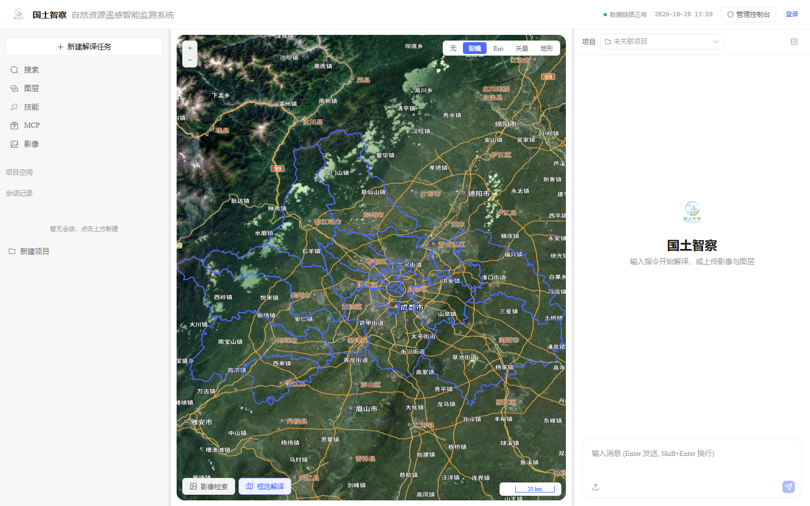
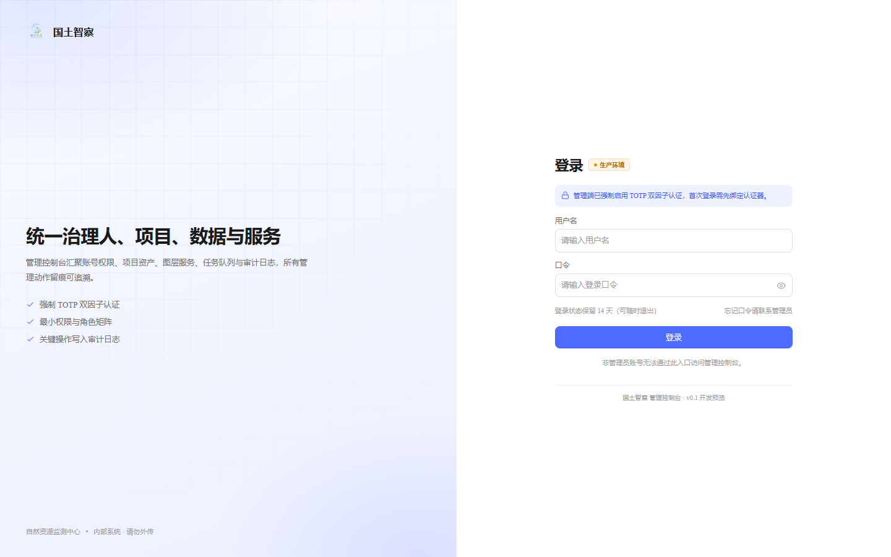
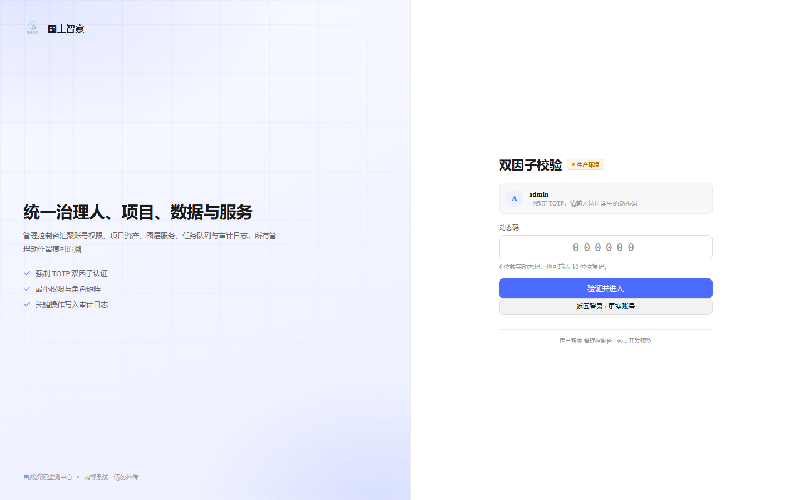
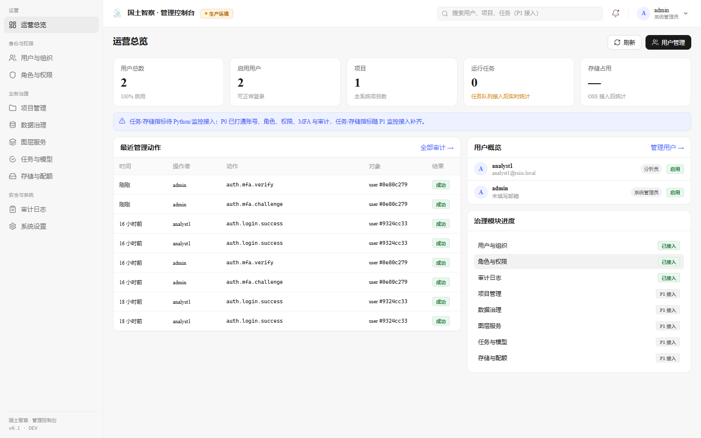
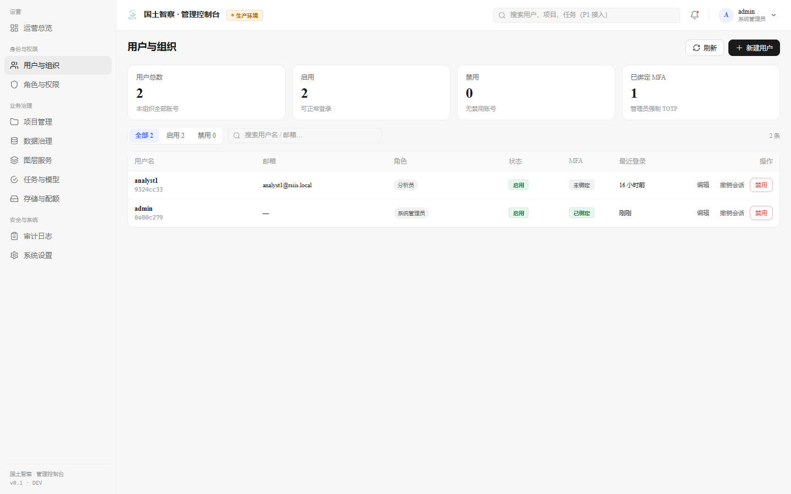
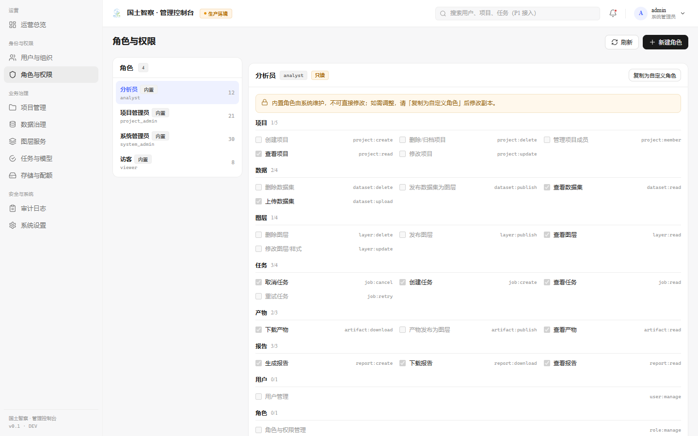
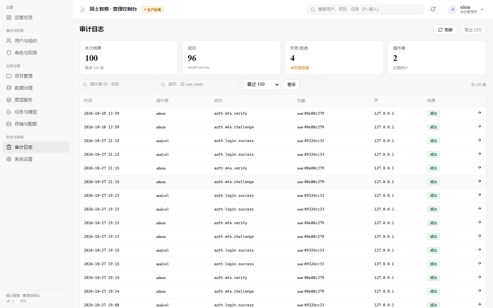

# 双入口启动与演示指南

> 形态：**单前端应用 + 路由分流**。
> `/` 是工作台（现有界面，默认入口）；`/admin/**` 是管理控制台，从工作台右上角「管理控制台」进入。
> 设计依据：[two-portal-ui-design.md](./two-portal-ui-design.md) · 截图目录 `docs/platform/screens/`

---

## 一、前置条件

| 依赖 | 版本/位置 | 说明 |
|---|---|---|
| JDK | 21 | Java 业务服务（认证 / 项目 / 用户 / 权限 / 审计） |
| PostgreSQL | 17（`D:\PostgreSQL\17`） | `rsiis_business` / `cd` / `Agent_study` |
| Python | conda `sam3`（`D:\anaconda3\envs\sam3\python.exe`） | AI 服务（Agent、解译、图层发布） |
| Node.js + npm | 18+ | 前端（Vite，单入口 + 路由） |
| GeoServer | 8080（可选） | 未启动时地图无业务图层，登录与管理端不受影响 |
| `DASHSCOPE_API_KEY` | 环境变量 | 工作台对话需要；不配也能打开界面 |

后端 jar 已构建：`backend-java/target/rsiis-business.jar`（改 Java 代码后 `mvn -f backend-java/pom.xml package`）。

---

## 二、启动（三个终端）

顺序建议 Java → Python → Vite；三个都起来后浏览器再访问。

```powershell
# 1. Java 业务服务 8081
java -jar backend-java\target\rsiis-business.jar

# 2. Python AI 服务 8020（不要加 --reload，Windows 沙箱下 reloader 会失败）
D:\anaconda3\envs\sam3\python.exe -m uvicorn backend.main:app --host 127.0.0.1 --port 8020

# 3. 前端 5173
npm --prefix frontend-vue run dev -- --host 127.0.0.1
```

健康检查：

```powershell
curl.exe -s -o NUL -w "java=%{http_code}`n"   http://127.0.0.1:8081/api/v1/projects
curl.exe -s -o NUL -w "python=%{http_code}`n" http://127.0.0.1:8020/api/v1/skills
curl.exe -s -o NUL -w "vite=%{http_code}`n"   http://127.0.0.1:5173/
```

---

## 三、路由与账号

| 路由 | 内容 | 说明 |
|---|---|---|
| `/`（`#/`） | **工作台**（默认入口） | 三栏：左侧项目/会话，中间地图，右侧 GeoAI Copilot |
| `/#/admin` | 管理控制台入口 | 未登录会跳到 `/#/admin/login?redirect=...` |
| `/#/admin/login` | 管理员登录 / MFA | 强制 TOTP；首次登录先绑定 |
| `/#/admin/overview` | 运营总览 | 登录后默认页 |
| `/#/admin/users` · `/roles` · `/audit` | 用户 / 角色 / 审计 | P0 已接通真实 API |
| `/#/admin/projects` · `/datasets` · `/layers` · `/jobs` · `/storage` · `/settings` | 业务治理与系统设置 | 信息架构 + P1 接入标注 |

| 账号 | 口令 | 角色 | 用哪个入口 |
|---|---|---|---|
| `analyst1` | `analyst1-pass-2026` | 分析员 | 工作台右上「登录」 |
| `admin` | `admin123` | 系统管理员 | 工作台右上「管理控制台」→ 管理员登录（强制 TOTP） |

> 工作台与会话：工作台的登录弹窗只做口令登录；管理端账号会返回 `mfa_required`，
> 弹窗提示“请使用管理控制台登录”，不会把 MFA 会话卡在半路。

---

## 四、演示 A：工作台（默认入口）

1. 打开 `http://127.0.0.1:5173/`：顶部品牌 + 三栏布局；右上角依次是「管理控制台」「登录」和 WS 状态点。
   
2. 右上「登录」→ `analyst1` / `analyst1-pass-2026` → 顶部显示 `analyst1 退出`。
   登录后 REST 自动带 Bearer；access token 30 分钟过期时用 refresh token 静默续期一次。
   
3. 左侧「新对话」→ 输入问题（如“查看 GeoServer 服务”“统计成都影像变化”），中间地图与右侧对话联动。
4. 左侧「图层管理」「技能库」「MCP 工具」「项目」按现有逻辑使用（不改行为）。
5. 左栏「影像」：区域（成都市/四川省/当前地图/框选）+ 近 90 天 → 检索；
   点「预览」叠加瓦片，或「下载」按范围裁剪 GeoTIFF（>0.5°² 会提示先框选）；点击地图上的预览影像可查看景号/日期/云量/数据源。
   详见 [open-imagery-sources.md](./open-imagery-sources.md)。
6. 底图固定 **Esri**（高分）→ 地图左上第 3 项「地物提取」→ 拖框 → **Enter 确定 / Esc 取消** → 确认后影像自动加入附件（不弹窗）→ 在聊天框输入类别描述（如“提取建筑物和水体”）→ 发送；
   影像自动发布到图层管理，Agent 转换为英文类别后调 `segment_image`，结果矢量叠加。
7. 地图左上「卷帘」（「图层」右侧）：选择两个 Esri Wayback 年度版本 → 开启卷帘 → 拖动中间分隔线对比；日期是发布版本日期，不是单景成像日期。
8. 地图左上「变化检测」：拖框 → 选 T1/T2 两个 Esri 历史版本 → 浏览器拼接两期高清影像 → 输入“检测建筑变化”发送；结果以变化图斑叠加。
9. 历史会话读取 `Agent_study`（当前为空，工作台「新建解译任务」即可开始）。

---

## 五、演示 B：从工作台进入管理控制台

1. 工作台右上点「管理控制台」→ 路由跳到 `/#/admin/login`（管理端独立布局与登录页）。
   
2. `admin` / `admin123`：
   - **首次**：显示 TOTP 密钥、otpauth 链接、8 个恢复码 → 认证器扫码 → 输入 6 位码完成绑定；
   - **已绑定**：直接输入 6 位动态码（也接受 10 位恢复码），6 位数字会自动提交。
   
3. **运营总览**：用户 / 启用 / 项目 / 运行任务 / 存储 KPI + 最近管理动作（真实审计）+ 用户概览 + 模块进度。
   
4. **用户与组织**：新建、编辑、改角色、重置口令、撤销会话、禁用（禁用立即撤销 refresh token）。
   
5. **角色与权限**：内置角色只读，右侧按模块展示权限矩阵；「复制为自定义角色」后可勾选保存。
   
6. **审计日志**：按操作者/动作筛选，点行展开 before/after JSON 与 request_id。
   
7. 项目管理 / 数据治理 / 图层服务 / 任务与模型 / 存储与配额：表格列与信息架构已固定，标 `P1 接入`，不伪造数据。
8. 系统设置：安全策略、组织、部署形态与服务地址只读展示。

> 浏览器刷新 `/#/admin/...` 不会丢状态（Hash 路由）；直接访问该地址而管理员会话不存在时会先跳 `/#/admin/login`。

---

## 六、MFA 与开发环境说明

- 管理端强制 TOTP：**未绑定前拿不到 access token**，只能调 `/mfa/setup*`。
- 密钥只在绑定页出现一次；库里存 AES-GCM 密文；恢复码一次性。
- 重置后重新绑定：

```powershell
$env:PGPASSWORD='001117'
& 'D:\PostgreSQL\17\bin\psql.exe' -U postgres -h 127.0.0.1 -d rsiis_business `
  -c "update users set mfa_enabled=false, mfa_secret=null, mfa_recovery_codes=null where username='admin';" `
  -c "delete from refresh_tokens;"
```

- `scripts/ui-shell-check.mjs` 首次绑定后把密钥写到 `.tmp/admin-totp-secret.txt`（仅供本机重复跑脚本，已在 `.gitignore`）。

---

## 七、本轮验证

| 项 | 结果 |
|---|---|
| `vite build` | 单入口通过；管理端页面按路由 chunk 拆出（UsersPage 14KB、RolesPage 9KB…），工作台主包不背治理页面 |
| UI 冒烟 `node scripts/ui-shell-check.mjs` | 9 张截图全部生成，**无 console / pageerror / 4xx** |
| 路由 | 工作台点「管理控制台」→ `/#/admin/login`；登录后 `/#/admin/overview`；直接访问 `/admin/users` 有会话可直达，无会话跳登录并带 `redirect` |
| 权限 | 非管理员登录管理端 → `/#/admin/403`，不再出现 Infinite redirect；管理员正常进总览 |
| 工作台登录 | 新契约（access + refresh + user）打通，弹窗正常关闭，历史 22 会话可见 |
| 管理端 | 首次绑 MFA / 二次动态码均通过；用户、角色、审计真实数据 |
| 会话隔离 | 工作台 `rsiis_token`；管理端 `rsiis_admin_*`，同一页面互不覆盖 |

---

## 八、常见问题

| 现象 | 原因 / 处理 |
|---|---|
| 打开 `/` 看不到管理端 | 管理端在 `/#/admin`；点工作台右上「管理控制台」即可 |
| 管理端直接访问 `/#/admin/overview` 跳登录 | 正常：管理端会话独立，需要先登录（带 redirect 回跳） |
| 工作台登录提示“该账号已启用双因子认证” | 用 `admin` 登工作台会这样；管理端账号走 `/#/admin/login` |
| 管理端登录后跳 `/#/admin/403` | 账号没有 `system_admin` 或管理类权限；这是正常 403 页，不是报错 |
| 登录时提示 Infinite redirect | 已修复（403 页此前仍走角色校验，导致自我重定向）；刷新页面即可 |
| 会话列表为空 | `Agent_study` 被清理；跑 `scripts/migrate_legacy_agent_db.py` 从旧 `agent` 库恢复 |
| 任务/图层为空 | Python 8020 / GeoServer 8080 未启动 |
| `vite build` 报 esbuild `Access is denied` | 先把 `$env:TEMP` 指到仓库内 `.tmp` 再构建 |

---

## 九、下一轮（P1）建议

1. 管理端 `GET /api/v1/admin/projects`（全量只读）+ 归档/转移；
2. datasets 表与 `/api/v1/admin/datasets`（CRS / 大小 / checksum / 孤儿文件）；
3. 图层服务健康检查、重发布、批量清理；
4. 任务取消/重试 + Worker/GPU 心跳（Celery + Redis）；
5. 云 OSS `StorageService` 与配额；
6. 工作台接入项目上下文（当前项目切换后会话/地图按项目过滤）；
7. 管理端“只读进入用户项目”与操作原因入库。
