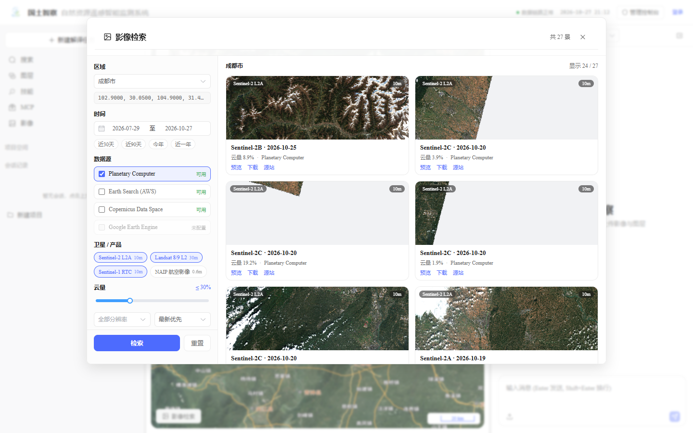
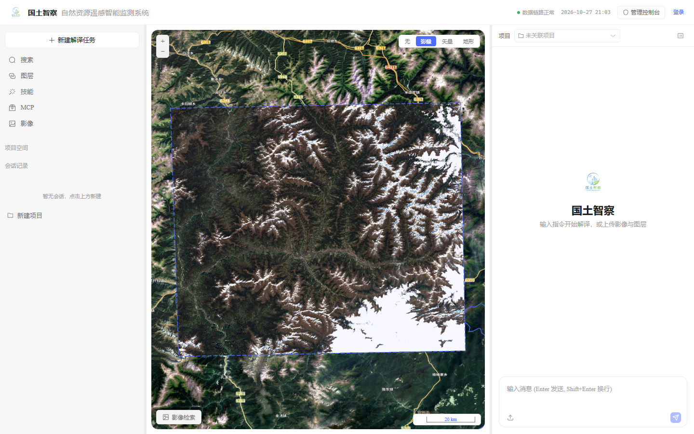
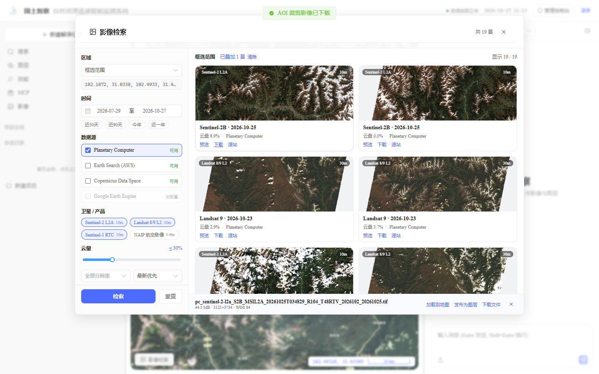
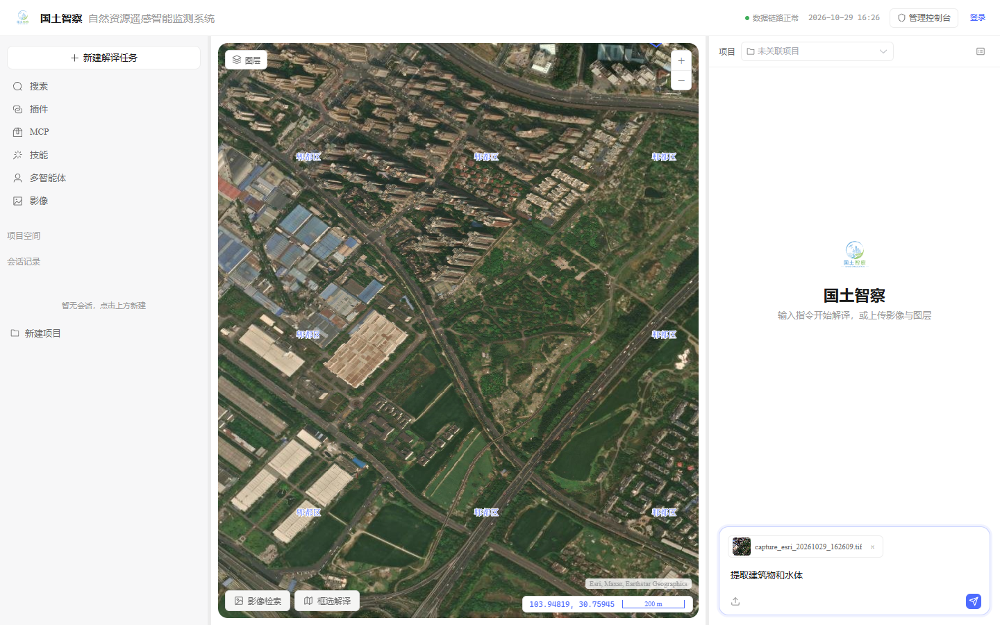
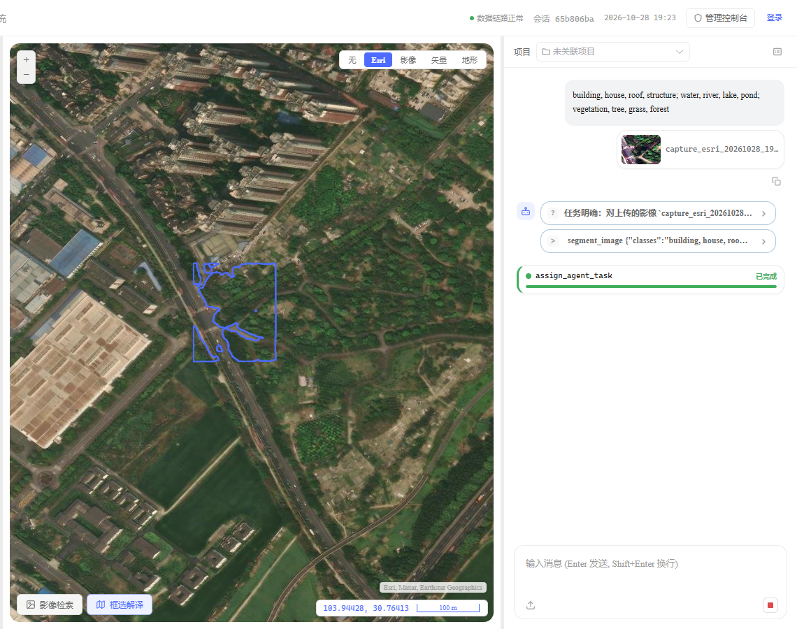
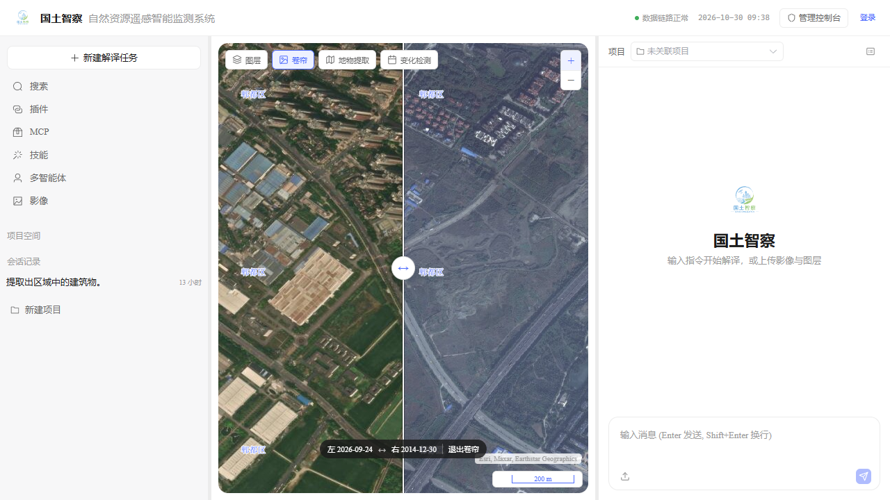
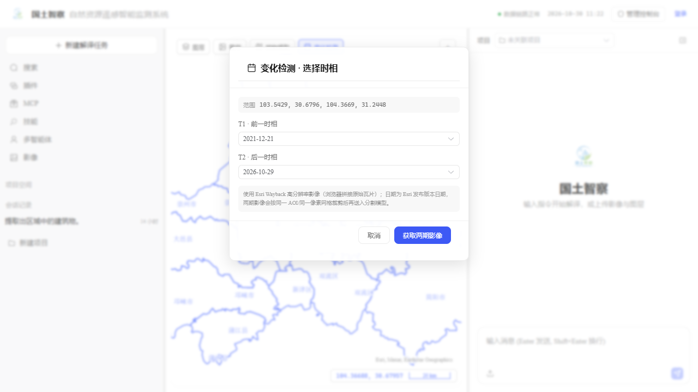
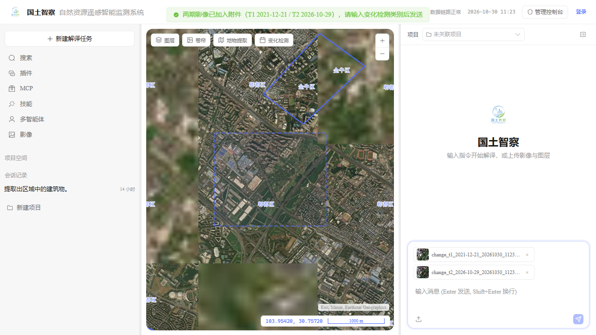

# 开源遥感影像检索与下载

> 面向「按时间 + 区域筛选高分辨率遥感影像」的开放数据接入说明。
> 代码：`backend/data/imagery/`、`backend/api/imagery.py`、`frontend-vue/src/components/map/ImagerySearchDialog.vue`。

---

## 一、结论先说

| 需求 | 现实情况 |
|---|---|
| 全球免费、可编程、免翻墙 | **Sentinel-2 L2A 10m**（约 5 天重访）是最优选择；Sentinel-1 10m 雷达可全天候 |
| 30m 长时序 | Landsat 8/9 L2（1982 年至今） |
| 亚米级（0.5–2m） | 全球开放的只有美国 **NAIP 0.6m**；中国境内没有免登录、可批量下载的亚米级开放 API |
| 国内亚米级 | 天地图影像（已作为底图，无时间维度）、中国资源卫星应用中心/商业卫星（需账号或采购） |
| Google Earth Engine | 可作兜底，但需要 Google 账号 + 服务账号密钥 + 科学上网，默认不启用 |

因此系统把「开放、免密钥、中国可直连」的数据源放在第一位，GEE 只作为可选兜底，不阻塞主流程。

---

## 二、已接入数据源

| key | 名称 | 检索 | 地图瓦片 | AOI 裁剪下载 | 账号 |
|---|---|---|---|---|---|
| `pc` | Microsoft Planetary Computer | ✅ | ✅ | ✅ GeoTIFF | 免密钥 |
| `es` | AWS Earth Search | ✅ | — | — | 免密钥 |
| `cdse` | Copernicus Data Space | ✅ | — | 整景请到 Copernicus Browser | 免费账号（仅下载） |
| `gee` | Google Earth Engine | ✅* | ✅* | ✅* | 服务账号 + 科学上网 |

\* GEE 需本机安装 `earthengine-api` 并配置服务账号，默认显示「未配置」。

### 集合（卫星/产品）

| 数据源 | 集合 | 分辨率 | 说明 |
|---|---|---|---|
| `pc` | `sentinel-2-l2a` | 10m | 多光谱，全球，默认首选 |
| `pc` | `landsat-c2-l2` | 30m | 长时序 |
| `pc` | `sentinel-1-rtc` | 10m | 雷达，全天候 |
| `pc` | `naip` | 0.6m | 航空影像，仅美国本土 |
| `es` | `sentinel-2-l2a` / `sentinel-1-grd` / `landsat-c2-l2` | 10–30m | AWS 开放数据目录 |
| `cdse` | `sentinel-2-l2a` / `sentinel-1-grd` | 10m | 欧空局官方分发 |
| `gee` | `sentinel-2-l2a` / `landsat-c2-l2` | 10–30m | 在线计算，可选 |

---

## 三、使用方式（用户端）

入口只有一个：

1. 左栏工具行 **「影像」**。

> 影像检索按钮统一在左栏「影像」；地物提取、双时相、变化检测统一在左上角工具条。

弹窗内：

1. **区域**：成都市 / 四川省 / 当前地图范围 / 框选范围（收起弹窗，在地图上拖一个矩形）；
2. **时间**：日期区间 + 近 30 天 / 近 90 天 / 今年 / 近一年；
3. **数据源**：可多选；「未配置」的源置灰；
4. **卫星 / 产品**：按已选数据源联动；
5. **云量**：0–100% 双端范围（默认 0–30%），STAC 查询使用 `eo:cloud_cover` 的 `gte/lt`；
6. **高级筛选**：平台（Sentinel-2A/2B/2C、Landsat 8/9、Sentinel-1A/1B）、处理级别（L1C/L2A）、轨道方向（升轨/降轨）、太阳高度角（≥15°/30°/45°）；
7. **分辨率 / 排序**：全部或 ≤1/10/30m；最新优先 / 云量最少 / 分辨率最高；
8. 点 **检索**，结果卡片显示快视图、日期、云量、分辨率、数据源；
9. **预览**：把该景 XYZ 瓦片叠加到地图，并画出景范围虚线（关闭弹窗看地图）；在地图上点击预览影像，弹出该景元信息（景号 / 日期 / 云量 / 数据源）；
10. **下载**：按当前范围裁剪 GeoTIFF（默认上限 0.5°²，约 70km × 70km）；
11. 下载完成后可 **加载到地图**、**发布为图层**（GeoServer `cd_raster`）、**下载文件**。

> 范围超过上限时，下载按钮会提示先「框选范围」；这是为了避免一次拉取整景（数百 MB 到 GB）。







### 3.1 高分底图与地物提取

底图**固定使用 Esri World Imagery**（城市区域约 0.3–0.6m，免翻墙），不再提供底图切换；右下角显示 `Esri, Maxar, Earthstar Geographics` 署名。Esri 不可达时框选抓图会自动回退天地图。

**地物提取**（原「区域选择」/「框选解译」）入口在左上角工具条第 3 项：

1. 点 **地物提取**，在地图上拖一个矩形；
2. 松开鼠标后先进入**待确认**状态：虚线框保留，顶部提示「已选择区域 · Enter 确定 · Esc 取消」；
3. 按 **Enter** 确认后才抓图；按 **Esc** 取消并清除虚线框，需要重新绘制；
4. **不弹窗**：后端按 bbox 以 **0.3m 最高分辨率 Esri** 抓图，影像直接加入右侧输入框附件，并发布到 `cd_raster` 图层管理；
5. 在聊天框输入自然语言类别，例如：`提取建筑物和水体`、`找出温室大棚和光伏板`；
6. 发送消息；Agent 做**意图识别和类别转换**（中文/自然语言 → 英文类别 + 英文同义词），调用 `segment_image`；
7. 结果以矢量/掩膜回显在地图；可继续追问或重新框选。

> 类别不再由弹窗选择。Agent 转换示例：`提取建筑和水体` → `building, house, roof, structure; water, river, lake, pond`；`找出温室大棚` → `greenhouse, plastic roof, glasshouse`。首类自动补 `background`，由 ProC-SAM3 做开放词汇分割。
>
> 地图左上角为工具条：「图层」「卷帘」「地物提取」「变化检测」从左到右排列；右上角只有放大/缩小；地图左下 `清除影像 N` 可关闭全部影像预览图层。





实现要点：

| 项 | 内容 |
|---|---|
| 接口 | `POST /api/v1/imagery/capture`，`{source, bbox, target_gsd}` |
| Esri | 官方 `World_Imagery/MapServer/export`，`png32` 解码后自行写 GeoTIFF（EPSG:4326） |
| 天地图 | `img_w` WMTS 瓦片拼接（EPSG:3857）；浏览器端 Key 需带 Referer/Origin，建议申请服务端 Key |
| 兜底 | Esri 连接失败时自动改用天地图，返回 `fallback` 字段，前端提示 |
| 限制 | 单次面积 ≤0.02°²；输出边长 ≤1024px（6GB 显存下单次分割约 1–2 分钟） |
| 底图叠加 | 地物提取不再叠加原图 WMS，避免白色底图块遮挡；地图沿用 Esri/天地图底图 + 矢量结果 |
| 署名 | Esri 底图需保留 `Esri, Maxar, Earthstar Geographics`；天地图需保留「天地图」 |

> 说明：Esri World Imagery 为商业底图，正式生产前请确认 Esri 授权与导出/存储条款；天地图请遵守其服务条款，避免批量抓取。

### 3.2 卷帘对比（Esri Wayback）

**底图也能在「图层」里改**：左上角「图层」浮层现在是两个层级 —— `底图` 与 `工作空间`。

1. `底图`：可切 Esri 影像 / 天地图影像 / 天地图矢量 / 天地图地形 / 无底图；选 Esri 时还能再选 **时相**：`最新影像（无单一日期）` 或某个 Wayback 年度版本（2014–2026，每年取最新一版），直接作为当前底图显示历史影像；
2. `工作空间`：GeoServer 图层树（显隐 / 定位 / 删除）。

底图选择记在本机（localStorage），刷新或重进工作台后保持；地图默认仍是 **Esri 最新影像**，不再在挂载时静默替换成 Wayback —— 历史影像不可达时整张底图会空白。切换失败或 Wayback 瓦片加载失败时，面板与卷帘会给出可读提示。

**当前 Esri 底图没有单一日期**：`World_Imagery` 是全球影像镶嵌，同一屏可能混合多年份、多来源影像，服务本身只保证“最新可用”。需要两个时相时，使用 Esri **Wayback** 历史版本。

入口：地图左上角工具条 **「卷帘」**（「图层」右侧）。

1. 打开面板，选择 **左侧时相** 与 **右侧时相**；下拉按年份收敛（2014–2026，每年取该年最后一个发布版本）；
2. 点 **开启卷帘**：左右两张 Wayback 瓦片叠加，地图中间出现白色分隔线；
3. 左右拖动分隔线查看两个时相；底部状态条显示 `左 2026-10-29 ↔ 右 2014-12-30`；
4. 点 **退出卷帘** 移除对比层。

实现要点：

| 项 | 内容 |
|---|---|
| 版本清单 | 浏览器依次探测 `wayback-a` / `wayback-b` / 主域 `wayback.maptiles.arcgis.com`，取首个可达域的 `.../World_Imagery/MapServer?f=json`，按 `Selection` 解析日期与 release 号；底图时相与卷帘共用同一份清单 |
| 瓦片 | `https://wayback-a.maptiles.arcgis.com/.../WMTS/1.0.0/default028mm/MapServer/tile/{release}/{z}/{y}/{x}`，EPSG:3857，与 3857 视图同投影（不重投影）；`wayback-a` 不可达时自动换 `wayback-b` |
| 换底图保护 | 选日期时先加载一张低层级瓦片探活（失败重试 1 次），探活通过才移除当前 Esri 底图；不可达则保持当前影像并给出提示，不会把地图切成空白 |
| 卷帘 | `useSwipeCompare`：读取分隔线的 CSS 像素中心，经 `getRenderPixel` 换算成画布设备像素后 `clip()`，`postrender` 恢复 |
| 高 DPI | `prerender` 的 canvas 是设备像素坐标；Windows 125%/150% 缩放下必须用 `getRenderPixel(event, cssPixel)`，直接传 CSS 像素会让接缝整体偏左 |
| 灰色垫层 | 开启卷帘时在两张瓦片下铺浅灰（zIndex 5.5）：某时相在该处没有瓦片就显示灰色，**不会透出最新底图**，避免“过渡位置不在分隔线”的错觉 |
| 错误判定 | 只有**一整侧都没加载到任何瓦片**才提示（并区分左右）；局部 404 交给灰色垫层，不再一个缺口就报“加载失败” |
| 瓦片重试 | `utils/tileLoader.js`：图片失败退避重试（Esri 底图 2 次、Wayback/预览 1 次），缓解代理 SSL EOF 造成的随机缺块 |
| 图层层级 | 底图 zIndex 0；Wayback 层 zIndex 6/7，位于底图之上、市界/解译矢量之下；开启时清除会遮挡对比的检索预览层 |
| 兜底 | 清单接口不可达时使用内置年度快照（13 个版本），并在面板提示；瓦片仍直连 Esri |
| 缓存 | 版本清单 localStorage 缓存 6 小时；瓦片走浏览器 HTTP 缓存；旧版底图 Service Worker 会在 `main.js` 注销并清缓存 |

> **2026-10-30 实测**：主域 `wayback.maptiles.arcgis.com` 在本机被 DNS 污染/重置，`wayback-a`、`wayback-b` 可直连；清单共 **198 个发布版本**，最新 `2026-10-29 / m=43291`。选 2021 版底图时服务端会 301 到实际 release（如 `26120 → 32645`），浏览器跟随重定向后正常出图。2022–2024、2017–2018、2014–2016 在成都**共用同一景**（瓦片字节相同），所以这些年份互相切换看不出变化。

> **日期含义**：Wayback 日期是**版本发布日期**，不是单景成像日期；不同地区可用版本、覆盖范围与分辨率不同，局部可能仍是旧影像或低分辨率。需要“真实成像日期”的双时相，请用「影像」检索 Sentinel-2 / Landsat，按 `datetime` 选两景，再叠加对比。



### 3.3 变化检测：选区 + 两个时相

入口：地图左上角工具条第 4 项 **「变化检测」**，流程与「地物提取」一致，只多一步时相选择。

1. 点 **变化检测**，在地图上拖出 AOI；
2. 弹窗选择 **T1 前一时相**、**T2 后一时相**（Esri Wayback 年度版本；默认 T1 约 5 年前、T2 最新）；
3. 点 **获取两期影像**：
   - 浏览器直接读取 Wayback 高清瓦片；
   - 按同一 AOI、同一瓦片层级/像素网格拼接两张 PNG；
4. 两张 PNG 上传 `/api/v1/imagery/georeference`，按精确 bbox 写成带 CRS 的 GeoTIFF；
5. 两期 GeoTIFF 进入右侧聊天附件，输入框自动聚焦；
6. 输入类别（如“检测建筑变化”或“building, house, roof”）后发送；Agent 调 `detect_change`；
7. 变化结果以变化图斑 / 图例叠加地图，并生成报告入口。

取图规则：

| 项 | 内容 |
|---|---|
| 数据源 | **Esri Wayback 高分辨率影像**（与「卷帘」共用同一份版本清单） |
| 时相 | 2014–2026 每年一个发布版本；日期为 Esri 版本发布日期 |
| 分辨率 | 浏览器原生瓦片，最高约 0.3–0.6m（具体随地区/年份变化） |
| 输出 | 单期 PNG 拼接上限 1200px、最多 100 张瓦片；两期使用同一 bbox/像素网格 |
| 配准 | `POST /api/v1/imagery/georeference`，PNG + bbox → EPSG:3857 GeoTIFF |
| 范围 | ≤0.02°²（与地物提取一致） |

算法链路（参考 SegEarth-OV3 思路）：

```text
T1/T2 两期影像
  → 分割模型分别得到两期类别掩膜（默认 ProC-SAM3；legacy 回退 SegEarth-OV3）
  → 连通域提取实例
  → T1×T2 实例 IoU 匹配
  → 未匹配 T1=消失、未匹配 T2=新增、匹配但类别不同=类别变化
  → 变化掩膜 → 统计 / 类别转移矩阵 / 变化图斑矢量
```

> 变化检测使用 **Esri Wayback 高清影像**，不再使用 Sentinel-2。Wayback 日期是**版本发布日期**，不是单景成像日期；不同地区/年份可能无覆盖或分辨率不一致。两期影像必须使用同一 AOI 与同一瓦片计划，否则变化对比会错位。





### 3.4 底图渲染性能与瓦片缓存

**现象**：底图平移/缩放时卡顿，瓦片出现慢，同一区域反复浏览仍要等。

**根因**：

1. 视图是 `EPSG:4326`，而 Esri / Esri Wayback / 天地图瓦片都是 `EPSG:3857`：OL 必须对**每张瓦片做一次重投影**（逐瓦片 canvas 重采样），这是渲染卡顿的主因（业务 WMS 也被按 4326 请求，同样多一次重投影）；
2. 瓦片源用默认参数（`transition` 淡入、`cacheSize` 512），回看/小幅平移容易重新请求；
3. 只有浏览器 HTTP 缓存，容量和保留时间不可控，刷新后经常重新拉取。

**优化**：

| 项 | 做法 | 收益 |
|---|---|---|
| 视图投影 | 地图视图改为 `EPSG:3857`，与所有瓦片同投影；经纬度展示仍由 MousePosition 转 4326，框选/定位 bbox 在边界统一转换 | 底图、卷帘、影像预览瓦片不再逐块重投影；WMS 按 `SRS=EPSG:3857` 请求（GeoServer 侧投影），客户端只剩矢量一次转换 |
| 瓦片参数 | `transition: 0`、`cacheSize: 1024`、`useInterimTilesOnError` | 去掉淡入重绘；回看/平移复用内存瓦片；缩放时先用上一级瓦片顶住，减少空白 |
| 浏览器持久缓存 | `public/basemap-cache-sw.js`（Service Worker，缓存名 `rsiis-tiles-v2`）：只拦截 Esri 影像与 Wayback 瓦片，cache-first 写入 Cache Storage，只缓存 `image/*` 且非空的响应（防止把代理错误页缓存成坏图），2500 张上限、30 天过期、LRU 淘汰，回源失败时退回过期瓦片 | 同一区域第二次浏览/刷新直接命中本地，不再走公网；图层面板「底图」下显示缓存张数并可清理 |
| 瓦片重试 | `utils/tileLoader.js`：图片加载失败按 0.8s / 1.6s 退避重试（Esri 底图 2 次、Wayback 与预览 1 次） | 代理偶发 SSL EOF / 连接重置时自动补拉，不再整块空白 |
| 天地图 | 暂不接管（浏览器 Key 按 Referer 校验，SW 回源可能丢 Referer 导致 403） | 避免把可用底图改坏 |

**可选（多终端/生产）**：在 nginx 用 `proxy_cache_path` 反代 Esri 瓦片做服务端共享磁盘缓存；或在 Python 增加 `/api/v1/basemap/tile` 代理。适合内网多终端共享同一份缓存，但首块瓦片会多一跳服务端，单机场景不如浏览器缓存直接。

> 实测：GeoServer `cd_shp:chengdushi`、`cd_raster:*` 在 `SRS=EPSG:3857` 下 GetMap 均返回 200，WMS 改为 3857 请求无需额外配置。

---

## 四、REST 契约

### 1）数据源清单

`GET /api/v1/imagery/providers`

```json
{
  "status": "success",
  "max_area_deg2": 0.5,
  "providers": [
    {
      "key": "pc",
      "label": "Planetary Computer",
      "configured": true,
      "auth": "none",
      "supports": {"search": true, "tiles": true, "clip": true, "download": true},
      "collections": [{"key": "sentinel-2-l2a", "label": "Sentinel-2 L2A", "gsd": 10}]
    }
  ]
}
```

### 2）检索

`POST /api/v1/imagery/search`

```json
{
  "providers": ["pc", "es", "cdse"],
  "collections": ["sentinel-2-l2a"],
  "bbox": [103.6, 30.5, 104.3, 31.0],
  "start": "2026-07-01",
  "end": "2026-10-27",
  "cloud_max": 30,
  "max_gsd": 10,
  "limit": 24,
  "sort": "date_desc"
}
```

返回统一归一化 item：

```json
{
  "provider": "pc",
  "collection": "sentinel-2-l2a",
  "id": "S2B_MSIL2A_...",
  "satellite": "Sentinel-2B",
  "datetime": "2026-10-25T03:48:29Z",
  "cloud_cover": 2.9,
  "gsd": 10,
  "bbox": [103.9, 30.6, 105.0, 31.5],
  "footprint": {"type": "Polygon", "coordinates": []},
  "thumbnail": "/api/v1/imagery/thumbnail?provider=pc&...",
  "tile_url": "https://planetarycomputer.microsoft.com/api/data/v1/item/tiles/WebMercatorQuad/{z}/{x}/{y}@1x?...",
  "downloadable": true,
  "download_mode": "clip",
  "source_url": "..."
}
```

- `errors`：某个源失败时返回 `{provider: message}`，不影响其他源；
- 结果跨源合并后按 `sort` 排序，`limit` 截断，`total` 为截断前数量。

### 3）快视图代理

`GET /api/v1/imagery/thumbnail?provider=pc&collection=sentinel-2-l2a&item=...&w=480`

- 服务端拉取（PC 用 `max_size` 等比缩放），落盘缓存到 `agent-files/imagery/thumbs/`；
- 缓存 TTL 默认 24h（`IMAGERY_THUMBNAIL_TTL`）；
- 只允许数据源内部资产 URL，不接受任意 URL，避免 SSRF。

### 4）AOI 裁剪下载

`POST /api/v1/imagery/download`

```json
{
  "provider": "pc",
  "collection": "sentinel-2-l2a",
  "item": "S2B_MSIL2A_...",
  "bbox": [103.95, 30.64, 104.05, 30.72]
}
```

返回：

```json
{
  "status": "success",
  "file_name": "pc_sentinel-2-l2a_....tif",
  "file_path": "E:/.../agent-files/imagery/downloads/....tif",
  "rel_path": "imagery/downloads/....tif",
  "download_url": "/api/v1/download/imagery/downloads/....tif",
  "size_bytes": 1361470,
  "bbox": [103.945, 30.64, 104.0, 30.7],
  "width": 561,
  "height": 606,
  "band_count": 4,
  "crs": "EPSG:4326",
  "resolution": 10.9,
  "layer_name": "pc_sentinel-2-l2a_...",
  "workspace": "cd_raster",
  "registered": true
}
```

- 下载的是 **AOI 裁剪后的 GeoTIFF**（不是整景），可直接进入解译/发布流程；
- 同步写 `image_metadata`（`workspace=cd_raster`），并生成同名 `.json` 溯源文件（STAC item + 查询范围）；
- 超过面积/大小上限直接拒绝，返回 `{status:"error", msg}`。

---

## 五、配置项

全部集中在 `backend/config.py`，可用环境变量覆盖：

| 环境变量 | 默认 | 说明 |
|---|---|---|
| `IMAGERY_ENABLED` | `true` | 关闭后 `/api/v1/imagery/*` 报错 |
| `IMAGERY_HTTP_TIMEOUT` | `45` | 外部 API 超时（秒） |
| `IMAGERY_THUMBNAIL_TTL` | `86400` | 快视图缓存 TTL（秒） |
| `IMAGERY_DOWNLOAD_MAX_MB` | `300` | 单次下载大小上限 |
| `IMAGERY_DOWNLOAD_MAX_AREA_DEG2` | `0.5` | 单次裁剪面积上限（平方度） |
| `IMAGERY_SEARCH_MAX_ITEMS` | `60` | 跨源合计上限 |
| `IMAGERY_CAPTURE_MAX_AREA_DEG2` | `0.02` | 框选取图面积上限 |
| `IMAGERY_CAPTURE_MAX_SIZE` | `1024` | 取图输出边长上限（像素） |
| `IMAGERY_CAPTURE_MAX_TILES` | `144` | 天地图拼接瓦片数上限 |
| `TIANDITU_KEY` | 内置浏览器 Key | 天地图 Key（建议换服务端 Key） |
| `TIANDITU_REFERER` | `http://127.0.0.1:5173/` | 天地图 Key 的 Referer 校验 |
| `GEE_SERVICE_ACCOUNT` / `GEE_KEY_FILE` / `GEE_PROJECT` | 空 | GEE 兜底源 |

### 启用 GEE（可选）

```powershell
pip install earthengine-api
$env:GEE_SERVICE_ACCOUNT="xxx@xxx.iam.gserviceaccount.com"
$env:GEE_KEY_FILE="E:\path\to\key.json"
$env:GEE_PROJECT="your-project"
# 需能访问 Google（科学上网）
```

未配置时前端显示「未配置」，不影响其他数据源。

---

## 六、实现要点

- **PC 跨集合检索限制**：Planetary Computer 不允许一次请求混合不同后端的 collection（会 400），因此按集合拆分并发子请求，单集合失败不影响其他集合。
- **PC 瓦片参数**：Sentinel-2 用 `visual|1,2,3`；Landsat 多资产必须重复 `assets=red&assets=green&assets=blue`（逗号形式会被判非法）。
- **ES 时间格式**：Earth Search 只接受严格 RFC3339（`...T00:00:00Z`），不能用纯日期。
- **CDSE 快视图**：STAC 的 `thumbnail` 指向 CREODIAS，返回 `application/octet-stream`，代理按文件头识别 PNG/JPEG。
- **瓦片 404**：景边界外的瓦片 PC 返回 404，前端对图层设置 `extent` 后不再请求。
- **坐标系**：PC 裁剪产物为 EPSG:4326；`image_metadata.resolution` 统一换算为米。
- **命名**：下载文件名为 `{provider}_{collection}_{item}_{日期}.tif`，清洗为非字母数字下划线，避免路径注入。
- **鉴权**：`/api/v1/imagery/*` 与 Python 其他端点一致，当前未在 Python 侧校验 JWT；生产由网关/Java 统一鉴权，或后续补 token 校验。
- **GEE**：代码路径已实现，但本机未配置服务账号，未做真实网络验证；启用前请先跑 `GET /providers` 确认 `configured=true`。
- **PROJ 冲突**：本机 `PROJ_LIB` 可能指向 PostGIS 旧 `proj.db`（LAYOUT.MINOR=2），写 GeoTIFF 会报 `OGR Error code 6`；`backend/config.py` 已在 rasterio 导入前切到其自带 `proj_data`。
- **Esri 导出格式**：`format=tiff` 的内嵌 WKT 与旧 PROJ 冲突，改用 `png32` 解码后自行写 GeoTIFF。
- **地物提取底图**：输入来自底图截图时不再发布/叠加原图 WMS，避免白色块遮挡；只保留矢量结果。
- **性能**：6GB 显存下单次 1024px 左右的分割约 1–2 分钟；框选过大或 0.3m 会显著变慢，建议 0.5–1m + 小范围。

---

## 七、验证

```powershell
# 数据源
Invoke-RestMethod http://127.0.0.1:8020/api/v1/imagery/providers

# 检索（成都，近三个月，云量 ≤30%）
$body = @{ providers=@('pc'); bbox=@(103.6,30.5,104.3,31.0); start='2026-07-01'; end='2026-10-27'; cloud_max=30; limit=5 } | ConvertTo-Json
Invoke-RestMethod http://127.0.0.1:8020/api/v1/imagery/search -Method POST -ContentType 'application/json' -Body $body

# 离线回归
python tests\imagery_test.py     # 输出 imagery: PASS

# UI 冒烟（需 Python/Vite 已启动）
node scripts\imagery-check.mjs   # 产物 .tmp/imagery-0*.png
```

---

## 八、许可与引用

- Sentinel / Landsat / NAIP 等为公开开放数据，使用时遵循各分发平台许可（Copernicus、USGS、AWS Open Data、Microsoft Planetary Computer）。
- 系统只在检索结果中展示来源与源站链接；下载产物用于内部解译，不改变原始数据许可。
- 商业卫星（高分、吉林一号、Planet 等）不在此接入范围，需单独采购或申请政务账号。
