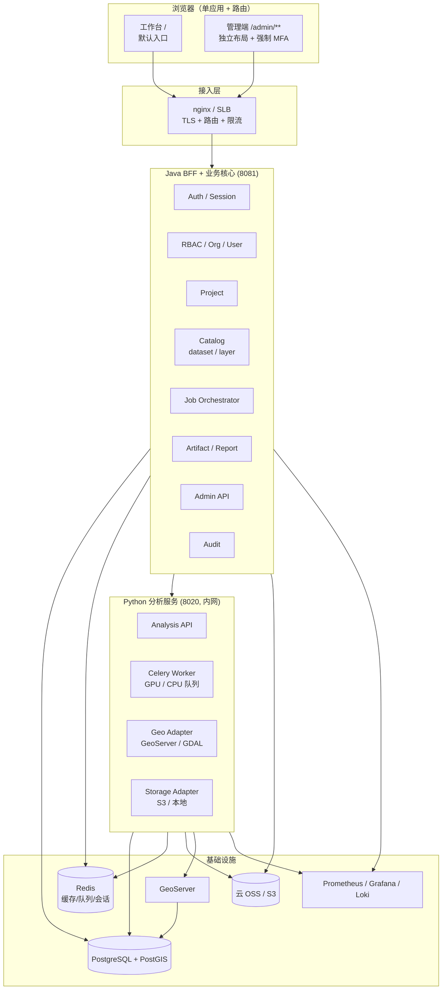
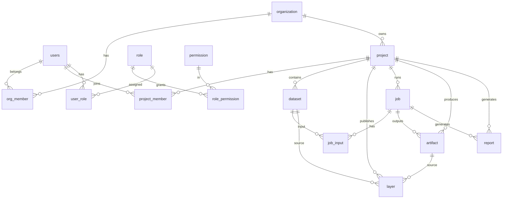

# 生产级双门户架构设计（V1 草案）

> 范围：多用户权限 + 用户端 + 管理端 + 生产部署。
>
> **已确认决策（2026-10-27）**：单组织、管理端强制 MFA、云 OSS（S3 兼容）、Celery + Redis；
> **用户端沿用现有工作台**（Agent 对话 + 地图 + 图层管理），不再新建用户端 SPA；
> 工作台与管理端**同属一个前端应用，用 Vue Router 分流**：`/` 工作台（默认），`/admin/**` 管理端。
>
> 结论先行：不要把“管理端”做成用户端多几个按钮。管理端**独立布局、独立守卫、独立登录**，与工作台共用同一套 Core API：
> - 工作台 `/`：会话 + 地图 + 图层 + Copilot，项目/数据/任务等按需嵌入；
> - 管理端 `/admin/**`：用户/组织/角色、全量项目、数据治理、图层服务、任务与模型、存储配额、审计、系统设置；
> - 后端 Java 做 BFF + 业务核心，Python 做分析/地理能力，二者只在内网通信；
> - 权限在后端强制，前端只做“可见性/禁用态”，不能作为安全边界。

---

## 一、设计目标与边界

### 1.1 目标

1. **多用户**：注册/邀请、登录、禁用、会话管理、密码策略。
2. **多角色/细粒度权限**：系统管理员、组织管理员、项目管理员、分析员、只读访客；权限可组合。
3. **单组织部署**：已确认一期只做单组织；表结构保留 `org_id` 作为未来扩展点，但不做多租户切换 UI/计费。
4. **两套门户**：用户端做业务闭环；管理端做治理与运维，功能明显更多。
5. **生产可运维**：异步任务、对象存储、审计、监控、备份、灰度、回滚。
6. **Agent 可插拔**：Agent 只是用户端的一个 Copilot，不进入管理端权限边界。

### 1.2 非目标（一期不做）

- 不做计费/商业化结算（可预留 quota）。
- 不做跨区域多活（先单区域主备）。
- 不做复杂 BPM/工作流引擎（Job 状态机足够）。
- 不做移动端原生 App（先响应式 Web）。

---

## 二、总体架构



### 2.1 服务职责

| 服务 | 职责 | 对外 |
|---|---|---|
| **nginx/SLB** | TLS、`app.` / `admin.` 两个子域分流、静态资源、限流、上传大小限制 | 是 |
| **Java BFF** | 登录/JWT/刷新、用户/组织/RBAC、项目、数据目录、图层目录、任务编排、产物/报告索引、管理端 API、审计 | 是（仅 `/api/v1/**`） |
| **Python Analysis API** | 数据解析/预览、GeoServer 发布、分析任务执行入口 | 否（仅 `/internal/**`） |
| **Celery Worker** | GPU 分割/变化检测、CPU 预处理/报告/清理 | 否 |
| **GeoServer** | WMS/WFS/WCS 渲染与发布 | 仅经 Java/Python 代理 |
| **PostgreSQL** | 业务/空间/任务/审计元数据 | 否 |
| **Redis** | 缓存、限流、Celery broker、refresh token 黑名单 | 否 |
| **云 OSS / S3** | 原始影像、产物、报告、导出包 | 仅签名 URL |

### 2.2 为什么是 Java BFF + Python Worker

- 现有 Java 已有认证/项目/工作区，适合承担用户、权限、项目、目录、任务编排；
- Python 有 GDAL/rasterio/geopandas/SAM3，适合做地理与模型执行；
- 两者边界清晰：**Java 管“谁、什么项目、什么任务”，Python 管“怎么算、怎么落盘、怎么发布”**。
- 不建议把 GDAL/ML 搬进 Java，也不建议让 Python 承担用户/权限/审计。

---

## 三、组织与权限模型（单组织）

### 3.1 租户模型（单组织）

已确认一期为单组织部署；所有表保留 `org_id`，默认写入同一个组织，未来才启用多组织：

```text
organization (租户)
  ├── org_member (user_id, org_role)
  └── project
        ├── project_member (user_id, project_role)
        └── dataset / job / artifact / layer / report
```

- 所有业务表带 `org_id`；项目内资源带 `project_id`。
- 服务层统一从 JWT 取 `user_id/org_id`，**不再接受前端传 user_id**。
- 防御纵深：关键表可启用 PostgreSQL RLS（可选，二期）。

### 3.2 角色模板

| 角色 | 范围 | 典型权限 |
|---|---|---|
| `system_admin` | 全局 | 全部管理端权限；用户/组织/系统设置/审计 |
| `org_admin` | 组织 | 本组织用户、项目、配额、审计 |
| `project_admin` | 项目 | 项目成员、数据、任务、图层、报告 |
| `analyst` | 项目 | 上传数据、创建任务、查看结果、生成报告 |
| `viewer` | 项目 | 只读项目数据/结果/报告 |
| `guest` | 分享链接 | 仅指定资源只读（可选） |

> 单组织一期建议收敛为 **system_admin / project_admin / analyst / viewer** 四个内置角色；`org_admin` 保留为未来多组织/运营角色的占位，一期可不启用。

### 3.3 权限点（字符串）

```text
project:create / project:read / project:update / project:delete / project:member
dataset:upload / dataset:read / dataset:delete / dataset:publish
layer:read / layer:publish / layer:update / layer:delete
job:create / job:read / job:cancel / job:retry
artifact:read / artifact:download / artifact:publish
report:create / report:read / report:download
user:manage / role:manage / org:manage
system:config / audit:read / storage:manage / model:manage
```

### 3.4 权限判定

- 后端统一 `@PreAuthorize("hasPermission('dataset:upload', #projectId)")` 或自定义 `PermissionEvaluator`。
- 数据级：先校验 `org_id`，再校验 `project_member`，最后校验资源归属。
- 管理端接口额外要求 `aud=admin` 的 token + `system_admin/org_admin` 角色。
- 前端只根据 `/api/v1/me/permissions` 做菜单/按钮显隐；**不作为安全边界**。

### 3.5 认证与会话

| 项 | 设计 |
|---|---|
| 密码 | Argon2id 或 BCrypt；最小长度/复杂度；禁止弱口令 |
| 登录 | 用户名/邮箱 + 密码；失败限流；连续失败锁定 |
| Access Token | JWT，15–30 分钟，`aud=user|admin`，含 `uid/org/roles/perms_version` |
| Refresh Token | 7–14 天，旋转，服务端存哈希；支持“退出所有设备” |
| 会话 | Redis 记录 refresh 家族/设备/IP；禁用用户立即失效 |
| 管理端 | 独立 `aud=admin`；**强制 MFA**（TOTP，后续可扩展短信/WebAuthn）；可选 IP 白名单 |
| SSO | 预留 OIDC（企业微信/钉钉/Azure AD） |

> 当前 `JwtService` 只有 HS256 + 24h 单 token，生产需升级为 access/refresh + 轮换 + 黑名单，并把 `role` 扩展为 `roles/permissions_version`。

---

## 四、数据模型

### 4.1 核心 ER



### 4.2 表清单

**身份/权限**

| 表 | 关键字段 |
|---|---|
| `organization` | id, name, code, status, quota_jsonb, created_at |
| `users` | id, org_id, username, email, password_hash, status, mfa_enabled, last_login_at, created_at |
| `org_member` | org_id, user_id, role, status |
| `role` | id, code, name, scope(system/org/project), builtin |
| `permission` | code, name, module |
| `role_permission` | role_id, permission_code |
| `user_role` | user_id, role_id, project_id(可空), org_id |
| `refresh_token` | id, user_id, token_hash, family_id, expires_at, revoked_at, device |
| `login_attempt` | username, ip, success, created_at（限流/审计） |

**业务**

| 表 | 关键字段 |
|---|---|
| `project` | id, org_id, owner_id, name, description, status, tags, bbox, cover_uri, folder_path, created_at |
| `project_member` | project_id, user_id, role, joined_at |
| `dataset` | id, org_id, project_id, name, kind, format, storage_uri, crs, bbox, width/height/bands, feature_count, size_bytes, checksum, source, status, created_by |
| `layer` | id, org_id, project_id, dataset_id/artifact_id, workspace, name, type, style_id, visible, published_at |
| `job` | id, org_id, project_id, type, status, progress, params, input_dataset_ids, output, error, source(manual/agent), agent_run_id, parent_job_id, created_by, started_at, finished_at |
| `job_event` | id, job_id, event_type, payload_jsonb, created_at（也可只写日志） |
| `artifact` | id, org_id, project_id, job_id, type, storage_uri, format, crs, spatial/temporal/business/lineage/quality, checksum, created_at |
| `report` | id, org_id, project_id, job_id, template, storage_uri, status, version, created_at |

**治理/运维**

| 表 | 关键字段 |
|---|---|
| `audit_log` | id, org_id, actor_id, action, resource_type, resource_id, before_jsonb, after_jsonb, ip, ua, request_id, created_at |
| `system_config` | key, value_jsonb, scope, updated_by, updated_at |
| `model_config` | id, name, provider, model, params_jsonb, enabled, is_default |
| `quota` | org_id/project_id, storage_bytes, jobs_per_day, gpu_seconds, used_jsonb |
| `notification` | id, user_id, type, title, body, read_at |
| `feature_flag` | key, enabled, rollout_jsonb |

### 4.3 迁移策略

1. 现有 `users` 扩列：`org_id/email/status/mfa_enabled/last_login_at`。
2. 现有 `project` 加 `org_id/status/tags/bbox/cover_uri`。
3. 现有 `image_metadata`/`vector_layer` 迁为 `dataset` 的 `kind` 子类型；保留旧表做 detail/兼容。
4. 现有 `ai_task` 迁为 `job`；`agent` 的推理 trace 留在 `Agent_study`。
5. 现有 `artifact` 加 `org_id/project_id/job_id`；`conversation_id` 可空。
6. 全量回填 `org_id`（默认组织）与 `project_id`（按目录/会话归属）。

> 推荐用 Flyway/Liquibase 管理迁移，禁止线上手工改表。

---

## 五、API 设计

### 5.1 命名空间

| 前缀 | 用途 | 认证 |
|---|---|---|
| `/api/v1/auth/**` | 登录/刷新/登出 | 公开（限流） |
| `/api/v1/me/**` | 当前用户/权限/偏好 | 用户 token |
| `/api/v1/**` | 用户端业务 | 用户 token |
| `/api/v1/admin/**` | 管理端业务 | admin token + 管理角色 |
| `/internal/**` | 服务间 | 内网 + `X-Internal-Token` |

### 5.2 认证

```http
POST /api/v1/auth/login       {username,password} -> {access_token,refresh_token,user}
POST /api/v1/auth/refresh     {refresh_token} -> 新 access/refresh（旋转）
POST /api/v1/auth/logout      {refresh_token}
GET  /api/v1/me               -> {user, orgs, roles, permissions}
```

### 5.3 用户端（节选）

```http
GET    /api/v1/projects
POST   /api/v1/projects
GET    /api/v1/projects/{id}/overview
GET    /api/v1/projects/{id}/datasets
POST   /api/v1/projects/{id}/datasets/upload
POST   /api/v1/datasets/{id}/publish
GET    /api/v1/projects/{id}/layers
POST   /api/v1/projects/{id}/jobs
GET    /api/v1/projects/{id}/jobs
GET    /api/v1/jobs/{id}/events        # SSE
GET    /api/v1/projects/{id}/artifacts
POST   /api/v1/artifacts/{id}/publish
POST   /api/v1/projects/{id}/reports
```

### 5.4 管理端（节选）

```http
GET    /api/v1/admin/overview
GET    /api/v1/admin/users?keyword=&role=&status=
POST   /api/v1/admin/users              # 邀请/创建
PATCH  /api/v1/admin/users/{id}         # 状态/角色/重置密码
POST   /api/v1/admin/users/{id}/revoke-sessions
GET    /api/v1/admin/roles
PUT    /api/v1/admin/roles/{id}/permissions
GET    /api/v1/admin/projects?org_id=&keyword=
POST   /api/v1/admin/projects/{id}/archive
GET    /api/v1/admin/datasets?status=&missing_crs=
POST   /api/v1/admin/maintenance/orphans/scan
GET    /api/v1/admin/layers
POST   /api/v1/admin/layers/{id}/republish
GET    /api/v1/admin/jobs?status=&type=
POST   /api/v1/admin/jobs/{id}/retry|cancel
GET    /api/v1/admin/workers
GET    /api/v1/admin/models
PATCH  /api/v1/admin/models/{id}
GET    /api/v1/admin/storage
POST   /api/v1/admin/storage/cleanup
GET    /api/v1/admin/audit?actor=&action=&from=&to=
GET    /api/v1/admin/settings
PUT    /api/v1/admin/settings
```

### 5.5 统一响应

```json
{ "status": "success", "data": {}, "request_id": "..." }
{ "status": "error", "code": "FORBIDDEN", "msg": "无权限", "request_id": "..." }
```

- 错误码：`UNAUTHORIZED/FORBIDDEN/NOT_FOUND/CONFLICT/VALIDATION/QUEUE_FULL/RATE_LIMITED`。
- 分页：`page/page_size/total`。
- 管理端危险操作要求 `reason` 字段，写审计。

---

## 六、任务与存储

### 6.1 任务队列

```text
Java Job Orchestrator
  → Redis (Celery broker)
    → queue:gpu（分割/变化检测）
    → queue:cpu（预处理/报告/清理）
      → Celery Worker
        → 回写 job 状态/进度/日志/产物
```

- **为什么用 Celery**：重试、路由、并发控制、定时任务成熟；GPU 队列独立，避免报告/清理占 GPU。
- 并发：每 GPU 1 worker；CPU worker 2–4；队列长度上限 + `QUEUE_FULL`。
- 幂等：`job_id` 作为幂等键；重复投递只执行一次。
- 取消：DB 标记 + worker 检查点；强杀进程作为兜底。
- 超时：任务级 `timeout`；GPU OOM 自动降级/重试策略。
- 优先级：管理端可调整队列权重；用户端按组织配额限流。

### 6.2 存储

| 类型 | 方案 |
|---|---|
| 原始影像/产物/报告 | 云 OSS（S3 兼容），按 `org/project/dataset|job` 前缀 |
| 缩略图 | 单独 bucket/前缀，CDN 可选 |
| 元数据 | PostgreSQL |
| 空间图层 | GeoServer + PostGIS/GeoTIFF |
| 下载 | BFF 签发 5–15 分钟签名 URL，前端不拿绝对路径 |

- 本地开发可继续 `agent-files/`（或本地 MinIO）；生产切**云 OSS**，代码统一走 `StorageService` 抽象，业务不感知厂商。
- 生命周期：临时文件 7 天、失败产物 30 天、审计 180 天（可配）。
- 配额：组织/项目存储上限，超限禁止上传并告警。

### 6.3 发布图层

- 发布是 Job（`type=publish`），不是同步接口。
- 成功写 `layer` 表，记录 `workspace/name/style`。
- 失败可重试；删除项目时先取消发布再清存储（异步、可审计）。

---

## 七、安全设计

| 面 | 措施 |
|---|---|
| 传输 | 全站 HTTPS；内网服务不暴露公网 |
| 认证 | access/refresh、旋转、黑名单、管理端 MFA |
| 授权 | RBAC + 项目成员 + 资源归属；后端强制 |
| 上传 | 扩展名/MIME/大小/魔数校验；压缩包解压限制；病毒扫描（可选） |
| 文件 | 签名 URL、短时有效、禁止路径穿越；不返回绝对路径 |
| SSRF | GeoServer/内网地址白名单；禁止用户传任意 URL |
| SQL | 参数化；表名/列名白名单（现有通用 CRUD 要收敛） |
| 管理端 | 独立 token audience、IP 白名单（可选）、危险操作二次确认 + 审计 |
| 审计 | 登录、权限变更、数据下载、任务、发布、删除全记录 |
| 依赖 | CI 扫描 CVE；镜像最小化；非 root 运行 |
| 备份 | PG 每日全量 + WAL；云 OSS 版本化/跨区域复制；GeoServer data dir 备份 |

> 当前 `security.mode=off` 是迁移期开关，生产必须 `enforce`；`study_user` 兜底必须移除。

---

## 八、可观测性与运维

### 8.1 指标

- API：QPS、p95、错误率、401/403、限流。
- 任务：队列长度、等待时间、执行时间、失败率、GPU 利用率/显存。
- 存储：容量、增长、孤儿文件、下载量。
- 业务：日活、项目数、任务数、报告数。
- 审计：管理端操作、异常登录。

### 8.2 日志/Trace

- JSON 结构化日志，带 `request_id/job_id/user_id/org_id`。
- OpenTelemetry：nginx → Java → Python → DB/Redis/OSS。
- 审计日志与运行日志分离，审计只追加、可导出。

### 8.3 SLO（建议）

| 指标 | 目标 |
|---|---|
| 用户端 API 可用性 | 99.5% |
| 读取 p95 | < 300ms |
| 登录 p95 | < 500ms |
| 任务排队 p95 | < 60s（GPU 空闲时） |
| RPO / RTO | 15min / 2h（单区域） |

### 8.4 备份与恢复

- PostgreSQL：每日全量 + WAL 归档；每月恢复演练。
- 云 OSS：版本化 + 跨区域复制；删除保护；生命周期转低频/归档。
- GeoServer：data dir 定时备份；配置即代码（workspace/style 可重建）。
- 配置/密钥：Vault/KMS 或至少加密的环境变量，不进 Git。

---

## 九、两套门户的职责划分

### 9.1 用户端（`/`）

| 模块 | 功能 |
|---|---|
| 项目 | 我的项目、项目总览、成员（项目管理员） |
| 数据 | 上传、目录、预览、发布、删除 |
| 地图 | 项目图层、属性、选区分析 |
| 任务 | 新建分割/变化检测/预处理/发布、进度、日志 |
| 结果 | 产物、下载、发布、对比 |
| 报告 | 生成、预览、下载 |
| 个人 | 资料、密码、会话、通知 |

### 9.2 管理端（`/admin/**`，生产可挂 `admin.example.com`）

| 模块 | 功能 | 用户端是否可见 |
|---|---|---|
| 运营总览 | 用户/项目/任务/存储/告警 | 否 |
| 用户与组织 | 用户 CRUD、邀请、角色、禁用、重置密码、会话、组织 | 否 |
| 角色权限 | 角色模板、权限矩阵、自定义角色 | 否 |
| 项目管理 | 全量项目、归属、配额、归档、转移 | 仅自己的 |
| 数据治理 | 全量数据集、缺 CRS/孤儿文件/重复、保留策略、清理 | 仅自己的 |
| 图层服务 | GeoServer 健康、工作空间、图层、样式、重发布 | 仅项目图层 |
| 任务与模型 | 全量队列、Worker/GPU、模型配置、并发、重试/取消 | 仅自己的任务 |
| 存储与配额 | 容量、组织/项目配额、清理 | 否 |
| 审计日志 | 登录/操作/下载/管理动作，导出 | 否 |
| 系统设置 | 安全策略、SSO、邮件、备份、功能开关、公告 | 否 |

### 9.3 权限差异原则

- 用户端默认只看到“自己参与的项目”；管理端可按组织/全局查看。
- 管理端有“跨项目”操作；用户端没有。
- 管理端危险操作必须填写原因并写审计；用户端删除只影响自己的项目。
- 管理端可以“只读 impersonate/查看”用户项目，但必须记审计（可选）。

---

## 十、部署与交付

### 10.1 环境

| 环境 | 用途 | 数据 |
|---|---|---|
| dev | 本地开发 | 本地 PG/Redis/本地 MinIO 或直接 agent-files/GeoServer |
| staging | 验收/压测 | 脱敏数据 + OSS 测试桶 |
| prod | 生产 | 正式数据 + 云 OSS 正式桶 |

### 10.2 单机生产（起步）

```text
docker compose:
  nginx
  java-api
  python-api
  celery-worker-gpu
  celery-worker-cpu
  postgresql+postgis
  redis
  geoserver
  prometheus/grafana/loki（可选）
```

- 生产对象存储使用**云 OSS**，不在生产 compose 里跑 MinIO；本地开发可用 MinIO 模拟 S3。
- GPU 直通给 worker；Java/Python API 不占 GPU。
- 数据卷：PG、GeoServer data、模型权重；OSS 走网络。
- 反向代理只暴露 nginx；PG/Redis/GeoServer 仅内网。

### 10.3 扩展路径

- API 无状态 → 多副本 + HPA。
- Worker 按队列扩缩；GPU 节点池。
- PostgreSQL 主备/托管；Redis 哨兵/集群；OSS 按量扩容、CDN 回源。
- 静态资源 CDN；大文件分片上传。

### 10.4 CI/CD

1. Lint/单测（Java + Python + 前端）。
2. 构建镜像（多阶段，非 root）。
3. Flyway 迁移检查。
4. staging 部署 + 冒烟（登录/上传/建任务/结果）。
5. 生产蓝绿/滚动；失败回滚镜像 + 迁移回滚预案。

---

## 十一、落地路线

| 阶段 | 目标 | 关键交付 |
|---|---|---|
| **P0 身份与权限** | 生产登录与 RBAC | access/refresh、用户/角色/权限表、`/me`、`enforce`、审计骨架 |
| **P1 组织与项目** | 多用户项目隔离 | org/project_member、项目列表/总览、数据/图层 project_id |
| **P2 用户端闭环** | 无 Agent 可用 | 数据目录、任务中心、结果中心、报告 |
| **P3 管理端 MVP** | 可运营 | 总览、用户/角色、项目、任务、审计 |
| **P4 生产化** | 可运维 | 云 OSS、Celery/Redis、监控、备份、配额、清理 |
| **P5 Agent Copilot** | 智能增强 | Agent 接同一 Job API，管理端无 Agent |

### 最小可上线组合（建议）

- 单组织 + 5 个内置角色；
- Java BFF + Python worker + PostgreSQL + Redis + 云 OSS + GeoServer；
- 用户端 5 页 + 管理端 6 页；
- 审计、备份、监控先做“够用版”。

---

## 十二、取舍与风险

| 风险 | 说明 | 对策 |
|---|---|---|
| 双服务双写 | Java/Python 都写业务表 | 明确表归属：Java 写 project/user/catalog/job；Python 只写 job/artifact 的受控字段，或全部经 internal API |
| 任务状态不一致 | DB/队列/worker 三处 | 以 DB 为唯一状态源；worker 心跳 + 超时回收 |
| GeoServer 成为瓶颈 | 发布/渲染同步 | 发布异步化；目录落库；WMS 代理缓存 |
| 文件路径泄露 | 前端拿绝对路径 | 统一签名 URL；禁止返回宿主机路径 |
| 权限漏判 | 前端隐藏不等于安全 | 后端统一 PermissionEvaluator + 集成测试 |
| GPU 资源争抢 | 多用户同时跑 | 队列 + 配额 + 并发上限 |
| 迁移风险 | 旧表/旧数据 | 双写/回填/灰度，保留只读兼容 |

---

## 十三、已确认决策与待确认项

### 13.1 已确认（2026-10-27）

1. **单组织**：一期不做多租户切换；表结构保留 `org_id`。
2. **门户隔离**：单应用 + 路由——`/` 工作台（默认）、`/admin/**` 管理端（独立布局 / 守卫 / 登录）。
   生产可同域路径访问；若需 IP 白名单或审计隔离，可由 nginx 把 `admin.example.com` 反代到同一份 dist 的 `/admin`。
3. **管理端强制 MFA**：一期用 TOTP，后续可扩展短信/WebAuthn。
4. **云 OSS**：S3 兼容接口，本地开发可用 MinIO 模拟。
5. **Celery + Redis**：作为异步任务队列与缓存。

### 13.2 仍需确认

1. 正式域名与 TLS 证书（`app.` / `admin.` 的具体域名）。
2. 云 OSS 厂商与区域（阿里云 OSS / 腾讯云 COS / AWS S3）；是否需要 CDN。
3. MFA 实现方式：TOTP 自研还是接企业身份提供商。
4. 历史数据：旧 `agent` 会话、旧 `agent-files` 是否迁入项目资产。
5. 管理员是否允许“只读进入用户项目”；若允许，需先做审计与只读模式。

---

## 十四、P0 实现状态（2026-10-27）

已落地（Java）：

- `schema.sql`：organizations / roles / permissions / role_permissions / user_roles / project_members / refresh_tokens / audit_logs；users/project 扩列。
- 认证：access + refresh（旋转、重放撤销）、logout、禁用即时失效。
- MFA：TOTP 绑定/校验/恢复码；secret AES-GCM 加密；管理端强制。
- RBAC：4 个内置角色、30 个权限点；JWT 过滤器从 DB 加载权限。
- 管理 API：`/api/v1/admin/users`、`/roles`、`/audit`、`/overview`；`/api/v1/me`。
- 测试：25 项 Java 单测通过；真实库验证登录/MFA/权限/刷新/审计。

下一步：

1. ~~用户端/管理端两套 SPA 壳~~ → 已收敛：**单应用 + Vue Router**（`/` 工作台、`/admin/**` 管理端），管理端页面异步加载；工作台接入新的 access + refresh token 契约。
2. `dataset/job/layer` 表与 Core API。
3. 云 OSS `StorageService` + Celery/Redis Worker。
