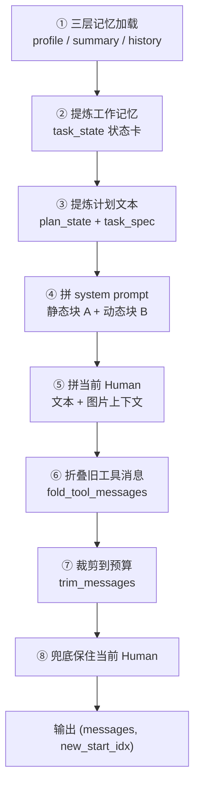
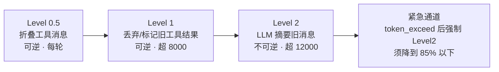

# 01 · LLM 请求链路（上下文工程）

> 回答一个问题：**模型每一轮到底看到了什么，预算是怎么花的，超了怎么办。**
> 总纲见 [README.md](README.md)；工具契约见 [02](02-tool-design-mcp.md)；编排见 [03](03-task-planning-skill.md)。

---

## 一、定位

上下文工程不是"写 system prompt"，而是在**有限 token 预算**下做**信息编排**。本项目把它当一条有明确阶段、明确预算、明确降级路径的**流水线**，而不是字符串拼接。

三个硬约束决定了设计：

1. **窗口是硬的**：`context_max_tokens = 16000`（`config.py:159`），输出 `max_tokens = 4096`（`config.py:140`）。
2. **信息是竞争的**：静态规则、工具目录、决策表、计划、摘要、历史、当前输入抢同一块预算。
3. **信息是腐烂的**：旧摘要、旧计划会与当前证据冲突，必须有优先级仲裁。

所以本链路有两个目标，且**优先级明确**：

> ① 让模型看到"足够做对决策"的最小信息；② 让"最新证据"永远压过"旧结论"。

目标 ② 常被忽略，但它是 Agent 与聊天机器人的分水岭——聊天机器人不需要仲裁，Agent 需要。

---

## 二、预算模型

| 预算项 | 值 | 含义 | 来源 |
|---|---|---|---|
| `context_max_tokens` | 16000 | 送进 LLM 的消息总量上限（trim 目标） | `config.py:159` |
| `max_tokens` | 4096 | 单轮输出上限 | `config.py:140` |
| `summarize_threshold` | 8000 | 累计历史超过此值触发摘要（正好是窗口一半） | `config.py:176` |
| `summary_level2_multiplier` | 1.5 | Level1 后仍超 `8000×1.5` 则升级 Level2 | `config.py:186` |
| `summary_max_tokens` | 300 | 单次摘要目标长度 | `config.py:180` |
| `tool_message_keep_tail` | 3 | 折叠工具消息时保留最近 3 条完整 | `config.py:190` |
| `history_load_limit` | 50 | 从 DB 加载最近 50 条 | `config.py:171` |
| `llm_force_compress_target_ratio` | 0.85 | 紧急压缩必须降到原 token 的 85% 以下 | `config.py:150` |

**为什么 16000**？注释记录了真实踩坑：system prompt 加入动态工具目录与 CoT 后膨胀到约 3700 token，原 6000 上限留给历史/大表格的余量太窄，会触发 trim 误删当前 HumanMessage 的边界 bug。16000 是"一半给静态、一半给动态"的经验切分。

---

## 三、组装流水线

入口 `memory_context.build_context_messages()`（`memory_context.py:233`），被 `chat_service.py:1154` 调用。八个步骤，顺序不可交换：



### ① 三层记忆加载

```python
user_profile_text = build_user_profile_text(user_id)          # 长期：跨会话
summary_data = get_memory_stores().summary.load(conversation_id)  # 短期：本会话
history = get_memory_stores().working.load_since(               # 工作：近期完整消息
    conversation_id, summarized_upto or 0, settings.history_load_limit)
```

关键点：`load_since(conversation_id, summarized_upto)` —— **只加载摘要点之后的消息**，避免"摘要 + 原文"重复计费。

### ② 提炼工作记忆（状态卡）

`build_task_state_text()`（`task_state.py:570`）把隐式历史压成 5 行显式状态：

```text
- 当前目标: 对比这两张影像的变化
- 前序目标: 提取这里的建筑
- 最近动作: understand_image -> segment_image
- 最近观察: 已有 128 个图斑, area=3.2km²
- 持久化任务状态: detect_change:running(10%)；generate_monitor_report:pending
```

这是"防长任务失忆"的第一道设计：不靠模型自己回看历史，而是每轮给它一张状态卡。

### ③ 提炼计划文本

`build_plan_context_text()`（`task_state.py:279`）输出计划、未完成必需步骤、完成门、`task_spec`（任务类型/时相/成功条件/缺失输入）。

**注意它读的是持久化计划**（`load_plan_state`），不是内存变量——所以进程重启后计划仍在，这是断点续跑的一部分。

### ④ 拼 system prompt（四段式）

见 §四。

### ⑤ 拼当前 Human

`_append_image_context_to_prompt()` 把附件元信息（路径/CRS/时相/来源）以文本追加，同时把原 prompt 存进 `additional_kwargs.display_content` 供前端回显——**给模型看的是增强版，给用户看的是原文**。

### ⑥ 折叠旧工具消息（Level 0.5 可逆压缩）

`fold_tool_messages(keep_tail=3)`（`memory_context.py:161`）。动机：工具结果（stats/legend/URL）占大量 token，而 `trim_messages` 是粗暴的**尾部截断**，会优先丢最近的——正好丢错方向。

折叠把旧的已完成工具消息变成：

```text
[已完成·detect_change·frontend_action] 检测到 128 个变化图斑, 总面积 3.2km²…
```

保留 `type + summary 前 80 字`，最近 3 条不动。**先折叠再裁剪**，这样同样的预算能多留几轮真实上下文。

### ⑦ 裁剪到预算

```python
trim_messages(raw_messages, max_tokens=16000, strategy="last",
              token_counter=_count_message_tokens,
              include_system=True, start_on="human")
```

三个参数各有原因：

- `include_system=True`：system prompt 永远保留（它是行为契约，丢了就变成裸模型）。
- `start_on="human"`：从人类轮切开，**不切断 `tool_calls` 与 `ToolMessage` 的配对**——切断了 provider 会直接报协议错误。
- 自定义 `token_counter`：因为 `ChatOpenAI` 对代理模型不支持 `get_num_tokens_from_messages`（会 `NotImplementedError`），改用 tiktoken `cl100k_base` 近似（中文汉字约 1.5~2 token，量级足够做裁剪决策）。

### ⑧ 兜底保住当前 Human（关键防御）

```python
if current_human not in trimmed:
    logger.warning("trim_messages 丢弃了当前 HumanMessage, 强制补回")
    trimmed = list(trimmed) + [current_human]
```

真实 bug 的补丁：当 system prompt 本身接近上限时，`trim_messages` 为了凑"以 human 开头"的切片，会把**唯一那条当前 HumanMessage** 丢掉，模型只能反问"请提供需求"。用**对象身份**（而非"最后一条是 Human"的假设）定位并补回。

---

## 四、System Prompt 解剖

组装函数 `build_system_prompt_blocks()`（`system_prompt.py:50`）把 prompt 拆成两块，原因见下。

### 4.1 块 A：静态契约（可缓存）

唯一静态模板 `prompt_store/templates/static_template2.md`，七个部分：

| 段 | 内容 | 作用 |
|---|---|---|
| 一、成功标准 | 四条完成条件 + **证据优先级链** | 定义"做完" |
| 二、行为红线 | 不伪造成功、不机械重试、不暴露绝对路径 | 定义"不能做什么" |
| 三、执行协议 | Thought → Action → Observation → **Repair** → 阻塞提问 | 定义"怎么做" |
| 四、工具与数据约定 | 工具族选择、附件语义、沙盒约定、报告由 report_agent 负责 | 减少误选 |
| 五、记忆使用 | 短期/长期/工作记忆各自权限 | 定义仲裁 |
| 六、输出契约 | 先结论后证据、≥3 条同类才建表 | 定义"怎么答" |
| 七、能力边界 | `{decision_table}` + `{tools_catalog}` | 注入动态内容 |

**证据优先级链**（`static_template2.md:14-23`）是整份 prompt 的灵魂：

```text
最新 agent_validation
> 当前轮工具结果
> 当前用户明确要求
> 当前计划与任务状态
> 会话摘要
> 长期记忆
```

这一条把"上下文防腐"从代码约束升级为模型可见的显式规则。没有它，模型会拿三轮前的摘要推翻本轮刚验证的事实。

### 4.2 块 B：动态状态（每轮刷新）

`dynamic_context.py:8` 固定四段：

```markdown
## 当前任务状态     ← task_state（目标/动作/观察/任务进度）
## 显式执行计划     ← plan_state（计划/未完成步骤/完成门/task_spec）
## 会话摘要         ← 短期记忆
## 用户画像         ← 长期记忆
```

### 4.3 为什么要分两块

`system_prompt.py:76-87` 给两块都打 `cache_control: {"type": "ephemeral"}`：

- 块 A 跨轮**逐字稳定**（模板 + 目录 + 决策表只随工具集变），命中缓存按约 10% 计费；
- 块 B 每轮都变，但**只有它需要重算**。

若合成一个字符串，任何一处动态变化（哪怕摘要更新一个字）都会让整段缓存失效——这是把提示词当"缓存布局"来设计，而非当文档来写。命中率由 `stream_usage=True` + `log_cache_hit_rate` 实测输出（`chat_service.py:924-934`）。

---

## 五、三层记忆的权限边界

| 层 | 存储 | 注入位置 | 权限 |
|---|---|---|---|
| 工作记忆 | 最近 50 条消息（含 tool_calls） | 消息列表 | 可被折叠/裁剪 |
| 短期记忆 | `conversation_summary` 表 | system prompt 动态段 | 优先级低于当前证据 |
| 长期记忆 | `user_memory` 表（preference / profile / lesson） | system prompt 动态段 | **只作辅助，不覆盖当前要求** |

长期记忆有一条硬门槛：**只有 `verification=passed` 的 lesson 才能进长期记忆**。这是防止"错误经验被固化后反复误导"的关键闸门——一个失败的尝试如果被总结成教训存下来，下次会主动把模型带进同一个坑。

---

## 六、三级压缩与降级路径

面对"上下文变长"，本链路有**三级递进** + **一条紧急通道**：



| 级别 | 触发 | 动作 | 可逆性 |
|---|---|---|---|
| 0.5 | 每轮 assemble | `fold_tool_messages` | 可逆（只改 content 文本） |
| 1 | 历史超 `summarize_threshold` | 标记旧工具结果，保留结构 | 可逆（DB 原文还在） |
| 2 | Level1 后仍超 `×1.5` | 调 LLM 生成摘要，删旧消息 | **不可逆** |
| 紧急 | LLM 报 `token_exceed` | `_force_compress_and_retrim` | 不可逆 |

**摘要触发时机很关键**：正常路径下摘要是**异步**的——先发 `done` 让用户立刻看到回复，再在后台跑 `maybe_summarize`（`chat_service.py:736`）。首字节延迟不被记忆维护拖累。

紧急通道（`chat_service.py:948`）有**四道防无限重试闸**：

1. `llm_retry_count` 上限 `llm_retry_max=3`；
2. 压缩后 token 必须 < `before × 0.85`，否则判失败（防止"压缩了但没降"导致死循环）；
3. `CancelledError` 单独透传，绝不吞（否则用户停止失效）；
4. `compressed_once` 限制同一 iteration 内只压一次。

---

## 七、LLM 调用与分类重试

### 7.1 端点路由

`_llm_endpoint()`（`llm_client.py:42`）三级降级：

```
Responses API（responses_api_key + responses_base_url）
  → 智谱 GLM（glm_api_key，OpenAI 兼容）
    → DashScope（dashscope_api_key，qwen3.7-plus）
      → 空凭据占位（真实请求时报配置错误）
```

**不在启动期校验凭据**，是为了让"缺一个 key"不阻断整个服务起不来——代价是错误推迟到首次请求。

### 7.2 错误分类

`_classify_llm_error()`（`chat_service.py:805`）把异常归三类，因为**不同错误的正确反应完全不同**：

| 类别 | 判定 | 策略 |
|---|---|---|
| `token_exceed` | `BadRequestError` **且** message/code 命中超限关键词 | 压缩后重试（只压一次） |
| `rate_limit` | `RateLimitError`（429） | 退避 `llm_retry_rate_limit_sleep` 后重试 |
| `others` | 超时 / 连接 / 认证 / 其他 BadRequest / 未知 | 立即重试 |

必须**双重判定**的原因写在注释里：DashScope 把"上下文超限"归到 `BadRequestError`，无法靠异常类型区分；但其他 `BadRequestError`（如参数错误）走压缩是纯浪费，所以必须再匹配 message 关键词。

### 7.3 重试发生在"同一 iteration 内"

```python
llm_retry_count = 0
compressed_once = False
while True:                      # 内层：重试
    try:
        ai_message = await self._stream_llm_thinking_ws(...)
        break
    except asyncio.CancelledError:
        raise                     # 用户停止必须透传
    except Exception as e:
        ...                       # 分类处理
```

**不 increment iteration、不碰 checkpoint**。语义上"这一轮模型还没答出来"，所以重试不能污染 ReAct 轮次计数，也不能让断点续跑从一个错误的起点恢复。

### 7.4 流式

`_stream_llm_thinking_ws()`（`chat_service.py:873`）逐 chunk 推 `thinking` 事件，同时：

- 每 8 个 chunk 调 `on_partial` 落一次 token 快照（供断点回放）；
- 每 chunk 后 `await asyncio.sleep(0)` 显式检查取消——httpx 底层可能不检测取消，这是"停止按钮真的能停"的必要条件；
- 合并 chunk 时保留 `usage_metadata`，用于算缓存命中率。

---

## 八、可恢复性

上下文之外还要能"续上"。`RunSnapshot`（`run_state.py:78`）在每个**工具批次结束**落库：

```python
iteration        # 回到第几轮
plan             # 显式计划（含 task_spec）
active_tool_names# 当前绑定的工具集（恢复后不必重新筛选）
messages         # 序列化后的完整消息
stream_state     # 未完成的流式 token（回放给前端）
checkpoint_id    # 回滚锚点
persist_start_idx# 防重复落库
```

两种中断的语义不同，处理也不同：

| 中断 | 用户意图 | 处理 |
|---|---|---|
| 用户点停止 | "这次不算" | 回滚到 `checkpoint_id`（隐藏后续消息），状态 `stopped` |
| 连接断开 | "我还会回来" | 保留已提交消息，状态 `paused`，重连后 `resume_chat` |

区分靠 `ws_manager.get_cancel_reason(session_id, conversation_id)`（`chat_service.py:1725`）。这个区分很重要：把断线当停止会导致用户回来时对话被删；把停止当断线会导致用户明确放弃的任务还在。

---

## 九、三条上下文防腐设计

1. **证据优先级链**（prompt 层）：显式写进模板，模型可见。
2. **即时约束 SystemMessage**（代码层）：`agent_validation` 失败后紧跟一条短 SystemMessage 声明"本 ToolMessage 是最高优先级证据"，并要求忽略旧摘要（`observation_builder.py:92`）。它比长 prompt 更硬，因为它**紧贴证据**。
3. **最近 N 条工具消息不折叠**（压缩层）：`keep_tail=3` 保证"刚发生的事"不被优化掉。

---

## 十、取舍表

| 决策 | 收益 | 代价 |
|---|---|---|
| 静态/动态 prompt 拆块打缓存标记 | 缓存命中，成本与延迟双降 | 两块需分别维护，改动要判断归属 |
| tiktoken 近似计数 | 不依赖 provider 支持 | 中文估算有偏差，须留余量 |
| 折叠先于裁剪 | 同预算下多保留几轮真实上下文 | 折叠不可逆（但 DB 原文在，可重建） |
| 摘要在 `done` 之后异步跑 | 首字节延迟低 | 摘要失败时下一轮才会暴露 |
| 重试不递增 iteration | 语义干净 | 需额外 `llm_retry_count` 计数防死循环 |
| 16000 而非更大窗口 | 成本可控、延迟稳定 | 长任务更依赖折叠与摘要 |

---

## 十一、边界与缺口

1. **token 计数是近似的**：`cl100k_base` 对 GLM 分词并非精确对齐，中文长文本可能低估，极端情况下会撞 provider 硬限并触发紧急压缩。
2. **摘要不可逆且会丢细节**：Level 2 删除旧消息后，具体数值/路径只能从 DB 反查，模型侧不可见。
3. **缓存命中率依赖 provider**：`ephemeral` 标记是否被后端真正利用，取决于 provider 实现；本项目只做标记与统计，不做保证。
4. **图片上下文是文本描述**：附件以路径与元信息文本注入，不是多模态输入（除非模型侧另行支持）。
5. **跨会话无计划继承**：`load_plan_state` 按 `conversation_id` 读，换会话即丢计划——这是有意的隔离，但也意味着"接着上次那个任务"需要用户重新描述。
