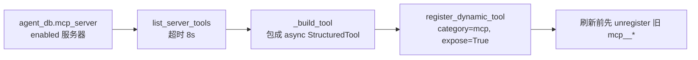

# 02 · 工具设计（MCP）

> 回答一个问题：**工具如何从"一个 Python 函数"变成"模型可靠可用的能力"，以及 MCP 如何并入这套体系。**
> 总纲见 [README.md](README.md)；上下文如何装工具 schema 见 [01](01-llm-request-pipeline.md)；失败后如何修参见 [03](03-task-planning-skill.md) §七。

---

## 一、定位

工具层最容易写成"一个 `@tool` 装饰器 + 一堆函数"。本项目把它拆成**三个互不干扰的平面**，因为三者变化的频率完全不同：

| 平面 | 变化频率 | 关心什么 | 位置 |
|---|---|---|---|
| **注册平面** | 每次加工具 | 有哪些能力、属于哪一类 | `agent/tools/*.py`、`integrations/external_tools.py` |
| **暴露平面** | 每次策略调整 | 模型**能看见**哪些 | `registry.py:31-94` |
| **执行平面** | 很少变 | 怎么跑、怎么记账、怎么回传 | `chat_service.py:1487` |

一句话概括设计意图：

> **注册 ≠ 暴露 ≠ 可执行。** 注册是"系统有"，暴露是"模型知道"，执行是"真的能跑"。

这个分离带来一个直接收益：**权限收紧不需要改业务代码**。`insert_data` / `update_data` / `delete_data` 三个写库工具正常注册（内部代码、测试、未来 API 可用），但对 LLM 完全不可见——因为它们不在白名单里。要恢复暴露，只需加一个字符串，不需要改实现。

---

## 二、注册平面

### 2.1 双装饰器与顺序约束

```python
@register_tool("samseg")          # 上层：注册进全局表
@tool(args_schema=SegmentImageArgs)  # 下层：包装成 StructuredTool
def segment_image(image_path: str, classes: str = "", referring_expression: str = "") -> Dict[str, Any]:
```

Python 装饰器**从下往上**执行：先 `@tool` 把函数包成 `StructuredTool`，再 `@register_tool` 接收已包装对象。所以注册时要用 `func.name`（而非 `func.__name__`）取名（`registry.py:104`）。这个顺序写错了会静默注册不上，是新人最容易踩的坑。

### 2.2 注册表结构

```python
_tool_registry: Dict[str, Dict[str, Callable]] = {}   # category → {name → tool}
_tool_category_map: Dict[str, str] = {}               # name → category（反向）
```

按 category 分桶而非扁平 dict，是为了 `build_tools_catalog()` 能直接按类分组渲染 prompt（`tool_catalog.py:32`），且新增分类不影响已有分类。

### 2.3 当前规模（AST 实测）

| 分类 | 注册 | 暴露 | 该分类在做什么 |
|---|---:|---:|---|
| `database` | 10 | 4 | 影像/矢量检索暴露；**增删改全部对 LLM 隐藏** |
| `geoserver` | 7 | 6 | 上传/下载/发布/删除/查询 |
| `layer_control` | 5 | 3 | 前端显隐/定位；分组控制与 `hide_layer` 隐藏 |
| `sandbox` | 5 | 5 | Python/Shell 执行、导入导出、渲染 |
| `analysis` | 4 | 3 | 连通域、掩膜矢量化、矢量可视化；`overlay_edge_on_image` 隐藏 |
| `memory` | 4 | 4 | 查/清长期记忆与摘要 |
| `report` | 4 | 4 | 统计图、PDF 报告、矢量/表格导出 |
| `preprocess` | 3 | **0** | 金字塔/COG/拓扑检查——**整类对 LLM 隐藏** |
| `agent_team` | 3 | 3 | worker 派发/查询/取消 |
| `samseg` | 2 | 2 | 分割、变化检测（主线） |
| `skill` | 2 | 1 | `lookup_skill` 暴露，`list_available_skills` 隐藏 |
| `discovery` | 2 | 2 | `search_tools` / `load_tool` |
| `vlm` | 1 | 1 | 影像理解 |
| `external` | 4 | 4 | 外部工具箱适配（栅格信息/光谱指数/矢量化/空间分析） |
| **合计** | **56** | **42**（+2 幽灵名 = 44 名单） | 14 类 |

> 暴露列合计 42 是**真实可调用**的工具数；白名单文件里另有 `save_user_memory_item`、`delete_user_memory_item` 两个无实现的幽灵名（见 §3.2），故名单长度是 44。

`external` 类不在 `agent/tools/` 下，而在 `integrations/external_tools.py`（`backend/integrations/vendor/` 是 vendored 代码，不含权重与数据）——这说明**注册平面是开放的**，任何模块只要 import `register_tool` 就能贡献工具，不需要改注册表。

---

## 三、暴露平面

### 3.1 三层白名单

```python
_LLM_EXPOSED_TOOL_NAMES      = { ... }   # 44 个，静态
_DYNAMIC_EXPOSED_TOOL_NAMES  = set()     # MCP 刷新时增删
_AGENT_ROLE_EXPOSED_TOOL_NAMES = {"verification_agent": set()}   # 角色白名单
```

取值时取并集（`registry.py:136`）：

```python
exposed = _LLM_EXPOSED_TOOL_NAMES | _DYNAMIC_EXPOSED_TOOL_NAMES
```

三个设计点：

1. **静态与动态分离**：MCP 工具刷新时频繁增删，若直接写进静态集合，`unregister` 时会和手工维护的名字混在一起，无法安全批量清理。
2. **角色白名单独立**：`verification_agent` 是**确定性 worker**，不绑任何工具——它在设计上就不该有"自己找证据"的能力，只能对已有结果做判定。
3. **静默过滤**：`get_tools_for_llm()` 遍历的是**已注册**工具，白名单只做"交集筛选"。所以白名单里写了不存在的名字**不会报错，只会静默缺失**。

### 3.2 幽灵工具名（已验证缺陷）

白名单中 `save_user_memory_item`、`delete_user_memory_item` **全仓无实现**（`registry.py:69-70` 是唯二出现处）。后果：

- 不会崩——`get_tools_for_llm` 只返回已注册的，交集自然排除；
- 但**模型永远拿不到"单条记忆增删"能力**，而它同时能看到 `view_user_memory` / `clear_user_memory`，形成能力不对称；
- 且没有任何自检会发现这件事：`validate_rules()` 只校验**决策表**引用的工具名，不校验白名单本身。

**修复建议**（未实施）：在 `tests` 里加一条与 `validate_rules` 对称的断言 `_LLM_EXPOSED_TOOL_NAMES - set(get_all_tools()) == set()`。这是一行代码就能堵住的类别性缺陷。

### 3.3 为什么必须收窄

44 个工具的完整 function schema 约 1.5~2 万 token，**单这一项就超过 `context_max_tokens=16000`**。所以收窄不是优化，是**可行性前提**。收窄分两级：

| 级 | 手段 | 效果 |
|---|---|---|
| 静态 | 白名单（56→44） | 去掉不该给的（写库、预处理） |
| 动态 | 首轮筛选（44→≤12） | 去掉本轮用不上的 |

---

## 四、契约平面：一个工具的三段式

工具的"契约"由三部分共同构成，缺一不可：

### 4.1 参数契约（`args_schema`，机器可读）

```python
class SegmentImageArgs(BaseModel):
    """segment_image 的参数契约。"""
    image_path: str = Field(..., description="本地影像路径；支持绝对路径或 agent-files/ 相对路径")
    classes: str = Field("", description="英文类别 + 英文同义词；分号分类别，逗号分同义词；留空使用默认类别")
    referring_expression: str = Field("", description="可选，指代式分割表达；classes 为空时使用")
```

`Field(...)` 的 `...` 表示必填；`ge/le` 等约束会进 JSON Schema 交给 provider 侧校验。**description 是给模型看的文档**，写"支持什么格式、留空会怎样"比写"路径"有用得多。

### 4.2 用途契约（docstring，模型可读）

docstring 被切成两半，各有去处：

| 部分 | 去处 | 压缩策略 |
|---|---|---|
| 首行（用途） | system prompt 工具目录 | 只取 `split("\n")[0]` |
| 整段 | `bind_tools` 的 `description` | `compact` 模式下截到 220 字（`schema.py:14`） |
| 全文 | `load_tool` 按需返回 | 不压缩 |

`segment_image` 的 docstring 是范本，包含五段：用途、**★ 触发场景**、**★ 不触发场景**、耗时/依赖、入参/出参。

其中"不触发场景"是最有价值的一段：

```text
★ 不触发场景: 用户只是问"图里有什么/描述一下/这是什么地物"等理解类问题 ——
  那是影像理解需求, 本工具只会按类别画掩膜, 无法回答"有什么", 不要调用。
```

它直接对抗一类高频误选：**把"描述影像"误判成"分割影像"**。做法是**在工具自己的 docstring 里写清边界**，而不是在 system prompt 里写一堆"请正确选择工具"——后者对模型几乎无效，前者紧贴决策点。

### 4.3 返回契约（统一结构）

见 §五。

---

## 五、返回契约：四态 + 统一字段

`_result.py` 把历史上五花八门的返回收敛为**软约束**（旧工具不强制改造，消费方兼容）：

```python
{
  "type": "success" | "error" | "frontend_action",   # 必填，唯一判别依据
  "summary": str,          # 给 LLM 看的文本摘要（消费最多）
  "msg": str,              # error 必填
  "data": dict,            # 结构化数据，含 artifact_path / artifact_url
  "instruction": {"type", "action", "params"},  # 仅 frontend_action
  "description": str,      # 给前端卡片/进度条的提示
  "wait_for_result": bool, # frontend_action 是否阻塞等回执
  "verification": dict,    # 产物成功契约 {ok, size_bytes, reason, evidence}
  "artifacts" / "evidence" / "quality"   # 工程化扩展
}
```

四个设计细节：

1. **`type` 是唯一判别依据**：消费方（`chat_service`、`observation_builder`）只看 `type`，不看别的字段推断，避免"字段存在性判断"散落各处。
2. **`instruction.type == action` 由 helper 保证**：历史上有工具两字段不一致（`layer_tools`/`analysis`/`data` 多处），helper 强制相等（`_result.py:172`）。
3. **`summary` 是回灌 LLM 的主文本**：`data` 是给程序/前端用的，`summary` 是给模型用的。很多工具写了大 `data` 却忘了 `summary`，导致模型只能看到 JSON 噪音。
4. **路径字段双轨**：新名 `artifact_path`/`artifact_url`，同时兼容 `output_path`/`local_path`/`geojson_path`/`shp_path` 等旧名（`_result.py:286`）。规范化是渐进的，不搞一次性大重构。

### 为什么保留三态而不是统一成 success/error

`frontend_action` 不是"成功/失败"的第三态，而是**语义不同的一类结果**：它的成功标准不在后端，而在**前端是否真的执行了**。把它塞进 `success` 会丢失 `wait_for_result` 语义，也无法驱动 `request_id` 闭环（详见 `docs/platform/communication.md`）。

---

## 六、执行平面

### 6.1 分派：同步走线程池，异步走 await

```python
_underlying = getattr(tool_func, 'coroutine', None) or getattr(tool_func, 'func', None)
if _underlying and inspect.iscoroutinefunction(_underlying):
    tool_result = await tool_func.ainvoke(invoke_args)      # 沙盒 docker exec
else:
    tool_result = await asyncio.to_thread(tool_func.invoke, invoke_args)  # torch/DB/GeoServer
```

判据是 LangChain 包装后**底层函数**是否 coroutine（存在 `.coroutine` 或 `.func`）。

- 远程推理/数据库/GeoServer 是**同步阻塞**的，直接跑会卡死 event loop，整个 WS 心跳与其他对话全部停摆 → 线程池；
- 沙盒工具是 `async` 的，走线程池反而丢取消能力 → 直接 `await`，可响应 `CancelledError`。

### 6.2 异常包装：把异常变成可决策的信号

```python
except Exception as e:
    err_msg = str(e) or type(e).__name__          # 空消息兜底
    _err_type = type(e).__name__
    if not err_msg.startswith(_err_type):
        err_msg = f"[{_err_type}] {err_msg}"      # 类名拼进 msg
    tool_result = {"type": "error", "msg": err_msg, "error_type": _err_type, "tool": tool_name}
```

三个细节，每个都对应一次真实故障：

- `str(e) or type(e).__name__`：`Exception()` 无参构造时 `str(e)` 为空，会产生 `{"msg": ""}`，前端与模型都无法定位。
- 类名拼进 msg：`_assess_severity` 靠 `permission`/`timeout`/`file` 等关键词判严重度，纯业务文案会被判 low 而**被自纠学习丢弃**。
- `error_type` 独立字段：`repair_policy` 用它识别 `invalid_arguments`，比解析文本可靠。

### 6.3 HITL：`frontend_action` 的双向闭环

```python
if tool_result.get("type") == "frontend_action":
    await ws_manager.send_to_session(session_id, {
        "type": "frontend_action", "event_type": instr_type, "event_data": params,
        "request_id": tool_call_id,   # ★ 用 tool_call_id 做配对键
        "conversation_id": conversation_id,
    })
    if tool_result.get("wait_for_result"):
        frontend_result = await ws_manager.wait_for_frontend_result(request_id)  # 超时 120s
        tool_result["frontend_result"] = frontend_result
```

**推送与等待必须解耦**。注释记录了一次真实 bug：早期两者耦合在同一个 `if wait_for_result` 块里，而 samseg 设 `wait_for_result=False`，导致前端永远收不到 `render_image`，面板空白但 LLM 已汇报"已完成"。

语义划分：

| 类型 | `wait_for_result` | 原因 |
|---|---|---|
| 渲染/下载（`render_image`/`download`/`chat_image`） | `False` | 几十秒推理，阻塞会超时 |
| 图层控制（`layer_control`/`layer_display`） | `True` | 需要前端确认图层真的加上了 |

用 `tool_call_id` 而不是新生成 UUID 作 `request_id`，是因为它天然唯一且与 ToolMessage 一一对应，重连后排障更容易。

### 6.4 记账：重工具开任务

```python
HEAVY_TOOL_CATEGORIES = {"samseg", "rule", "report", "preprocess", "analysis"}  # agent_db.py:1785
```

命中则开 `ai_task`：

- 输入**脱敏**（路径只留 basename，避免绝对路径污染日志）→ `_sanitize_task_input`
- `progress` 推进、`task_log` 追加、失败写 `error`
- 成功时提取 `resource_usage`（耗时等）做成本采集
- 登记 `artifact` 形成产物血缘

轻工具（memory/skill/database 查询）**不开任务**——否则一次对话会刷出几十条无意义任务记录，任务列表失去可读性。

---

## 七、工具发现：按需加载

### 7.1 首轮筛选

`select_initial_tool_names(prompt, images)`（`discovery.py:108`）：

```
META（search_tools/load_tool）+ CORE（segment/detect/understand/lookup_skill）
  + 附件数规则（≥2 张→detect_change；1 张→segment_image + understand_image）
  + prompt 关键词检索 top20
  → 截到 agent_dynamic_tools_limit（默认 12）
```

关键词打分（`discovery.py:73`）：工具名命中 +5、描述 +2、分类 +1；中文额外做 **2~4 字滑窗**，让"提取建筑""变化检测"这类短词能命中。

附件数规则是**确定性优先于检索**的典型：两张图几乎必然是变化检测，没必要让模型从 12 个工具里猜。

### 7.2 两级发现

```text
search_tools(query) → [{name, category, description}]   # 只有卡片，无参数 schema
    ↓ 模型判断"我需要它"
load_tool(name)     → {name, description, parameters}   # 完整 JSON Schema
    ↓ chat_service 检测到 load_tool 成功
active_tool_names.add(loaded) ; tools_dirty = True
    ↓ 本批次工具跑完
重新 bind_tools                                         # 下一轮可直接调用
```

关键约束：**`search_tools` 不返回参数 schema**，只返回卡片（`schema.py` 的 `ToolCard`）。否则"检索"就退化成"把所有 schema 又灌一遍"，动态加载失去意义。

重新绑定发生在**整个工具批次结束后**（`chat_service.py:1708`），不是调用后立刻——避免同一轮内消息序列与绑定工具集不一致（provider 会报"调用了未绑定的工具"）。

---

## 八、MCP 子体系

MCP 是"把外部工具接进来"的标准通道。本项目用**适配而非侵入**的方式实现：MCP 工具走同一套注册表，因此自动获得白名单、执行、观测、验证、记账的全部能力。

### 8.1 流程



### 8.2 关键设计

| 点 | 做法 | 原因 |
|---|---|---|
| 命名 | `mcp__{server}__{tool}`，非法字符转 `_`，截 64 字符 | 满足函数名约束、可读、可反查来源 |
| 参数 | 远程工具只接**一个 `arguments` 对象** | MCP 是通用协议，不假定扁平参数 |
| schema | 把 `inputSchema` **序列化进 description**（截 1200 字） | 见 §九缺陷 1 |
| 生命周期 | **短连接**：每次 `list`/`call` 都开一次 session | 避免启动期被不可达服务器阻塞 |
| 加载 | TTL 300s 懒加载，失败只 warning 不阻断聊天 | 聊天可用性 > 工具完整性 |
| 刷新 | 先 `unregister_tool` 所有 `mcp__*`，再重新注册 | 防止重名与过期工具残留 |
| 超时 | `mcp_timeout_seconds`（默认 8s） | 单个坏服务器不能拖死整轮 |

`mcp_enabled` 默认 `true`，但**没有配置任何服务器**时 `_server_configs()` 返回空列表，等价于不启用——用"默认开、数据驱动"替代"默认关、需手动开"，减少部署时的开关遗漏。

### 8.3 transport

- `sse`：需要 `url`
- `stdio`：需要 `command`，`shlex.split` 后 Windows 下去引号（`posix=False` 会保留包裹引号，是已修的坑）

---

## 九、取舍与缺口

### 9.1 取舍

| 决策 | 收益 | 代价 |
|---|---|---|
| 注册/暴露分离 | 收紧权限不改业务代码 | 加工具必须记得同步白名单 |
| 白名单静默过滤 | 不会因配置错误崩溃 | 名字写错/实现缺失无法自发现（见幽灵工具） |
| 首轮只绑 ≤12 | schema 体积可控 | 模型可能"不知道自己有能力"，需先 `search_tools` |
| docstring 双用（prompt + function） | 单一事实源 | docstring 变长会挤占 prompt |
| `frontend_action` 独立态 | 支持双向 HITL | 多一个状态分支要维护 |
| 重工具才记账 | 任务列表干净 | "哪些算重"需人工判断 |
| MCP 短连接 | 启动快、无状态残留 | 每次调用有连接开销 |

### 9.2 缺口

1. **MCP 参数没有结构化 schema**（最实质的缺陷）。`_build_tool` 把 `inputSchema` 塞进 description 文本（`mcp/registry.py:60-64`），LLM 只能"读文档"而非获得 function calling 级别的约束。理想做法是**动态生成 Pydantic model 或直接传 JSON Schema 作为 `args_schema`**。当前实现的好处是零适配，坏处是远程工具的参数错误率显著高于原生工具。
2. **幽灵工具名**：见 §3.2。
3. **白名单无自检**：`validate_rules()` 保护决策表，但没有任何测试保护 `_LLM_EXPOSED_TOOL_NAMES` 与注册表的一致性。
4. **MCP 工具无独立观测**：`mcp__*` 的返回是 `{status, content}`，不符合 `_result.py` 四态契约，因此 `verification_agent` 对它们基本只能给 `warning`（无 `verification`、无可校验路径）。
5. **无工具级超时**：`asyncio.to_thread` 跑同步工具时没有超时控制，一个卡住的 GeoServer 请求会一直占线程（只能靠用户停止）。
6. **`preprocess` 整类对 LLM 隐藏**，但仍在 `HEAVY_TOOL_CATEGORIES` 中——说明记账规则与暴露策略是两套独立维护的清单，存在漂移风险。
