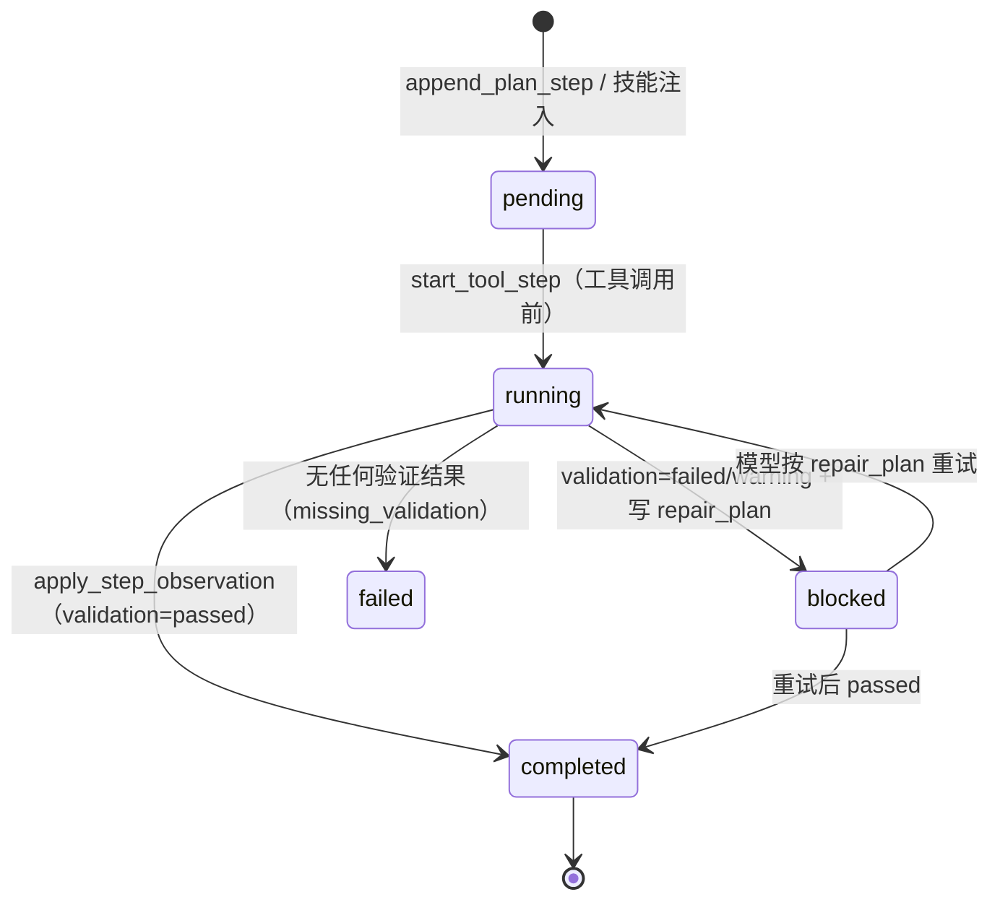
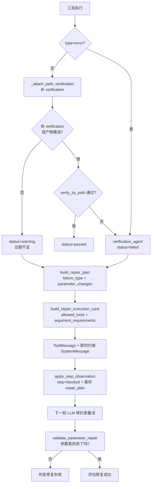

# 03 · 任务规划（SKILL）

> 回答一个问题：**长任务怎么从"用户一句话"变成"可执行、可验证、可修复、可续跑"的编排。**
> 总纲见 [README.md](README.md)；工具契约见 [02](02-tool-design-mcp.md)；上下文注入见 [01](01-llm-request-pipeline.md)。

---

## 一、定位：四级编排梯度

"任务规划"最容易走两个极端：全自由 ReAct（灵活但漂移）或全硬编码工作流（稳定但僵化）。本项目选择**梯度**——按任务的确定性程度选择编排强度，四级逐级上升：

| 级 | 名称 | 载体 | 适用 | 是否在主线 |
|---|---|---|---|---|
| L1 | **单工具直调** | 无 | "显示某图层"、"列出数据库表" | ✅ |
| L2 | **轻量 plan state** | 对话级 JSON，每轮注入 prompt | 任何多步任务（每次工具调用自动落一步） | ✅ |
| L3 | **Skill 契约** | Markdown + `skill-contract` JSON | 已知标准流程（变化检测、地物提取、发布） | ✅ |
| L4 | **PlanGraph DAG** | `PlanNode` 图 + 校验 + 并行执行器 | 需要结构校验、并行、占位符传参 | ⚠️ Pilot，未接主线 |

**设计哲学：不要一步跳到重型编排。** L2 是"永远开着"的底座，L3 是按需叠加的模板，L4 是需要时才启用的执行引擎。这样 90% 的简单请求不承担任何编排成本，而复杂请求可以逐级加重。

---

## 二、SKILL 体系（L3）

### 2.1 三个组成

```text
backend/model/skills/*.md          ← 技能文档（人来写）
  ├─ YAML-like 头部 + 正文        ← 给人看：触发场景、前置条件、标准步骤、异常处理
  └─ <!-- skill-contract {...} --> ← 给机器看：结构化契约
        ↓ loader.py              扫描 + 解析（正则抽 contract 并 json.loads）
        ↓ selector.py            质量门 + 单选（确定性打分，不调 LLM）
        ↓ skill_tools.py         lookup_skill 对外暴露
        ↓ skill_execution.py     契约 → plan steps
```

### 2.2 当前技能清单

| 文件 | 流程 | 契约必填输入 |
|---|---|---|
| `wf1-segment-visualize-report.md` | 分割 → 矢量化 → 报告 | `image_path`, `classes` |
| `wf2-change-detection-visualize-report.md` | 双时相检测 → 图表 → 报告 | `t1_path`, `t2_path` |
| `wf4-upload-geoserver-display.md` | 上传 → 发布 → 前端加载 | `file_path` |

（无 `wf3`，编号是历史遗留。）

### 2.3 契约结构（9 个必填字段）

```json
{
  "version": "1.0",
  "trigger_conditions": ["双时相遥感影像变化检测", "违建或新增建筑监测"],
  "required_inputs": ["t1_path", "t2_path"],
  "steps": [
    {"step_id": "detect", "goal": "执行双时相变化检测", "tool_name": "detect_change",
     "required_inputs": ["t1_path", "t2_path"],
     "expected_outputs": ["vector_url", "mask_tif_url", "stats"],
     "verification_rules": ["agent_validation.status=passed"], "required": true}
  ],
  "tool_allowlist": ["detect_change", "generate_change_stats_chart", "generate_monitor_report"],
  "expected_outputs": ["mask_tif_url", "vector_url", "chart_path", "report_url"],
  "verification_rules": ["每个必需步骤均为 agent_validation.status=passed"],
  "fallback_rule": "失败时执行 repair_plan；无显著变化时保留无变化证据并生成报告",
  "promotion_evidence": "变化矢量、统计图和报告均通过客观验证"
}
```

**为什么把契约埋进 Markdown 注释**？因为同一份文件要服务两类读者：人看正文（怎么用、可能出什么问题），机器看契约（能不能执行、缺什么输入）。分成两个文件会导致它们长期不一致——注释方案让"改步骤必须同时改契约"成为**同一个文件的编辑动作**。

### 2.4 质量门（`validate_skill_contract`）

执行前必须全过（`selector.py:21`）：

| 检查 | 不通过的后果 |
|---|---|
| 9 个契约字段齐全 | `missing_contract_fields=[...]` |
| `steps` 非空 | 无法执行 |
| 首步必须有 `required_inputs` | 防止"没输入就开跑" |
| 末步必须有 `verification_rules` | 防止"跑完不知道算不算成" |
| `step_tools ⊆ tool_allowlist` | 防止步骤偷偷越权调工具 |
| `tool_allowlist ⊆ LLM 暴露集合` | 防止技能要求一个模型根本调不到的工具 |

外加一道**输入门**：`_missing_required_inputs()` 检查 `required_inputs` 是否都有非空值。**缺输入不是"跑起来再报错"，而是根本不选中该技能**——这与"技能缺必填输入不执行"的架构约束一致。

### 2.5 选择器：确定性单选

`select_skill()`（`selector.py:97`）**不调 LLM**，纯打分排序：

```text
total_score = 关键词分（loader 检索，阈值 ≥3）
            + lesson_bonus（已准入教训命中，≤1）
            + plan_tiebreak（当前计划已选同名技能，稳定性加分）
eligible = 契约合法 AND 无缺失输入
```

三个刻意的限制：

1. **最多选一个主技能**。多个技能并行会让 plan 步骤互相污染，且失败归因无法定位。
2. **教训加分 ≤1**。长期记忆不能压过"任务与输入事实"——这是记忆权限边界在代码里的体现。
3. **阈值 score≥3**（`loader.py:209`）。注释解释了原因：长任务意图通常命中多个关键词（"数据/入库/影像/流水线"），单一操作（"显示图层"）只命中 1~2 个，不应误触发长任务检索。

### 2.6 契约 → 计划步骤

`apply_skill_selection_to_plan()`（`skill_execution.py:10`）：

- **再次**跑质量门（防止调用边界传伪造契约）；
- 每个 `steps[]` 追加为 **pending 必需步骤，但不执行任何工具**；
- 输入映射：已有值直接用，缺失写成 `"<来自前序步骤:name>"` 占位（提示模型这是串行依赖）；
- 同一 plan 只应用一次同名同版本技能（`name@version` 去重）；
- 同时生成 `task_spec`（见 §三.3）。

**"只登记不执行"是关键**：技能提供的是**顺序与验收标准**，不是脚本。真正执行仍由主控 Agent 逐轮决策——保留模型对异常的处理能力（例如"无变化时仍要出报告"这类分支，硬编码脚本写不出来）。

---

## 三、轻量 plan state（L2 底座）

### 3.1 结构

```json
{
  "plan_id": "plan_<conv>_<hex>", "conversation_id": "...", "goal": "...",
  "status": "running", "steps": [ ... ], "current_step_id": "step_3",
  "completion_gate": {"allowed": false, "reason": "仍有未完成必需步骤: step_3:blocked"},
  "plan_version": 1, "parent_plan_id": null, "revision_reason": "",
  "created_at": "...", "updated_at": "..."
}
```

每个 step：`step_id / goal / executor / status / required / tool_name / inputs / expected_outputs / depends_on / parallel_group / acceptance / evidence / repair_plan / next_action`。

### 3.2 生命周期



三个关键函数：

| 函数 | 时机 | 作用 |
|---|---|---|
| `create_plan_state` | 首次工具调用前 | 建空计划，完成门默认关闭 |
| `start_tool_step` | **每个工具调用前** | 激活同名 pending/blocked 步骤；无匹配则追加一步 |
| `apply_step_observation` | 工具返回后 | **只有 `passed` 才 completed**，否则 blocked + 保存 `repair_plan` |

`start_tool_step` 的依赖检查有个务实妥协：若同名步骤依赖未满足，优先找依赖已满足的同名步骤；若没有，**仍激活它**，把"依赖未完成"留给完成门在收尾时拦截。理由：宁可让步骤跑起来拿到真实证据，也不要在执行前因计划错误卡死。

### 3.3 `task_spec`：结构化任务规格

`build_task_spec()`（`task_spec.py:132`）从 `goal + context_inputs + selection` **纯规则**提炼（零 LLM、O(1)）：

```json
{
  "task_type": "change_detection",
  "goal": "对比这两张影像的变化",
  "spatial_scope": {"image_paths": ["...T1", "...T2"], "image_count": 2, "is_dual_temporal": true},
  "success_criteria": ["mask_tif_url", "vector_url", "chart_path", "report_url"],
  "missing_fields": [],
  "status": "ready"
}
```

它的价值是把"什么算成功"从散落的 prompt 描述变成**计划里的结构化字段**，供完成门、验证、报告共享同一语义输入。`status=needs_input` 时会在 prompt 里显式标记缺失输入，提示模型先问用户。

### 3.4 Plan 与 ReAct 的交互：可写范围

主链路没有独立的计划执行器，plan state 是 ReAct 循环的审计与约束载体。计划与执行之间只有四个写入口：

| 入口 | 位置 | 对计划的作用 |
|---|---|---|
| Plan-first 初始化 | `planner/runtime.py:104` → `graph_to_plan_state` | 在首个工具调用前一次性生成整张步骤表；未命中任务类型、路径不存在或校验失败时返回 `None` |
| 工具调用前 | `chat_service.py:1444-1446` → `start_tool_step` | 激活同名 `pending/blocked/failed` 步骤；无同名步骤时**追加**一步（`task_state.py:169-177`） |
| 技能选择 | `chat_service.py:1656-1663` → `apply_skill_selection_to_plan` | 把契约 `steps[]` 追加为 pending 必需步骤；同一 `name@version` 只应用一次 |
| 工具返回后 | `chat_service.py:1650` → `apply_step_observation` | 只改状态与证据：`passed` → `completed`；`failed/warning` → `blocked` + `repair_plan`；无验证结果 → `failed` |

因此 ReAct 阶段对计划可写的是：**追加步骤、切换步骤状态、写 `evidence` / `repair_plan` / `next_action`**，每轮再以 `build_plan_context_text()` 重新注入模型上下文（`chat_service.py:1668`）。

不可写的部分：

- 没有计划编辑工具（`agent/tools/` 下不存在修改 plan 的入口），模型无法显式删除、重排或取消既有步骤；
- `create_plan_revision()`（`task_state.py:377`）实现的版本链（`plan_version+1`、`parent_plan_id`、`revision_reason`、保留 completed 步骤）**没有任何调用点**，`plan_version` 恒为 1；
- 重规划只有一条非结构化路径：`retry_guard` 判定同签名重复失败后追加 SystemMessage（`chat_service.py:433-438`），要求模型换工具、换参数或调整计划，计划对象本身不重构；
- 完成门拦截（`chat_service.py:1379-1390`）同样只追加约束消息并 `continue`，不改步骤。

结论：当前可稳定实现"先规划 → ReAct 在完成门约束下执行 → 按验证结果推进步骤"，不具备"执行中结构化改写计划并保留版本历史"的能力。Plan-first 本身还受两道限制：`AGENT_PLAN_FIRST` 默认 false（`config.py:221-223`），且只覆盖能确定性推断类别的变化检测 / 单图分割 / GeoServer 发布。该结论针对自由 ReAct 路径；开启 §3.5 的 Plan-and-Execute 模式后，计划由外层调度并可重规划。

### 3.5 Plan-and-Execute 模式（`AGENT_PLAN_EXECUTE`，默认关闭）

开关打开后，主链路不再进入自由 ReAct，而是执行 `Loop{Plan, ReAct}`：

```text
run_plan_and_execute（executor/plan_executor.py）
  1. 计划来源：技能契约 > 确定性模板 > LLM 规划器（planner/llm_planner.py）
  2. 按 depends_on 取 ready 步骤
       └─ run_step（executor/step_executor.py）：本步骤独立 ReAct，只绑定该步工具，默认 6 轮上限
            ├─ agent_validation=passed → 回填 outputs/evidence
            └─ failed（必需步骤）→ revise_plan → 新版本计划，保留 completed 步骤
  3. 全部必需步骤通过 → 完成门放行 → 一次无工具 LLM 调用生成最终回复
  4. 预算耗尽 / 重规划次数耗尽 → budget_exceeded / blocked
```

| 环节 | 实现 | 说明 |
|---|---|---|
| 技能优先 | `select_skill()` → `skill_contract_to_graph()` | 契约步骤转线性 DAG，输入只填已确认值 |
| 模板次之 | `build_graph_for_task()` | 现有 3 个确定性模板 |
| LLM 兜底 | `llm_planner.build_plan()` | 一次规划 + 一次修复；两次失败返回 None 并回退自由 ReAct |
| 单步执行 | `step_executor.run_step()` | 工具绑定收窄；`agent_validation` 通过即停 |
| 重规划 | `create_plan_revision()` + `llm_planner.revise_plan()` | 保留 completed 步骤；`plan_version+1`、`parent_plan_id` 指向旧版 |
| 预算 | `AGENT_PLAN_MAX_TOOL_CALLS=20`、`AGENT_PLAN_MAX_VERSIONS=2`、`AGENT_STEP_MAX_TURNS=6` | 超限分别标记 `budget_exceeded` / `blocked` |
| 回退 | 计划为空或规划失败 | 走原 `while True`，行为不变 |

边界：

- 步骤按 DAG 依赖串行调度，尚未使用 `dag_executor` 的并行批次；
- 断点恢复走自由 ReAct 的快照路径，计划步骤不保证工具幂等；
- 关闭开关时全部逻辑不生效，`chat_service` 仍在原循环内运行。

---

## 四、完成门：防"假完成"

### 4.1 判定

```python
required_steps = [s for s in plan["steps"] if s["required"]]
open_steps = [s for s in required_steps if s["status"] in {"pending","running","blocked","failed"}]
allowed = bool(required_steps) and not open_steps
```

三条语义，都有明确理由：

1. **无计划即放行**（`can_finalize_plan(None) → True`）：普通问答不该被编排绑架。
2. **没有必需步骤 = 不放行**：空计划不能算完成，否则"建了计划但没执行"会被误判成功。
3. **任一必需步骤未完成 = 禁止收尾**，并给出具体原因（`step_3:blocked`）。

### 4.2 拦截时的行为

```python
if not plan_allowed and not waiting_for_user:
    all_messages.append(AIMessage(content))          # 保留模型想说的话
    all_messages.append(SystemMessage(
        f"显式计划完成门已拦截本次收尾: {plan_reason}。"
        "不得向用户宣告完成；立即执行当前步骤的 next_action 或 repair_plan，"
        "并在获得 agent_validation.status=passed 后再收尾。\n" + build_plan_context_text(current_plan)))
    continue                                          # ★ 回到循环，不发 done
```

三个细节：

- **保留 AIMessage**：模型的措辞不丢，作为上下文参考，避免它下一轮"忘记自己刚想说什么"。
- **注入完整计划文本**：不只说"不行"，还把当前计划（含未完成步骤与 `next_action`）重新摆到眼前。
- **`continue` 而不是 `return`**：不给 `done` 事件，前端不会关闭 loading。

### 4.3 唯一例外

`waiting_for_user = next_action.startswith("request_")`。当修复策略是"向用户索要输入"时，收尾是**正确行为**——此时不让它收尾，模型会被逼着继续猜路径，制造真正的问题。

这个例外是完成门能不能长期存活的关键：一个没有例外的硬门禁，最终会被各种 `if` 补丁绕过。

---

## 五、PlanGraph DAG（L4，Pilot）

### 5.1 三层分工

| 层 | 文件 | 职责 |
|---|---|---|
| 结构 | `planner/schema.py` | `PlanNode` / `PlanGraph`，纯数据，不校验不执行 |
| 校验 | `planner/validator.py` | 9 类检查，失败抛 `PlanValidationError` |
| 执行 | `executor/dag_executor.py` | 按 `depends_on` 调度、并行、占位符解析、预算熔断 |

### 5.2 校验清单（9 类）

`collect_plan_issues()`（`validator.py:74`）：

1. `plan_id` / `goal` 非空、至少一个节点；
2. `node_id` 唯一；
3. `executor ∈ {tool, internal, worker}`；
4. `tool` 执行器必须声明工具；
5. 工具**已注册** 且 **在白名单内**（双检，防"计划里写了模型调不到的工具"）；
6. 必需工具节点必须有 `acceptance`（**没有验收标准的步骤等于不可验证**）；
7. 依赖必须存在、不能自依赖；
8. **无环**（Kahn 拓扑排序）；
9. 节点数 ≤ `budget.max_nodes`(20)、深度 ≤ 12。

校验失败的处理是**整体回退 ReAct**，不是"执行能执行的部分"——半执行计划会产生无法归因的残留状态。

### 5.3 执行语义

`run_plan()`（`dag_executor.py:131`）：

| 机制 | 行为 |
|---|---|
| ready 判定 | 依赖节点必须 `completed` 或 `skipped` |
| 依赖失败 | 必需节点直接 `blocked`，不空等 |
| 并行 | 同批 ready 取 `max_parallel=4`，`asyncio.gather` |
| 占位符 | `{{node_id.field}}` 解析上游 `outputs`；字段缺失**抛错**而非传 None |
| 预算 | `max_tool_calls` 超限 → `blocked` + `metadata.budget_exceeded` |
| 失败传播 | `required` 失败 → 其余 pending 全 `blocked`（`stop_on_required_failure`） |
| 降级 | `optional` 失败 → `skipped`，清空 outputs，不阻塞主链路 |

占位符"字段缺失就抛错"是刻意的：宁可节点失败，也不要带着 `None` 跑下去——后者会生成一个"成功但内容为空"的产物，比失败更难排查。

### 5.4 三个模板

`planner/templates.py`：`change_detection`（校验 → `detect_change` → 图表[可选] → 报告[可选]）、`semantic_segmentation`、`geoserver_publish`。

以变化检测为例：

```text
n1_validate (internal, required)
  └─ n2_detect_change (tool, required, acceptance: vector_path 存在 / 图斑统计完整 / validation=passed)
       ├─ n3_change_chart (tool, required=false, inputs: {{n2.vector_path}})
       └─ n4_report       (tool, required=false)
```

图表与报告标 `required=false`：失败降级为 `skipped`，主体结果不受影响——**对应"报告失败不阻断主流程"的业务规则**。

### 5.5 现状：未接主线

`change_detection_runner.py:10-11` 明确写道：

> 当前未接入聊天主链路，供灰度开关和测试使用；接入时只需在 chat_service 中构造 graph 并调用 run_change_detection_graph。

所以 L4 目前是**可用的引擎 + 未接线的插头**。生产路径走的是 L2 + L3。

---

## 六、双灰度开关

| 开关 | 环境变量 | 默认 | 作用 |
|---|---|---|---|
| `agent_plan_shadow_enabled` | `AGENT_PLAN_SHADOW` | **true** | 只构建+校验 PlanGraph 并写 `logs/agent-plan-shadow.jsonl`，**不改变执行** |
| `agent_plan_first_enabled` | `AGENT_PLAN_FIRST` | **false** | 在 ReAct 前先生成显式 plan state，失败则回退 ReAct |

Shadow 默认开是为了**积累真实样本**：线上每一条双时相请求都会静默产出一份"如果按 DAG 走会怎么走"的计划与校验结果，用于回答"切过去会不会更差"。

Plan-first 的触发条件很窄（`planner/runtime.py:104`）：

```
有本地文件路径（发布） → geoserver_publish
或：能从 prompt 确定类别 + 有两张图 → change_detection
或：能从 prompt 确定类别 + 有一张图 → semantic_segmentation
且所有路径必须真实存在；否则返回 None → 回退 ReAct
```

关键是 `infer_classes_from_prompt()` 用确定性关键词映射（建筑→`building, house, roof`），**类别推不出来就放弃**——"猜一个类别然后跑"比"不规划"更糟。

---

## 七、失败修复闭环

### 7.1 完整回路



### 7.2 13 类失败归因

`_infer_failure_type()`（`repair_policy.py:50`）先看**可确定的根因**（文件不存在 > 参数非法 > 一般工具错误），再看 issues 文本特征：

| # | failure_type | next_action | 参数层面动作 |
|---|---|---|---|
| 1 | `missing_input_file` | `request_valid_input_file_or_upload` | 不重试同路径，`must_not_call_tool=true` |
| 2 | `missing_sandbox_file` | `locate_existing_sandbox_artifact_then_retry` | 先列 `/workspace` 找真实产物 |
| 3 | `missing_vector_artifact` | `locate_existing_vector_artifact_then_retry` | 搜 `.geojson` 候选 |
| 4 | `invalid_arguments` | `repair_arguments_before_retry` | `from_schema` + `from_context` + `classes` |
| 5 | `tool_error` | `diagnose_error_then_retry` | 读 `msg`/`error_type` 改参数 |
| 6 | `missing_artifact` | `retry_same_tool_with_checked_output_path` | 换 `output_path` 到会话目录 |
| 7 | `empty_or_tiny_artifact` | `rerun_and_check_upstream_data` | 检查输入非空 |
| 8 | `empty_vector` | `return_to_segmentation_with_same_target_and_synonyms` | **保留原目标** + 扩同义词 |
| 9 | `incomplete_shapefile_zip` | `reexport_shapefile_or_fallback_geojson` | 补齐 `.shp/.dbf/.shx` |
| 10 | `unreadable_artifact` | `regenerate_with_format_check` | 显式格式 + 写完校验 |
| 11 | `permission_or_path_error` | `move_to_allowed_workspace` | 换到允许目录 |
| 12 | `insufficient_evidence` | `collect_evidence_before_final_answer` | 补路径/统计/图层状态 |
| 13 | `unknown_failure` | `inspect_evidence_then_choose_strategy` | 至少改变一个参数/工具/策略 |

每条都带 `stop_condition`（如"同一 error_type 连续出现两次且无新参数可改时，向用户报告阻塞点"）。**没有停止条件的修复策略等于无限重试**，所以这个字段是强制的。

### 7.3 两个"防假修"机制

**(a) 参数级审计** `validate_parameter_repair()`（`observability/parameter_repair.py:194`）：

- 遍历必填参数（排除 `OPTIONAL_PARAM_NAMES` 白名单，避免把合理留空判成失败）；
- 任一为空 → `passed=false`；
- 再要求参数文本体现 `expected_terms` 语义（`建筑 / 建筑物 / building` 做同义词归一）；
- 特殊场景单独判：`missing_input_file` 要求**不调用工具**并请求输入；`insufficient_evidence` 允许"调证据收集工具"本身作为通过条件。

这解决了最容易漏的一类：**工具选对了，参数没改**。只查工具名的审计会放过它。

**(b) 失败签名拦截** `retry_guard`（`runtime/retry_guard.py:29`）：

```python
signature = sha256({tool_name, args, failure_type, error_message})[:16]
```

- 同签名首次出现：**放行**（允许一次修复尝试）；
- 同签名再次出现：追加 SystemMessage 拦截，强制"换工具、换参数、请用户补输入或调整计划"。

因为签名含参数，**参数一变签名就变**——它精确拦"机械重复"，不误伤"合理重试"。同时 `failure_type` 进签名，意味着"同一个工具、同样的参数、但失败原因不同"仍被放行。

### 7.4 修复链的三层表达

同一个修正意图被写成三种粒度，覆盖不同上下文长度：

| 粒度 | 载体 | 用途 |
|---|---|---|
| 结构化 | `tool_result.agent_validation.repair_plan` | 机器可审计、可评估 |
| 短硬卡片 | `tool_result.repair_execution_card` | 模型腐烂上下文时仍能抓住（`priority: highest_current_context`） |
| 自然语言 | 紧跟 ToolMessage 的 SystemMessage | 压过旧摘要噪声 |

为什么需要第三层？因为 ToolMessage 是 JSON，长对话里模型容易"只读 summary 不看字段"。一条紧跟其后的短 SystemMessage 是**最低成本的注意力重定向**。

---

## 八、Worker 团队

架构约束：**主控 Agent 是唯一决策中心与唯一用户可见回复者**，只保留两个确定性 worker。

| worker | 触发 | 是否调 LLM | 输出 |
|---|---|---|---|
| `verification_agent` | 工具结果需验证时**同步**调用 | ❌ 纯规则 | `passed` / `failed` / `warning` + `repair_plan` |
| `report_agent` | `segment_image` 成功后**代码派发**（不经 LLM） | 视实现 | 报告文件 + 下载入口 |

设计要点：

- **验证用规则不用 LLM**：验收必须可复现、可解释、零成本。让 LLM 判"报告合格吗"会引入二次幻觉。
- **报告由代码派发**：`chat_service.py:1631` 检测到 `segment_image` 成功就 `create_task(_dispatch_segment_report_worker(...))`。不让模型决定"要不要出报告"，避免漏发/多发。
- **统一任务源**：所有 worker 状态写 `ai_task`（`team/task_manager.py`），主控用 `query_agent_task` 查产物与状态。worker 之间不直接通信。

---

## 九、取舍与缺口

### 9.1 取舍

| 决策 | 收益 | 代价 |
|---|---|---|
| 四级梯度而非单一编排 | 简单任务零编排成本 | 四套代码要维护 |
| 技能"只登记不执行" | 保留模型处理异常分支的能力 | 步骤可能被跳过（靠完成门兜） |
| 选择器确定性单选 | 可复现、可解释、零成本 | 无法处理"两个技能组合"的需求 |
| 完成门硬拦截 | 杜绝假完成 | 计划本身错误时会卡住（需用户停止） |
| 契约埋在 md 注释 | 人与机器同文件、不易漂移 | 注释内 JSON 无法被 IDE 校验 |
| DAG 先 Pilot 不接线 | 风险可控、可积累样本 | 长期停留在"引擎未接线"状态 |
| 验证全部规则化 | 可复现、零成本 | 无法判断"语义质量"（如报告文笔） |

### 9.2 缺口

1. **`create_plan_revision` 只在 Plan-and-Execute 模式接入**（`executor/plan_executor.py`，见 §3.5）。计划版本链（`plan_version+1`、`parent_plan_id`、保留 completed 步骤）已可运行；自由 ReAct 路径仍不调用，"重规划"只靠 `retry_guard` 拦截消息 + LLM 自行调整（交互可写范围见 §3.4）。
2. **DAG 执行器未接主线**（见 §5.5）。`run_plan` 目前只被 `change_detection_runner` 使用，而后者自己也未接 `chat_service`。
3. **两套技能表示并存**：`skills/spec.py` 的 `SkillSpec` + `skills/catalog.py` 的 5 个 `STANDARD_SKILLS` **未被任何链路引用**（全仓仅自引用），真正生效的是 md 契约 + `selector`。这是重构残留，容易让新人误以为要改 `catalog.py`。
4. **Plan-first 覆盖窄**：只处理"能确定性推断类别"的变化检测/分割/发布。带自然语言描述（"提取那种矮房子"）的请求一律回退 ReAct。
5. **`plan_version` 字段存在但恒为 1**：因缺口 1 未接线，版本链从未真正递增。
6. **完成门无超时**：一个始终 blocked 的计划会一直循环，只能靠用户停止（与 ReAct 无轮次上限是同一取舍的两面）。
7. **worker 无法与主控双向对话**：`assign_agent_task` 是单向派发，主控只能轮询 `query_agent_task`，缺少"worker 反问主控"的通道。
