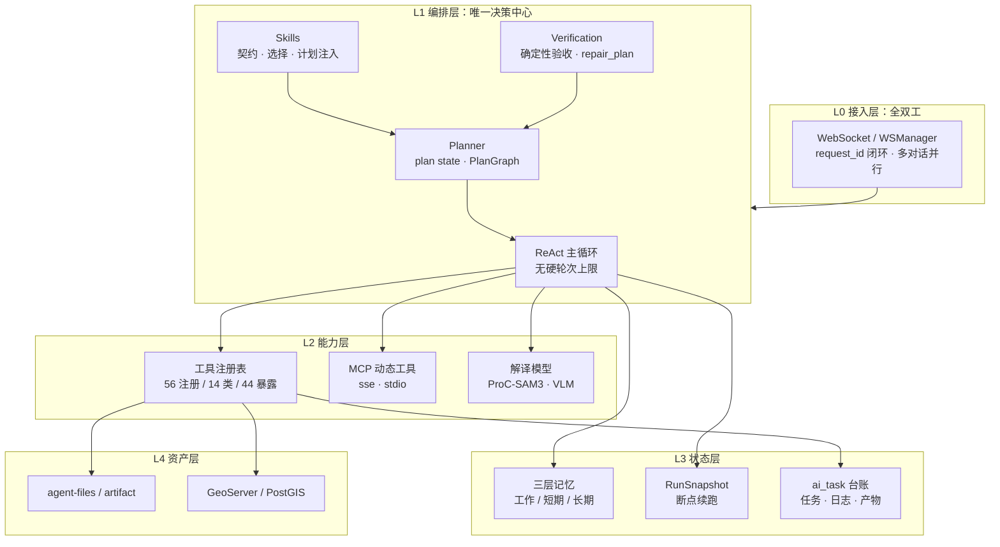

# 智能体三体系架构大纲

> 版本 2026-11 · 口径：**以 `backend/` 源码为唯一事实源**，凡与旧文档冲突处以本文为准（见 §六）。
> 本文是总纲与阅读入口；三篇子系统文档分别展开 **LLM 请求链路（上下文工程）**、**工具设计（MCP）**、**任务规划（SKILL）**。

---

## 一、为什么恰好是这三个体系

一个 LLM Agent 的能力上限，由三个**正交**问题决定：

| 问题 | 体系 | 缺了它会怎样 |
|---|---|---|
| 模型**看到什么**？ | 上下文工程 | 56 个工具的完整 schema 撑爆窗口，模型在噪声里选择困难 |
| 模型**能做什么**？ | 工具契约（Tool/MCP） | 只能聊天，无法落地任何动作 |
| 按什么顺序做、**什么算做完**？ | 任务编排（Skill/Plan） | 单步可用，长任务失忆、假完成、无限重试 |

本项目的答案不是"把三件事写进一段 system prompt"，而是拆成三根可独立演进、可独立验证的支柱，再用**一条主链路**串起来：

```
信息（上下文工程） → 能力（工具契约） → 秩序（任务编排） → 真值（验证与修复）
```

这个顺序也解释了很多设计取舍：**先收窄信息，再收窄能力，最后才谈编排**。反过来做（先写复杂编排，再补上下文）在工程上几乎必然失败，因为编排的成本全落在上下文里。

---

## 二、分层视图



**边界约束（改动前必读）**：`agent → model`、`agent → data`、`model → data`；`data` 不反向依赖。Java 业务服务单向调用 Python 的 `/internal/*`，Python 不反向调用 Java。主控 Agent 是唯一决策中心与唯一用户可见回复者。

---

## 三、一次请求的完整生命周期（主链路）

这是三篇文档共用的坐标系。任何设计讨论都应该能指到某个阶段。

| # | 阶段 | 做什么 | 归属体系 | 源码入口 |
|---|---|---|---|---|
| 1 | **接单** | 建立运行时上下文（conv/user/project）、加载 MCP、读恢复快照 | 接入 | `chat_service.py:1015` |
| 2 | **装上下文** | 三层记忆 → 任务状态卡 → 计划文本 → system prompt → 历史 → 当前 Human → 折叠 → 裁剪 | **上下文工程** | `memory_context.py:233` |
| 3 | **绑能力** | 白名单 → 首轮动态筛选（≤12）→ `bind_tools` | **工具契约** | `chat_service.py:1079` |
| 4 | **决策** | 流式 LLM；有 `tool_calls` 则行动，无则尝试收尾 | 编排 | `chat_service.py:1276` |
| 5 | **执行** | 同步走线程池 / 异步走 await；`frontend_action` 推前端并可选阻塞 | **工具契约** | `chat_service.py:1487` |
| 6 | **观测** | 补 `verification` → `verification_agent` 验收 → 生成 `repair_plan` → 构造 `ToolMessage` | **任务编排** | `observation_builder.py:52` |
| 7 | **记账** | 重工具更新 `ai_task`、登记产物血缘、累计失败签名 | 状态 | `chat_service.py:1539` |
| 8 | **续跑或修复** | 完成门拦截 / 修复约束注入 / 同签名重复拦截 | **任务编排** | `chat_service.py:1695` |
| 9 | **收尾** | 过完成门 → 落库 → `done` → 异步记忆沉淀与自纠扫描 | 上下文 | `chat_service.py:1367` |
| 10 | **可恢复** | 每工具批次存快照；停止回滚 / 断线暂停 | 状态 | `run_state.py:78` |

关键不变量：**阶段 6 的 `agent_validation` 是全链路最高优先级证据**，它可以否决阶段 4 的收尾意图、否决阶段 8 的工具选择。

---

## 四、三体系 → 主链路映射

| 体系 | 主要介入阶段 | 核心机制 | 关键源码 |
|---|---|---|---|
| 上下文工程 | 2, 3, 9, 10 | 四段式 prompt、三级压缩、分类重试、断点续跑 | `agent/prompt/`、`agent/memory/`、`agent/runtime/run_state.py` |
| 工具契约（MCP） | 3, 5, 7 | 注册/暴露/执行三平面、统一结果四态、按需发现 | `agent/tools/`、`agent/mcp/` |
| 任务编排（SKILL） | 4, 6, 8 | Skill 契约 → plan state → PlanGraph → 完成门 → repair_plan | `agent/skills/`、`agent/planner/`、`agent/team/`、`agent/executor/` |

三者的耦合点只有两个，这是刻意的低耦合设计：

1. **`agent_validation`**：工具 → 编排的唯一回传契约。
2. **`ToolMessage.content`（JSON）**：编排 → 上下文的唯一注入形态。

---

## 五、大纲设计原则

写这三篇文档时遵循五条，建议后续维护同样遵循：

1. **一条主线贯穿三篇**：都按"阶段 1→10"定位自己，不各讲一套。
2. **统一内部结构**：`定位 → 数据结构 → 运行流程 → 关键取舍 → 失败降级 → 边界与缺口`。任何一篇都能被单独抽出来讲。
3. **交叉引用而非重复**：工具的那 8 道参数防线只写在 02，03 只引用。
4. **代码即事实**：每个结论后面跟 `file:line`，不写"应该/大概"。
5. **显式记录缺口**：每篇末尾的「边界与缺口」是文档的一部分，不是附录。一个只讲优点的架构文档没有可信度。

---

## 六、口径约定（与旧文档的差异声明）

核对源码（AST 解析 + 白名单比对）后发现既有 `docs/architecture.md` 有若干历史值或不一致，本文与三篇子系统文档以代码为准：

| 项目 | 旧文档口径 | 代码事实 | 依据 |
|---|---|---|---|
| 注册工具数 | 「56 个（14 类）」与「50 个（14 类）」并存 | **56 个工具、14 类** | `@register_tool` AST 统计 + `integrations/external_tools.py` |
| LLM 可见工具 | 未区分 | **44 个静态白名单**，其中 **42 个可解析** | `registry.py:31-86` |
| 幽灵工具名 | 未记载 | `save_user_memory_item`、`delete_user_memory_item` **无实现**，仅存在于白名单 | 全仓检索无定义 |
| ReAct 轮次 | 「最多 15 轮」 | **无硬上限**，仅用户停止兜底 | `chat_service.py:1212-1216` |
| 首轮绑定工具 | 未记载 | 默认动态，**≤12 个** | `discovery.py:138`、`config.py:232` |
| Plan-first | 未区分 | shadow 默认 **true**、plan-first 默认 **false** | `config.py:216-223` |

> 差异不是错误，而是代码演进快于文档。维护建议：把这三篇当作"机制说明"，把 `architecture.md` 当作"业务全景说明"，两者不重叠。

---

## 七、阅读路径

**想快速理解一次请求怎么跑完** → 本文 §三 → `01` §三 → `02` §五 → `03` §四

**想确认 Plan-first 之后 ReAct 能改写多少计划** → `03` §3.4（可写：追加步骤与状态；不可写：删除/重排/版本链）

**想了解 Loop{Plan, ReAct} 的实现** → `03` §3.5（`AGENT_PLAN_EXECUTE`，逐步骤执行 + 失败重规划）

**准备技术答辩/评审**，按这个顺序讲最连贯：

1. `01` 的「四段式 prompt + 三级压缩」——证明上下文是**工程**而非拼字符串；
2. `02` 的「三平面 + 结果四态」——证明工具是**契约**而非函数集合；
3. `03` 的「完成门 + repair_plan」——证明长任务有**真值约束**而非自由发挥。

**要动手改某一块**：

| 我要改… | 先读 | 再改 |
|---|---|---|
| 提示词/上下文预算 | `01` §四、§六 | `prompt_store/templates/static_template2.md`、`config.py:153-192` |
| 新增一个工具 | `02` §三、§四 | `agent/tools/`，记得同步 `_LLM_EXPOSED_TOOL_NAMES` |
| 新增一个长任务流程 | `03` §二 | `model/skills/*.md` 的 `skill-contract` |
| 新增失败修复策略 | `03` §七 | `team/repair_policy.py` 的 `plans` 字典 |

---

## 文档清单

| 文档 | 主题 | 核心问题 |
|---|---|---|
| [01-llm-request-pipeline.md](01-llm-request-pipeline.md) | LLM 请求链路（上下文工程） | 模型每轮到底看到什么？预算怎么花？超限怎么办？ |
| [02-tool-design-mcp.md](02-tool-design-mcp.md) | 工具设计（MCP） | 工具如何注册、暴露、执行、发现？MCP 如何并入？ |
| [03-task-planning-skill.md](03-task-planning-skill.md) | 任务规划（SKILL） | 长任务怎么编排？什么算做完？失败了怎么改？ |

---

## 与既有文档的关系

| 既有文档 | 关系 |
|---|---|
| `docs/architecture.md` | 业务全景与十大模块；本文补充其缺的**机制层**视角 |
| `docs/agent/core/architecture-agent.md` | Agent 层设计细节，与本文互为索引 |
| `docs/model/architecture-tools.md` | 工具层历史设计，工具数以本文为准 |
| `docs/platform/communication.md` | WS 协议与 `request_id` 闭环，是本文 L0 的展开 |
| `docs/agent-interview-qa.md` | 问答体；本文是体系体的对应物 |
